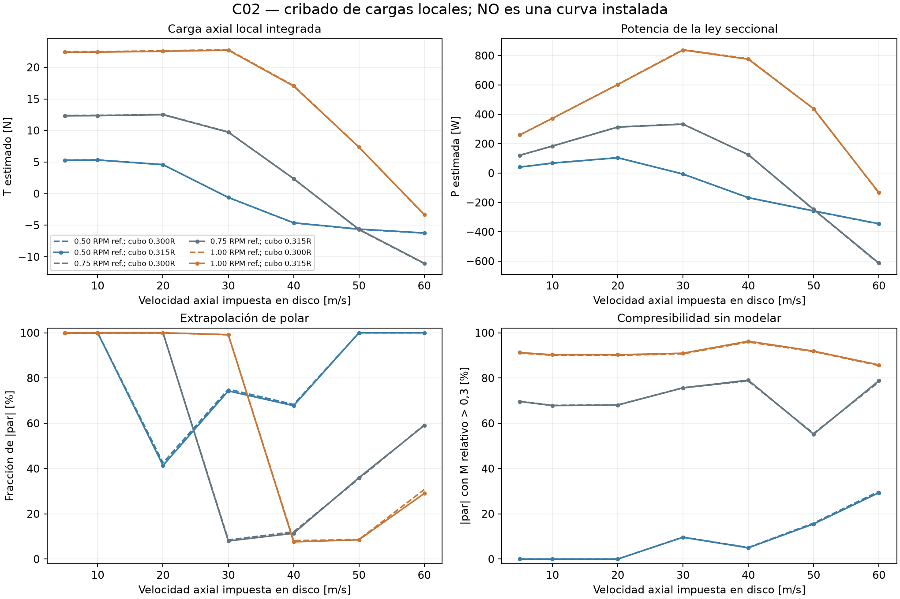

# C02: ley local de pala y límites del acoplamiento

4 de noviembre de 2026. Implementación y cribado computacional; ninguna curva instalada ni potencia de motor quedan aceptadas.

## Resultado implementado

`ley_elemento_rotor.py` calcula fuerza axial, fuerza tangencial, par y trabajo a partir de la velocidad **en el disco**, cuerda, torsión, régimen y polar seccional. No suma una nueva inducción a la velocidad recibida. El BEM existente sigue congelado y no se modificó ningún CAD ni fuente del solver.

Convenciones: axial positivo hacia el flujo aguas abajo; tangencial positivo en el sentido de giro. Con Wt=Omega·r−Vtheta, W=sqrt(Va²+Wt²) y phi=atan2(Va,Wt), las proyecciones son:

- dL/dr=0,5·rho·W²·c·B·CL y dD/dr=0,5·rho·W²·c·B·CD.
- dT/dr=(dL/dr)cos(phi)−(dD/dr)sin(phi).
- dQ/dr=r·[(dL/dr)sin(phi)+(dD/dr)cos(phi)].
- Omega·dQ/dr=(dT/dr)Va+(dQ/dr)Vtheta/r+(dD/dr)W.

La última igualdad distingue trabajo de la fuerza sobre el flujo medio de la estimación de potencia de eje. El último término es un déficit de trabajo del modelo seccional; no se convierte automáticamente en calor o energía turbulenta del CFD. No es correcto identificar sin más la integral f·U del actuador con la potencia del motor. Cada módulo necesitará además la transformación de ejes y signo de giro; aquí no se asignan seis cargas al vehículo.

`verificar_ley_elemento.py` pasa nueve casos de proyección vectorial/energía con polares constantes, reproduce las fuerzas y pares de los 64 anillos del diseño BEM guardado y rechaza cuatro entradas fuera de la rama identificada. El primer intento del puente falló por un nombre de campo; código y fallo se conservan en `ley_elemento_verificacion_r1/`. La versión corregida está en `ley_elemento_verificacion_r2/AUDITORIA.json`. Son verificaciones matemáticas. El [contraste público previo con CCBlade](benchmark_bem_publico/INFORME.md) conserva por separado los límites de su comparación con el [tutorial oficial](https://flow.byu.edu/CCBlade.jl/stable/tutorial/).

## Identidad geométrica y cribado

El rotor nominal D82 usa cuerda/torsión del diseño C01 que originó el STEP padre identificado por la metadata C02. El banco CFD sella el cubo a radio12,915mm, es decir0,315R; el BEM original empezaba en0,30R. El área anular pasa de0,00480573 a0,00475701m²: **−1,01374 %**. Esto corrige el área de la aproximación sellada, no mide flujo en las cavidades reales.

`cargas_locales_C02_r1/` conserva **42 puntos**, con dos radios de cubo, tres regímenes y siete velocidades uniformes de disco5–60m/s. Se impone remolino cero. No se resuelve inducción ni una intersección de curva motor–ventilador–conducto. El caudal calculado A·Va corresponde al anillo activo y excluye el bypass de punta. No es el caudal total del conducto. No se aplican multiplicadores de punta/raíz a las fuerzas seccionales.

Todos los puntos conservan alguna sección fuera de la polar. En el ejemplo de46231rpm y20m/s uniformes, el100% del peso absoluto del par está fuera del dominio disponible; sus cifras de fuerza/potencia no se usarán para dimensionar. En el punto BEM C01 original, con otra distribución de velocidad/remolino, el2,0343% del peso del par estaba fuera de polar y el87,0390% correspondía a Mach relativo>0,3. No se confunden esos dos estados ni se atribuyen esos porcentajes a mediciones del rotor real.

La [polar SD8020 original](../../fuentes/uiuc/SD8020.DRG), atribuida al [programa UIUC](https://m-selig.ae.illinois.edu/pd.html), contiene Reynolds medios61400/101500/203300/304800; se conservan sus dominios de ángulo. La extensión de extremos del interpolador permite calcular diagnósticos, pero permanece marcada y no valida secciones extrapoladas. No hay corrección compresible, de cascada o de rotación aceptada.

`verificar_integracion_local.py` compara64/128/256 anillos en ocho puntos seleccionados, sin alterar el cribado. El máximo cambio128→256 es0,05103% en T y0,04312% en potencia estimada. Es sensibilidad de cuadratura, no incertidumbre física. Los42puntos y sus indicadores se conservan sin descartar casos.

## Uso siguiente

La ley sirve para preparar un acoplamiento con velocidad local, par y una contabilidad de energía explícita. Antes de aceptarlo faltan datos seccionales pertinentes, compresibilidad, distribución no uniforme/remolino, efectos tridimensionales, acoplamiento rotor–conducto y comparación física. No se añade la inducción del BEM a una velocidad CFD que ya la contiene. La reversibilidad y los regímenes no identificados siguen abiertos. T10/T12 y el cierre de potencia permanecen pendientes.

Una revisión posterior de cobertura y geometría distingue los datos combinados de sustentación/arrastre DRG de las series adicionales de sustentación LFT, que se conservan con sus ramas de ángulo. Bajo las condiciones de cribado elegidas, la cuerda interpolada de la punta deja una zona que no puede satisfacer simultáneamente Re≥61.400 y M≤0,3. Es una limitación conjunta de datos y supuestos, no una inviabilidad física demostrada. Detalles, porcentajes y código: `INFORME-COBERTURA-POLAR-C02.md`.
