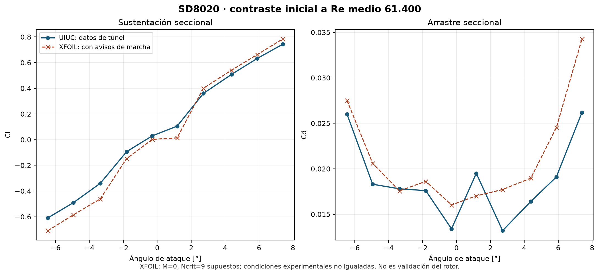

# XFOIL para el perfil SD8020: instalación y primer contraste

4 de noviembre de 2026, hora de Bogotá. Este trabajo verifica el funcionamiento y explora la sensibilidad de un modelo 2D; **no acepta una polar para el rotor ni una potencia instalada**. La descripción del método y de sus limitaciones se consulta en la [distribución oficial de MIT](https://web.mit.edu/drela/Public/web/xfoil/) y su [manual](https://web.mit.edu/drela/Public/web/xfoil/xfoil_doc.txt). Los datos de comparación proceden del [programa experimental UIUC](https://m-selig.web.engr.illinois.edu/pd.html).

## Entornos y fallos conservados

1. Se creó una imagen separada con el paquete oficial Ubuntu noble ARM64 `xfoil 6.99.dfsg+1-3`. El primer Dockerfile intentó usar un identificador `sha256:` como nombre `FROM`; Docker trató de resolverlo como repositorio y lo rechazó antes de construir. Se corrigió usando una etiqueta local y se comprobó que resolvía a la imagen base identificada.
2. La prueba viscosa de SD8020 y tres pruebas independientes inviscidas, incluida NACA 0012, terminaron con señal SIGFPE. Registros en `smoke_r1/` y `arranque_r2/`. Se comprobó que el binario empaquetado llama a `_gfortran_set_fpe` con máscara 5. No se ha demostrado aún qué instrucción o condición provoca la excepción, ni se debe atribuir automáticamente a la geometría SD8020.
3. Se descargó de MIT `xfoil6.996.tgz` (SHA-256 `0feb71b58070d8514d830fcb0b609a10a11399d362493d7b9bbfb7343dff3f23`) y se compiló en otra imagen aislada para ARM64 con GNU Fortran 13.3, precisión real predeterminada de 8 bytes y `-fallow-argument-mismatch`. El Makefile original deja `CHK` vacío; esta compilación **no activa las trampas de excepciones del paquete Ubuntu**. El compilador informó discrepancias de rango en llamadas antiguas, registradas como advertencias durante la construcción. La salida del programa indica versión 7.00 aunque el archivo distribuido se denomina 6.996. La versión compilada, banderas y los registros se identifican en `mit_smoke_r1/EJECUCION.json` y los Dockerfiles de esta carpeta.

La versión compilada produjo una polar viscosa de prueba y terminó con salida 0. Los ensayos inviscidos no producen una línea `CL =` en la salida capturada con los comandos empleados; una salida 0 no prueba por sí sola sus coeficientes. Las diferencias simultáneas de versión, compilación, precisión y trampas impiden identificar la causa del fallo del paquete con este contraste.

## Comparación con UIUC a Re medio 61.400

Se ejecutó un proceso nuevo por cada uno de los diez ángulos de `SD8020.DRG`, sin arrastrar la solución de otro ángulo. Condiciones elegidas: Mach 0, Ncrit 9, transición forzada en x/c=1 y 240 nodos de panel. **No se ha acreditado que el Mach y Ncrit reales de UIUC coincidan con estos valores**. Los diez puntos y registros, incluidos avisos, están en `uiuc_61400_r1/`.

La auditoría identificó que en los diez puntos el residuo acoplado final informado es menor que `EPS1=10⁻⁴`, valor comprobado en el código `xoper_mit_6.996.f`. Sin embargo, los diez casos contienen al menos un aviso `MRCHUE` o `MRCHDU: Convergence failed` durante el recorrido de capa límite. El cribado estricto original, que rechaza cualquier aviso de convergencia, conserva **0 de 10 puntos aceptados**. El residuo final y los avisos se registran por separado en `AUDITORIA_RESIDUOS.json`; aún debe investigarse su causa y efecto.

Como descripción exploratoria de los diez números emitidos, sin filtrar puntos ni convertirlos en validación, el RMSE frente a las tablas es **0,07135 en Cl y 0,003785 en Cd**. A 1,17°, el cálculo emite Cl=0,0138 frente a 0,105 medido; esas diferencias dependen también de las condiciones experimentales aún no igualadas. El estudio de NASA sobre [evaluación de perfiles a bajo Reynolds](https://rotorcraft.arc.nasa.gov/Publications/files/1.c037023.pdf) ilustra la sensibilidad de este régimen, pero no valida este caso.

Una comparación posterior con las ramas del archivo LFT a Re medio 60.600 muestra que los valores de sustentación de las dos corridas experimentales cercanas no coinciden exactamente; a 1,17° la rama decreciente LFT interpolada da Cl≈0,01082. Por ello, la diferencia respecto al punto DRG no basta para concluir que ese valor de XFOIL sea erróneo ni correcto. `INFORME-UIUC-TRAZABILIDAD.md` documenta la comparación completa y sus límites.

## Orden de columnas y controles

En esta compilación y con una sección, el encabezado de transición del archivo de polar enumera `Top_Xtr, Bot_Xtr, Top_Itr, Bot_Itr`. Las diez comparaciones con los registros muestran que las posiciones de transición de los lados 1 y 2 están en las **columnas numéricas 6 y 8**, respectivamente; la rutina `iopol_mit_6.996.f` escribe los valores por lado. `AUDITORIA_ORDEN_COLUMNAS.json` conserva las diez comprobaciones. No se generaliza este resultado a otras versiones ni se usan aún esas columnas para ajustar el rotor.

`AUDITORIA_CL_CD.json` comprueba que ángulo, Cl, Cd total y Cm del archivo coinciden con el último valor impreso del solver en los diez casos, dentro del redondeo de salida. No compara el componente de arrastre de presión. La consistencia de archivos no equivale a exactitud física.

## Sensibilidad preliminar

Cuatro ángulos se repitieron con 160 y 320 nodos (`paneles_r1/`), además de los 240 originales. A 1,17° se obtienen Cl=0,0134 / 0,0138 / 0,0140 y Cd=0,01703 / 0,01702 / 0,01701 para 160 / 240 / 320 nodos. A 2,72°, Cl=0,4012 / 0,4003 / 0,4003. Dos puntos de 160 nodos pasaron el cribado local sin avisos de marcha; los otros seis ensayos a 160/320 conservaron avisos. Estas tres discretizaciones no constituyen una incertidumbre de malla completa ni convierten el resultado en aceptado.

Una secuencia de arranque `0° → 1,17° → 2,72° → 5,89°` produjo los mismos Cl y Cd que las ejecuciones independientes en los dígitos guardados (`continuacion_r1/`). Solo se ensayó esa secuencia; no demuestra unicidad ni ausencia de dependencia de historia para todo el dominio.

## Siguiente paso

Investigar las advertencias y el origen del SIGFPE con información de depuración; estudiar condiciones de transición y correspondencia experimental, así como sensibilidad a paneles e inicialización. No se han generado datos nuevos para completar la tabla del ventilador ni se ha modificado su ley de pala. C02 aún requiere validación tridimensional y acoplamiento de rotor, conducto y motor.
