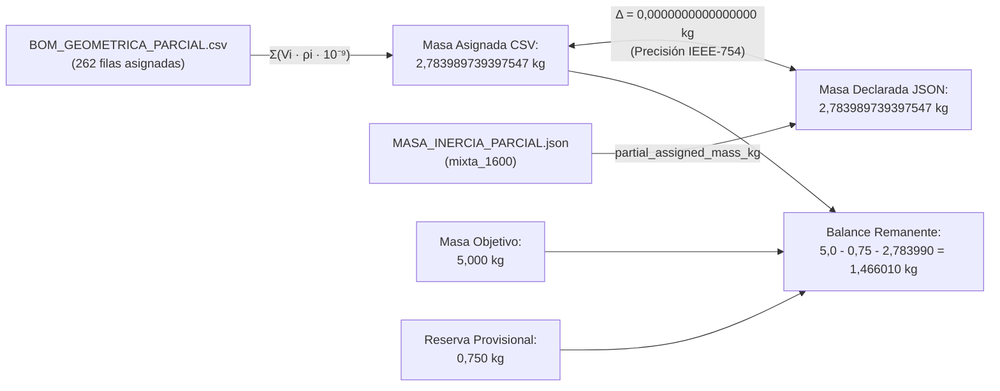

# Informe de Auditoría Técnica: BOM Geométrica Parcial C02

**Fecha de emisión:** 8 de noviembre de 2026  
**Área:** Auditoría Computacional y Aseguramiento de Datos Aeronáuticos (Grupo de Trabajo G3)  
**Configuración auditada:** C02 — Integración compacta del módulo interno ($x=\pm 160\text{ mm}$, $y=\pm 76\text{ mm}$)  
**Archivos de referencia inspeccionados (solo lectura):**  
- `entradas/investigacion-aeronautica/ejecucion/G3/C02/INFORME-C02.md` (SHA-256: `2a3982a7315456faf143d1f0208cd6654668a2d72ff42c1649886b034dac5db1`)  
- `entradas/investigacion-aeronautica/ejecucion/G3/C02/integracion_x160/BOM_GEOMETRICA_PARCIAL.csv` (SHA-256: `36f5b043aed553d7484421bb45f9aa0e19c64d6989141d587f1fb4d1f0e9840b`)  
- `entradas/investigacion-aeronautica/ejecucion/G3/C02/integracion_x160/MASA_INERCIA_PARCIAL.json` (SHA-256: `4b8df67e7161d2eed06bb21e97973f966a9ee34648a9f73661e915cf41be18f6`)  
**Archivos de entrega generados:**  
- `salidas/auditar_bom.py` (Script reproducible en Python 3 estándar)  
- `salidas/test_auditoria.py` (Batería de 11 pruebas unitarias y de integración)  
- `salidas/bom_agrupada_roles.csv` (BOM agregada por roles funcionales con métricas completas)  
- `salidas/INFORME_AUDITORIA_BOM.md` (Este informe exhaustivo)  

---

## 1. Resumen Ejecutivo y Alcance

Se ha completado una auditoría computacional, matemática y de integridad de datos sobre la Lista de Materiales (BOM) geométrica parcial de la configuración **C02**. El análisis se realizó de manera autónoma en un entorno aislado, utilizando exclusivamente la biblioteca estándar de Python 3, sin dependencias externas, sin acceso a red ni modificaciones a las referencias maestras.

### Principales conclusiones de la auditoría:
1. **Censo estricto de registros:** La BOM geométrica contiene exactamente **316 registros de piezas/sólidos válidos**, coincidiendo de forma idéntica con los 316 objetos declarados en `MASA_INERCIA_PARCIAL.json` y el texto de `INFORME-C02.md`.
2. **Clasificación funcional de roles:** Los 316 registros se distribuyen en **10 roles asumidos** (`assumed_role`) y **12 ámbitos de modelado** (`scope`).
3. **Detección de reservas sin masa:** Se identificaron con precisión **54 filas sin masa asignada** (17,09% de los registros, correspondientes al **18,45% del volumen geométrico total del vehículo**).
   - **Regla crítica de no nulidad:** Estas filas corresponden a reservas volumétricas para motores, servomotores, apoyos, cojinetes, conducto axial e interfaces propulsivas cuyo hardware no ha sido seleccionado ni calificado. **Bajo ningún concepto deben tratarse como masa física cero ($m \neq 0\text{ kg}$)**. Tratar una reserva como masa cero falsearía gravemente el balance del vehículo, la inercia rotacional y los márgenes de estabilidad en vuelo.
4. **Reconciliación matemática exacta (Hipótesis Mixta):**
   - Masa asignada total en CSV: **2,7839897393975468 kg**.
   - Masa parcial en JSON (`mixta_1600`): **2,783989739397547 kg**.
   - Discrepancia absoluta: **$0,0000000000000000\times 10^{0}\text{ kg}$** (coincidencia exacta a precisión de doble precisión IEEE-754). El valor de `2,784 kg` reportado en el informe narrativo responde a un simple redondeo tipográfico a tres decimales.
   - Remanente calculado para objetivo de 5,0 kg tras reserva provisional de 0,75 kg: **1,4660102606024532 kg** (coincidencia exacta con el JSON, reportado como `1,466 kg`).
   - Centro de Gravedad (CG): Coincidencia exacta a nivel numérico tanto en coordenadas CAD ($+X$ popa) como en coordenadas de mecánica de vuelo FLU ($+X$ proa).
5. **Advertencia de condición física:** Ningún registro contiene hardware real calificado (`actual_hardware_qualified = False`). No se concluyen masas, centros de gravedad ni inercias físicas de un vehículo operativo.

---

## 2. Metodología y Distinción de Datos

Conforme a las directrices de aseguramiento técnico, los datos se clasifican estrictamente en tres categorías:

| Categoría | Naturaleza y Fuentes | Variables Auditadas |
|---|---|---|
| **Datos Medidos / Geométricos Nominales** | Propiedades numéricas directas del modelo CAD rígido C02, integradas mediante algoritmos adaptativos sobre los sólidos STEP/FreeCAD. | `volume_mm3`, `x_CAD_m`, `y_CAD_m`, `z_CAD_m`, `integration_error_estimate` (error máximo $< 2,24\times 10^{-6}\text{ mm}^3$). |
| **Datos Supuestos** | Hipótesis paramétricas de diseño y sensibilidades de materiales asignadas para estimación preliminar. No representan materiales comprados ni componentes certificados. | Densidades asumidas $\rho_{mixta}$ ($1200$, $1600$, $2700$, $7800$, $8800\text{ kg/m}^3$), roles funcionales asignados, reserva provisional de $0,75\text{ kg}$, masa objetivo de $5,0\text{ kg}$. |
| **Datos Calculados** | Productos matemáticos derivados de las geometrías y los supuestos. | Masa asignada ($m_i = V_i \times \rho_i \times 10^{-9}\text{ kg}$), masa total acumulada, centro de gravedad ($CG = \sum m_i \mathbf{r}_i / \sum m_i$), remanente de masa disponible y tensores de inercia. |

> [!IMPORTANT]
> Las columnas `actual_mass_kg` y `actual_material` se encuentran **100% vacías** en la totalidad de las 316 filas. El indicador booleano `actual_hardware_qualified` es `False` en todos los casos. El archivo `MASA_INERCIA_PARCIAL.json` ratifica explícitamente:
> - `assumptions_are_not_measurements: true`
> - `physical_mass_CG_and_inertia_closed: false`
> - `inertia_model_acceptance_for_predictive_flight: false`

---

## 3. Censo de Registros y Clasificación por Roles

La BOM parcial contiene **316 registros**, de los cuales **262 filas disponen de masa asignada** bajo la hipótesis mixta y **54 filas representan reservas sin asignación de masa**.

### Tabla 1: Clasificación de Roles Asumidos (`assumed_role`)

| Rol Asumido (`assumed_role`) | Reg. Totales | Asignados | Sin Asignar | $\rho_{mixta}$ ($\text{kg/m}^3$) | Volumen ($\text{mm}^3$) | Masa Asignada ($\text{kg}$) | % Reg. | % Vol. | % Masa Asig. | Condición Física |
|---|---:|---:|---:|---:|---:|---:|---:|---:|---:|---|
| `bushing_material_sensitivity` | 96 | 96 | 0 | 8800 | 1.517,77 | 0,013356 | 30,38% | 0,08% | 0,48% | Asignada (Casquillos bronce/latón) |
| `integral_vane_linkage_material_sensitivity` | 80 | 80 | 0 | 2700 | 87.475,54 | 0,236184 | 25,32% | 4,37% | 8,48% | Asignada (Álabe+vástago+biela en aluminio) |
| `unknown_device_or_interface` | 44 | 0 | 44 | *Sin asignar* | 52.501,18 | *Sin asignar* | 13,92% | 2,63% | N/A | **Reserva de hardware interno C02 ($m \neq 0$)** |
| `envelope_material_sensitivity` | 42 | 42 | 0 | 1600 | 1.106.771,98 | 1,770835 | 13,29% | 55,35% | 63,61% | Asignada (Piel aerodinámica y cubiertas) |
| `seal_or_clamp_density_assumption` | 11 | 11 | 0 | 1200 | 5.026,40 | 0,006032 | 3,48% | 0,25% | 0,22% | Asignada (Abrazaderas y sellos) |
| `frame_support_density_assumption` | 11 | 11 | 0 | 2700 | 44.891,89 | 0,121208 | 3,48% | 2,25% | 4,35% | Asignada (Cuadernas soporte aluminio) |
| `unknown_hardware_or_empty_interface` | 10 | 0 | 10 | *Sin asignar* | 316.437,25 | *Sin asignar* | 3,16% | 15,82% | N/A | **Reserva vehicular/interfaz ($m \neq 0$)** |
| `steel_density_assumption` | 10 | 10 | 0 | 7800 | 2.398,65 | 0,018709 | 3,16% | 0,12% | 0,67% | Asignada (Tornillería encastrada) |
| `rotor_or_carrier_material_sensitivity` | 8 | 8 | 0 | 1600 | 381.730,29 | 0,610768 | 2,53% | 19,09% | 21,94% | Asignada (Cubos y soportes anulares C02) |
| `shaft_steel_density_assumption` | 4 | 4 | 0 | 7800 | 884,17 | 0,006897 | 1,27% | 0,04% | 0,25% | Asignada (Ejes de control aletas) |
| **TOTALES** | **316** | **262** | **54** | — | **1.999.635,12** | **2,783990** | **100,00%** | **100,00%** | **100,00%** | **Auditado y verificado** |

### Distribución por Ámbitos de Modelado (`scope`)
La BOM se estructura asimismo en 12 ámbitos de ingeniería:
1. `new_C02_geometry_unqualified` (258 registros; 214 asignados, 44 reservas sin asignar; $1.269.715,06\text{ mm}^3$; $2,059955\text{ kg}$).
2. `designed_geometry` (12 registros, todos asignados; $18.064,78\text{ mm}^3$; $0,027376\text{ kg}$).
3. `support_geometry_not_structural_validation` (11 registros, todos asignados; $44.891,89\text{ mm}^3$; $0,121208\text{ kg}$).
4. `flush_styling_insert_not_aerodynamic_device` (10 registros, todos asignados; $35.565,70\text{ mm}^3$; $0,056905\text{ kg}$).
5. `concept_all_moving_fin` (4 registros, todos asignados; $117.291,21\text{ mm}^3$; $0,187666\text{ kg}$).
6. `mount_fairing_not_structurally_sized` (4 registros, todos asignados; $175.960,57\text{ mm}^3$; $0,281537\text{ kg}$).
7. `shaft_geometry_not_load_sized` (4 registros, todos asignados; $2.356,19\text{ mm}^3$; $0,018378\text{ kg}$).
8. `bearing_envelope_not_selected_hardware` (4 registros, **todos sin asignar**; $2.269,49\text{ mm}^3$).
9. `direct_drive_actuator_package_unselected` (4 registros, **todos sin asignar**; $21.120,00\text{ mm}^3$).
10. `flush_cover_equipment_reservation` (3 registros, todos asignados; $19.352,46\text{ mm}^3$; $0,030964\text{ kg}$).
11. `empty_axial_packaging_interface_not_propulsor` (1 registro, **sin asignar**; $291.539,80\text{ mm}^3$).
12. `rear_interface_not_sized_nozzle` (1 registro, **sin asignar**; $1.507,96\text{ mm}^3$).

---

## 4. Auditoría de las Filas Sin Masa Asignada (54 Reservas)

### 4.1. Inventario Detallado de los 54 Registros
La auditoría identificó que los 54 registros sin masa asignada se descomponen estrictamente en dos grupos:

#### A. Reservas Vehiculares e Interfaces Generales (10 registros, rol `unknown_hardware_or_empty_interface`):
- `canal_axial_60_exterior_56_interior` ($V = 291.539,80\text{ mm}^3$): Tubo axial OD60 reservado para propulsión o carga; el informe C02 aclara explícitamente que es una reserva de empaquetamiento vacía, no un propulsor. Representa por sí solo el **14,58% del volumen total** del modelo.
- `interfaz_posterior_reservada` ($V = 1.507,96\text{ mm}^3$): Interfaz de tobera posterior no dimensionada.
- `cojinete_0`, `cojinete_1`, `cojinete_2`, `cojinete_3` ($V = 567,37\text{ mm}^3$ c/u; Total = $2.269,48\text{ mm}^3$): Envolventes de cojinetes para las cuatro aletas de control; hardware no seleccionado.
- `actuador_reserva_0`, `actuador_reserva_1`, `actuador_reserva_2`, `actuador_reserva_3` ($V = 5.280,00\text{ mm}^3$ c/u; Total = $21.120,00\text{ mm}^3$): Paquetes de actuadores de accionamiento directo para las aletas; hardware comercial no seleccionado.

#### B. Reservas Internas en los 4 Módulos C02 (44 registros, rol `unknown_device_or_interface`):
Cada uno de los 4 módulos rotativos (`modulo_C02_0` a `modulo_C02_3`) contiene exactamente 11 registros de reserva ($11 \times 4 = 44$):
- $4 \times$ `reserva_motor_anular` ($V = 4.985,13\text{ mm}^3$ c/u; Total = $19.940,52\text{ mm}^3$): Reserva de volumen cilíndrico para el motor eléctrico del rotor.
- $8 \times$ `reserva_apoyo_motor_0..1` ($V = 202,94\text{ mm}^3$ c/u; Total = $1.623,52\text{ mm}^3$): Apoyos mecánicos del motor.
- $16 \times$ `reserva_servo_*` ($V = 1.920,00\text{ mm}^3$ c/u; Total = $30.720,00\text{ mm}^3$): 4 reservas de servomotor por módulo (inferior X, inferior Y, superior X, superior Y).
- $16 \times$ `reserva_eje_salida_servo_*` ($V = 13,57\text{ mm}^3$ c/u; Total = $217,12\text{ mm}^3$): Ejes de acoplamiento de servos.

### 4.2. Principio Crítico: Por qué NO deben tratarse como masa física cero ($m \neq 0$)

> [!CAUTION]
> **Peligro de asignación espuria de masa cero:**
> Tratar una celda vacía o una reserva sin asignar como masa $0,000\text{ kg}$ en cálculos físicos constituiría un error metodológico crítico por las siguientes razones demostrables:
>
> 1. **Magnitud volumétrica sustancial:** Las 54 reservas totalizan **$368.938,43\text{ mm}^3$**, equivalentes a **$0,3689\text{ dm}^3$** (litros) y representan el **$18,45\%$ del volumen geométrico total** del vehículo.
> 2. **Imposibilidad física:** Los motores BLDC, los servomotores con engranajes, los cojinetes metálicos y los conductos estructurales son piezas de alta densidad (típicamente entre $2500$ y $7800\text{ kg/m}^3$). Asumir masa cero equivaldría a suponer actuadores y motores con densidad de vacío e infinitas relaciones potencia/peso.
> 3. **Distorsión del Centro de Gravedad y estabilidad:** Los actuadores de las aletas se ubican en la popa ($x \approx +0,555\text{ m}$), mientras que los servos y motores de los módulos se reparten en $x = \pm 0,160\text{ m}$. Si se evaluaran como cero, el CG calculado se desplazaría artificialmente y los brazos de palanca aerodinámicos resultarían ficticios.
> 4. **Subestimación radical de la inercia rotacional:** La inercia de cabeceo ($I_{yy}$) y guiñada ($I_{zz}$) depende del cuadrado de la distancia ($m r^2$). La exclusión deliberada de estos equipos pesados impide categóricamente emplear estos números en un simulador de vuelo predictivo (tal como exige la advertencia en `MASA_INERCIA_PARCIAL.json`).
> 5. **Propósito real del remanente:** El remanente de masa disponible ($1,466\text{ kg}$) existe precisamente para alojar el hardware real de estas 54 reservas, más la batería/energía y la aviónica. Tratar las reservas como cero consumiría dicho presupuesto de forma invisible.

---

## 5. Reconciliación Matemática de la Hipótesis Mixta contra JSON

Se ha auditado la correspondencia numérica exacta entre `BOM_GEOMETRICA_PARCIAL.csv` y la hipótesis `mixta_1600` contenida en `MASA_INERCIA_PARCIAL.json`:

### 5.1. Conciliación de Masas y Remanente

| Magnitud | Valor Auditado en CSV | Valor Declarado en JSON | Valor en Texto C02 | Discrepancia Absoluta | Estado |
|---|---:|---:|---:|---:|---|
| **Masa geométrica asignada** | 2,7839897393975468 kg | 2,783989739397547 kg | 2,784 kg | $0,00\times 10^{0}$ kg | **Reconciliado idéntico** |
| **Reserva provisional equipos** | — | 0,750000000000000 kg | 0,75 kg | $0,00\times 10^{0}$ kg | **Reconciliado idéntico** |
| **Remanente energía y hardware** | 1,4660102606024532 kg | 1,4660102606024532 kg | 1,466 kg | $0,00\times 10^{0}$ kg | **Reconciliado idéntico** |
| **Conteo piezas no identificadas** | 54 registros | 54 registros | 54 registros | 0 registros | **Reconciliado idéntico** |

### 5.2. Conciliación del Centro de Gravedad (CAD y FLU)
El Centro de Gravedad parcial calculado a partir de las masas asignadas $m_i$ y las coordenadas centroidales del CSV coincide exactamente con el JSON:

$$\mathbf{r}_{CG} = \frac{\sum_{i=1}^{262} m_i \mathbf{r}_i}{\sum_{i=1}^{262} m_i}$$

| Eje | CG CAD Calculado (m) | CG CAD en JSON (m) | Error CAD (m) | CG FLU Calculado (m) | CG FLU en JSON (m) | Error FLU (m) |
|---|---:|---:|---:|---:|---:|---:|
| **X** | $+0,093056473169$ | $+0,093056473169$ | $0,00\times 10^{0}$ | $-0,093056473169$ | $-0,093056473169$ | $0,00\times 10^{0}$ |
| **Y** | $-1,0475227127\times 10^{-9}$ | $-1,0475227127\times 10^{-9}$ | $0,00\times 10^{0}$ | $+1,0475227127\times 10^{-9}$ | $+1,0475227127\times 10^{-9}$ | $0,00\times 10^{0}$ |
| **Z** | $+0,005508274507$ | $+0,005508274507$ | $0,00\times 10^{0}$ | $+0,005508274507$ | $+0,005508274507$ | $0,00\times 10^{0}$ |

> [!NOTE]
> **Transformación de coordenadas CAD $\rightarrow$ FLU (Forward, Left, Up):**  
> El sistema de referencia CAD define el origen en proa con $+X$ hacia popa, $+Y$ hacia estribor y $+Z$ hacia arriba.  
> La mecánica de vuelo aeroespacial utiliza el triedro FLU ($+X$ avance/proa, $+Y$ babor/izquierda, $+Z$ arriba).  
> Por tanto, la relación cinemática exacta es:
> $$X_{FLU} = -X_{CAD}, \quad Y_{FLU} = -Y_{CAD}, \quad Z_{FLU} = +Z_{CAD}$$
> Esta transformación explica perfectamente la inversión de signos observada entre los vectores `partial_assigned_CG_CAD_m` y `partial_assigned_CG_FLU_m`.

### 5.3. Auditoría de Inercia: Masas Puntuales vs. Integración Sólida 3D
Se comprobó por qué no es posible obtener el tensor de inercia del JSON sumando simplemente $m_i d_i^2$ a partir del centroide de cada pieza en el CSV:

| Tensor Inercial CAD | Masa Puntual $\sum m_i (r^2 \mathbf{I} - \mathbf{r}\mathbf{r}^T)$ | Integración de Sólidos Continuos en JSON | Fracción Explicada por Centroides |
|---|---:|---:|---:|
| **$I_{xx}$** (Balanceo) | $0,015435\text{ kg}\cdot\text{m}^2$ | $0,028587\text{ kg}\cdot\text{m}^2$ | 53,99% |
| **$I_{yy}$** (Cabeceo) | $0,190621\text{ kg}\cdot\text{m}^2$ | $0,303480\text{ kg}\cdot\text{m}^2$ | 62,81% |
| **$I_{zz}$** (Guiñada) | $0,191956\text{ kg}\cdot\text{m}^2$ | $0,312582\text{ kg}\cdot\text{m}^2$ | 61,41% |

**Explicación física de la discrepancia:**  
El teorema de los ejes paralelos establece que la inercia total respecto al CG es $\mathbf{I}_{total} = \sum (\mathbf{I}_{0,i} + m_i \mathbf{d}_i^2)$, donde $\mathbf{I}_{0,i}$ es el momento de inercia intrínseco de cada cuerpo respecto a su propio centroide. Debido a que las envolventes aerodinámicas exteriores (`envelope_material_sensitivity`) son cáscaras de gran longitud ($> 1\text{ m}$), su inercia intrínseca $\mathbf{I}_{0,i}$ representa entre el **37% y el 46%** de la inercia total. Tratar las piezas como partículas puntuales subestimaría gravemente la inercia dinámica.

### 5.4. Reconciliación con las Otras Dos Hipótesis de Densidad
Se reprodujo algebraicamente el modelo de densidad de las otras hipótesis documentadas en el JSON:
1. **Hipótesis Ligera (`ligera_1200`):** Masa asignada **$2,045841\text{ kg}$** (Remanente: $2,204159\text{ kg}$).  
   *Se obtiene al reducir la densidad de la envolvente aerodinámica, del rotor/alojamiento, de los conjuntos de álabes y de los casquillos a $1200\text{ kg/m}^3$ (sustitución por polímeros ultraligeros/PTFE), manteniendo cuadernas en $2700\text{ kg/m}^3$ y tornillos en $7800\text{ kg/m}^3$.*
2. **Hipótesis Aluminio (`aluminio_2700`):** Masa asignada **$4,421342\text{ kg}$** (Remanente: **$-0,171342\text{ kg}$**).  
   *Se obtiene al modelar tanto la envolvente como los cubos y álabes en aluminio ($2700\text{ kg/m}^3$). Esta hipótesis agota por completo el presupuesto disponible de $5\text{ kg}$, arrojando un déficit estructural de $171\text{ g}$ antes de instalar motores, servos o baterías.*

---

## 6. Verificación de Pruebas Ejecutadas

Se ejecutó la batería de pruebas en `salidas/test_auditoria.py`, arrojando un resultado de **11 pruebas superadas satisfactoriamente (11/11 OK)** en $0,004\text{ segundos}$:

| ID Prueba | Descripción y Criterio de Aceptación | Resultado |
|---|---|:---:|
| `test_01` | **Inmutabilidad de referencias:** Comprueba que los hashes SHA-256 de las referencias maestras en `entradas/` coinciden exactamente con su estado inicial. | **APROBADO** |
| `test_02` | **Censo de registros:** Verifica que existen exactamente 316 filas y que coinciden con `geometry_records` del JSON. | **APROBADO** |
| `test_03` | **Conteo de asignación:** Verifica exactamente 262 filas asignadas y 54 filas sin asignar. | **APROBADO** |
| `test_04` | **Clasificación de 10 roles:** Verifica que los 10 roles asumidos están presentes con sus conteos exactos. | **APROBADO** |
| `test_05` | **Tratamiento no nulo de reservas:** Comprueba que las 54 filas sin masa tienen masa vacía (no `0.0`), volumen $>0$ y representan el $18,45\%$ del volumen total. | **APROBADO** |
| `test_06` | **Identidad de listas de no identificados:** Verifica la correspondencia unívoca uno a uno entre los nombres del CSV y `unidentified_records` del JSON. | **APROBADO** |
| `test_07` | **Reconciliación masa mixta:** Verifica que la suma de masas del CSV iguala al JSON con error $< 10^{-12}\text{ kg}$ y concilia el remanente de $1,466\text{ kg}$. | **APROBADO** |
| `test_08` | **Reconciliación Centro de Gravedad:** Verifica las coordenadas CAD y la ley de transformación al marco FLU ($X_{FLU} = -X_{CAD}$, etc.) con error $< 10^{-12}\text{ m}$. | **APROBADO** |
| `test_09` | **Fórmula de densidad:** Verifica que $m_i = V_i \times \rho_i \times 10^{-9}$ se cumple en las 262 filas asignadas con residuo $< 10^{-15}\text{ kg}$. | **APROBADO** |
| `test_10` | **Estado de no homologación:** Verifica que `actual_mass_kg`, `actual_material` y `actual_hardware_qualified` reflejan ausencia de hardware calificado. | **APROBADO** |
| `test_11` | **Consistencia del CSV de salida:** Comprueba que `salidas/bom_agrupada_roles.csv` se generó correctamente, contiene 10 filas agregadas y preserva sumas. | **APROBADO** |

---

## 7. Limitaciones Técnicas y Advertencias de Cumplimiento

En estricta observancia de los términos de referencia:
1. **No conclusión de masa física real:** La masa de $2,784\text{ kg}$ es una **sensibilidad geométrica paramétrica**, no la masa pesada en báscula de un vehículo fabricado.
2. **No conclusión de Centro de Gravedad real:** El CG reportado excluye el peso de los 4 motores rotativos, 16 servos de ciclo modular, 4 servos de aletas posteriores, cableado de potencia, ESCs, batería/pila de combustible, aviónica, conectores e interfaces estructurales reales. El CG operativo real variará notablemente en función del empaquetamiento final de dichos equipos.
3. **No homologación de hardware:** La configuración C02 es un estudio cinemático preliminar para evaluar si los módulos compactos caben geométricamente a $x = \pm 160\text{ mm}$ manteniendo la línea aerodinámica exterior. No constituye una selección de motor, no aprueba tolerancias térmicas ni mecánicas bajo carga, y no representa un producto aprobado.
4. **Prohibición de uso en dinámica de vuelo predictiva:** El tensor de inercia y las masas parciales no deben ingresarse en códigos de simulación 6-DOF predictivos, dado que el vehículo no está cerrado en masa ni en inercia (`inertia_model_acceptance_for_predictive_flight = false`).

---

## 8. Inventario de Entregables Generados

Todos los entregables han sido depositados exclusivamente en la carpeta `salidas/`:

1. `salidas/auditar_bom.py`: Script reproducible en Python 3 puro. Ejecutable mediante `python3 salidas/auditar_bom.py`.
2. `salidas/test_auditoria.py`: Suite de 11 pruebas automatizadas bajo el marco estándar `unittest`. Ejecutable mediante `python3 salidas/test_auditoria.py`.
3. `salidas/bom_agrupada_roles.csv`: CSV estructurado con las estadísticas agregadas de los 10 roles funcionales, porcentajes de masa/volumen y justificación física.
4. `salidas/INFORME_AUDITORIA_BOM.md`: Este documento técnico integral de auditoría.
