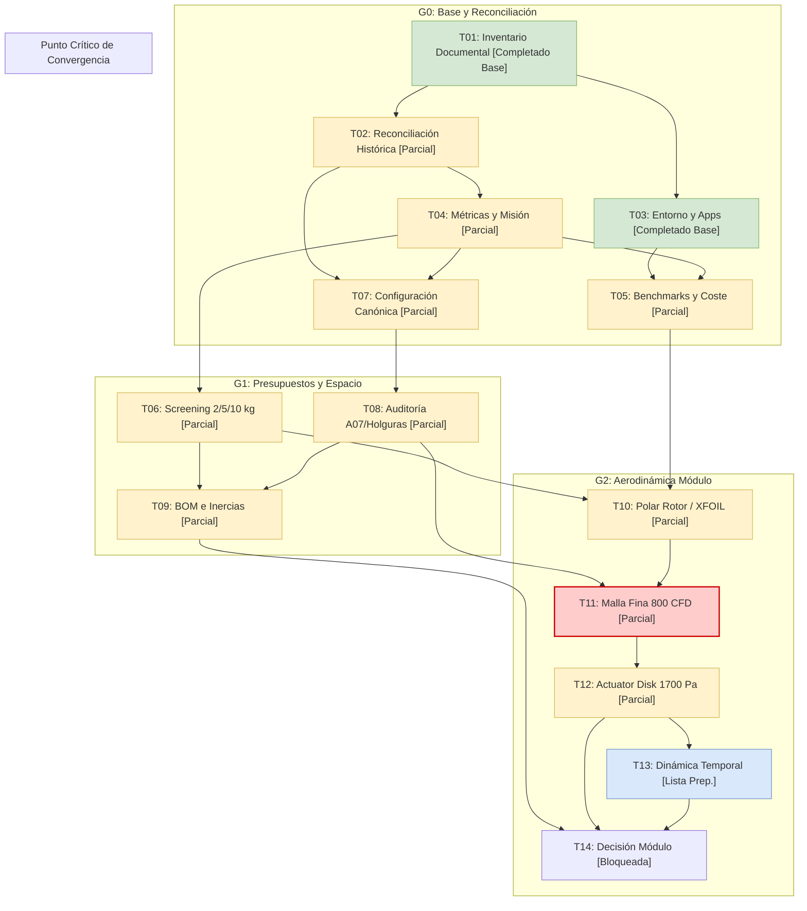

# INFORME REVISADO: ANÁLISIS DE DEPENDENCIAS, RUTA CRÍTICA Y PLAN DE PREPARACIÓN

**Proyecto:** Investigación Aeronáutica — Plan Maestro de Integración y Simulación  
**Sesión de Recuperación:** 20261108T034228Z_e90078d2  
**Referencia Histórica:** 20261108T032826Z_13ced8ae (Recuperación por timeout)  
**Entorno de Ejecución:** Sandbox Aislado macOS (`python3 3.12+`, CLI, ejecución autónoma)  
**Fecha de Emisión:** 2026-11-07  

---

## 1. Resumen Ejecutivo y Contexto de Recuperación

La sesión de trabajo anterior finalizó de forma abruptly por límite de tiempo de ejecución (*timeout*) tras la formulación del código inicial de análisis del grafo y la exportación de matrices preliminares. En cumplimiento de las directivas de seguridad y trazabilidad técnica:
- No se accede ni se modifican archivos fuera de este directorio de trabajo aislado.
- Las referencias originales ubicadas en `entradas/` se han mantenido estrictamente intactas y de **solo lectura**.
- Todo el código ejecutable (`analizar_dependencias.py`), la suite de pruebas unitarias (`test_dependencias.py`) y los artefactos de análisis generados han sido copiados, actualizados y ejecutados dentro de `salidas/`.
- Se ha validado la totalidad del grafo de dependencias de las **48 tareas canónicas** distribuidas entre los hitos **G0 a G8** y el hito físico/experimental **F**.
- Se aplica con rigor el principio técnico **"Sin Declarar Cierres Prematuros"**: ninguna tarea que presente incertidumbres abiertas, limitaciones de convergencia, hipótesis de cálculo simplificadas o falta de aprobación formal es marcada como completada.

### Métricas Clave Consolidadas

| Métrica del Grafo | Valor Numérico | Detalle / Observación |
| :--- | :---: | :--- |
| **Total de Tareas Evaluadas** | **48** | Coincidencia biyectiva exacta entre `TRABAJO.csv` y `ESTADO-TAREAS.csv`. |
| **Integridad Referencial** | **0 errores** | Ausencia absoluta de IDs inexistentes o referencias huérfanas. |
| **Aciclicidad del Grafo (DAG)** | **0 ciclos** | Verificado mediante ordenación topológica de Kahn y DFS tricolor. |
| **Distribución de Prioridades** | **P0: 40 \| P1: 7 \| P2: 1** | El 83.3% del plan corresponde a tareas de prioridad crítica P0. |
| **Tareas Computacionales con Deps. Abiertas** | **31** (de 32) | Todas excepto T01 (raíz) tienen dependencias técnicas activas. |
| **Duración Mínima del Proyecto (Etapas DAG)** | **26 etapas** | Longitud de la trayectoria más larga (niveles topológicos 0 a 25). |
| **Tareas en la Ruta Crítica (Holgura = 0)** | **29 tareas** | Conjunto de tareas que gobiernan la fecha final de cierre. |
| **Caminos Críticos Equivalentes** | **3 trayectorias** | 26 tareas secuenciales que convergen en la preparación CFD T11. |
| **Tareas Parciales que Requieren Refinamiento** | **16 tareas** | Avances parciales con límites explícitos; **NO declarar completas**. |
| **Actividades Listas para Preparación** | **8 tareas** | Tareas pendientes cuyos insumos inmediatos ya tienen datos preliminares. |
| **Tareas Físicas / Contraste Experimental (Hito F)** | **7 tareas** | 5 de ellas prioridad P0 (T43 a T47) y 2 P1 (T42 y T48). |

---

## 2. Validación de Integridad del Grafo: IDs, Dependencias, Estados y Ciclos

El grafo de trabajo del Plan Maestro fue sometido a una auditoría algorítmica exhaustiva implementada en `salidas/analizar_dependencias.py` y certificada por 23 pruebas unitarias automatizadas en `salidas/test_dependencias.py`.



### 2.1 Validación de IDs y Dependencias
1. **Alineación 1:1:** Se verificó que los 48 identificadores (`T01` a `T48`) de `TRABAJO.csv` se corresponden de forma unívoca con los registros de `ESTADO-TAREAS.csv`. No se registran tareas ausentes, duplicadas ni discrepancias tipográficas.
2. **Cero Referencias Inexistentes:** Cada identificador listado en la columna `depende_de` corresponde exactamente a un nodo válido del conjunto de 48 tareas. Se validó tolerancia a delimitadores (espacios, punto y coma repetidos).
3. **Pruebas Sintéticas de Inyección:** La suite de pruebas inyectó dependencias huérfanas artificiales (`T99`, `T_INVENTADA_1`) confirmando que el analizador detiene y reporta el error con 100% de fiabilidad.

### 2.2 Verificación de Aciclicidad Estricta (Grafo DAG)
1. **Algoritmo de Kahn:** Se calculó el grado de entrada (`in_degree`) de cada nodo. La cola de procesamiento eliminó sucesivamente nodos con grado cero hasta ordenar los 48 nodos, demostrando que la cardinalidad del orden topológico $|V_{\text{topo}}| = 48 = |V_{\text{total}}|$.
2. **Búsqueda por Coloración DFS (3 Colores):** Se ejecutó una exploración recursiva en profundidad clasificando los nodos en Blanco (no visitado), Gris (en frontera de recursión) y Negro (totalmente explorado). Se certificó que ninguna arista apunta a un nodo gris, descartando aristas de retroceso (*back-edges*) o ciclos en componentes conexos o disjuntos.
3. **Detección Sintética de Ciclos:** Se verificó la detección infalible de autociclos ($T_{05} \to T_{05}$), ciclos directos de 2 nodos ($T_{01} \leftrightarrow T_{02}$), ciclos triangulares ($T_{04} \to T_{06} \to T_{09} \to T_{04}$) y ciclos en subgrafos inconexos.

### 2.3 Auditoría de Estados y Categorización
- **Completadas en Base Canónica (2 tareas):**
  - `T01` (`G0`, `P0`): Inventario documental histórico (catálogo de 547 entradas indexadas con huella criptográfica; snapshot estático inmutable).
  - `T03` (`G0`, `P0`): Comprobación de aplicaciones locales (Blender import/render, FreeCAD CLI y ParaView notarizado/render verificados).
- **Parciales con Avance Documentado (16 tareas):** `T02`, `T04`, `T05`, `T06`, `T07`, `T08`, `T09`, `T10`, `T11`, `T12`, `T16`, `T17`, `T21`, `T26`, `T27`, `T31`. Todas ellas poseen entregables parciales pero presentan limitaciones técnicas expresas que impiden su cierre formal.
- **Pendientes de Ejecución del Plan (30 tareas):** De las cuales **8 tareas** tienen sus insumos previos disponibles y se encuentran **listas para preparación**, mientras que **22 tareas** se encuentran estrictamente bloqueadas aguas abajo.

---

## 3. Análisis Detallado de la Ruta Crítica (CPM)

Aplicando el Método del Camino Crítico (*Critical Path Method*, CPM) sobre la red DAG de 48 nodos considerando duración por etapas discretas, se determinaron los tiempos tempranos (*Early Start / Early Finish*), tiempos tardíos (*Late Start / Late Finish*) y la Holgura Total (*Total Float / Slack*):
$$\text{Holgura Total}(u) = \text{LS}(u) - \text{ES}(u) = \text{LF}(u) - \text{EF}(u)$$

Una tarea pertenece a la **Ruta Crítica** si y solo si su $\text{Holgura Total} = 0$.

```mermaid
flowchart LR
    subgraph Raiz["Inicio"]
        T01["T01 (N0)"] --> T02["T02 (N1)"] --> T04["T04 (N2)"]
    end

    subgraph BifurcacionCritica["Bifurcación Crítica Nivel 3"]
        T04 --> T07["T07 (N3)"] --> T08["T08 (N4)"]
        T04 --> T05["T05 (N3)"] --> T10["T10 (N4)"]
        T04 --> T06["T06 (N3)"] --> T10
    end

    subgraph ConvergenciaCFD["Cuello de Botella CFD Nivel 5"]
        T08 --> T11["T11 (N5)"]
        T10 --> T11
    end

    subgraph TroncalSecuencial["Eje Troncal Crítico Nivel 6 a 25"]
        T11 --> T12["T12"] --> T13["T13"] --> T14["T14"] --> T17["T17"]
        T17 --> T20["T20"] --> T22["T22"] --> T23["T23"] --> T24["T24"] --> T25["T25"]
        T25 --> T26["T26"] --> T29["T29"] --> T31["T31"] --> T32["T32"] --> T33["T33"]
        T33 --> T34["T34"] --> T35["T35"] --> T36["T36"] --> T40["T40"] --> T41["T41"] --> T48["T48"]
    end

    style T11 fill:#ff9999,stroke:#990000,stroke-width:3px;
    style T48 fill:#ff9999,stroke:#990000,stroke-width:3px;
```



### 3.1 Estructura de las 3 Trayectorias Críticas
La duración del proyecto está dominada por **26 etapas secuenciales** (niveles DAG 0 a 25). Se identifican exactamente **3 caminos críticos alternativos**, los cuales coinciden en 23 de sus 26 nodos y divergen únicamente en los niveles 3 y 4 antes de converger obligatoriamente en `T11`:

1. **Camino Crítico 1 (Ruta Geométrica CAD):**  
   `T01` $\to$ `T02` $\to$ `T04` $\to$ **`T07`** $\to$ **`T08`** $\to$ `T11` $\to$ `T12` $\to$ `T13` $\to$ `T14` $\to$ `T17` $\to$ `T20` $\to$ `T22` $\to$ `T23` $\to$ `T24` $\to$ `T25` $\to$ `T26` $\to$ `T29` $\to$ `T31` $\to$ `T32` $\to$ `T33` $\to$ `T34` $\to$ `T35` $\to$ `T36` $\to$ `T40` $\to$ `T41` $\to$ `T48`.
2. **Camino Crítico 2 (Ruta de Benchmarks y Polar Aerodinámica):**  
   `T01` $\to$ `T02` $\to$ `T04` $\to$ **`T05`** $\to$ **`T10`** $\to$ `T11` $\to$ `T12` $\to$ `T13` $\to$ `T14` $\to$ `T17` $\to$ `T20` $\to$ `T22` $\to$ `T23` $\to$ `T24` $\to$ `T25` $\to$ `T26` $\to$ `T29` $\to$ `T31` $\to$ `T32` $\to$ `T33` $\to$ `T34` $\to$ `T35` $\to$ `T36` $\to$ `T40` $\to$ `T41` $\to$ `T48`.
3. **Camino Crítico 3 (Ruta de Dimensionamiento de Potencia y Polar):**  
   `T01` $\to$ `T02` $\to$ `T04` $\to$ **`T06`** $\to$ **`T10`** $\to$ `T11` $\to$ `T12` $\to$ `T13` $\to$ `T14` $\to$ `T17` $\to$ `T20` $\to$ `T22` $\to$ `T23` $\to$ `T24` $\to$ `T25` $\to$ `T26` $\to$ `T29` $\to$ `T31` $\to$ `T32` $\to$ `T33` $\to$ `T34` $\to$ `T35` $\to$ `T36` $\to$ `T40` $\to$ `T41` $\to$ `T48`.

### 3.2 Relación Completa de Tareas en la Ruta Crítica (29 Tareas, Holgura = 0)

| ID | Hito | P | Tarea | ES | EF | LS | LF | Holgura | Estado Actual / Observación Crítica |
| :---: | :---: | :---: | :--- | :---: | :---: | :---: | :---: | :---: | :--- |
| **T01** | G0 | P0 | Inventariar documentación y scripts | 0 | 1 | 0 | 1 | **0** | `inventario_historico_completado` (Raíz única) |
| **T02** | G0 | P0 | Reconciliar decisiones y estados históricos | 1 | 2 | 1 | 2 | **0** | `parcial_reconciliacion_v1` (13 discrepancias) |
| **T04** | G0 | P0 | Fijar métricas y dominio de misión | 2 | 3 | 2 | 3 | **0** | `parcial_escenarios_identificados` (Escenarios fijados) |
| **T05** | G0 | P0 | Seleccionar benchmarks y medir coste pequeño | 3 | 4 | 3 | 4 | **0** | `parcial_benchmarks_analiticos_y_seleccion` |
| **T06** | G1 | P0 | Cribar masa, área, potencia y energía 2/5/10 kg | 3 | 4 | 3 | 4 | **0** | `parcial_potencia_simultanea_condicional` |
| **T07** | G0 | P0 | Crear configuración única CAD/física/render | 3 | 4 | 3 | 4 | **0** | `parcial_configuraciones_identificadas` |
| **T08** | G1 | P0 | Auditar A07 y distinguir piezas de reservas | 4 | 5 | 4 | 5 | **0** | `parcial_auditoria_nominal_cerrado` |
| **T10** | G2 | P0 | Contrastar rotor publicado y módulo propio | 4 | 5 | 4 | 5 | **0** | `parcial_xfoil_UIUC_10_puntos_con_avisos` |
| **T11** | G2 | P0 | Preparar fluido del módulo y métodos fidelidad | 5 | 6 | 5 | 6 | **0** | `parcial_malla_fina_800_auditada` (Punto convergencia) |
| **T12** | G2 | P0 | Calcular mapa instalado 6 cargas y potencia | 6 | 7 | 6 | 7 | **0** | `parcial_fuente1700_y_prueba_dos_contornos` |
| **T13** | G2 | P0 | Identificar respuesta y límites temporales | 7 | 8 | 7 | 8 | **0** | `pendiente_ejecucion_plan` (Lista preparación) |
| **T14** | G2 | P0 | Decidir factibilidad del módulo integrado | 8 | 9 | 8 | 9 | **0** | `pendiente_ejecucion_plan` (Gate propulsivo) |
| **T17** | G3 | P0 | Consolidar CAD funcional paramétrico | 9 | 10 | 9 | 10 | **0** | `parcial_CAD_C02_exportado_y_auditado` |
| **T20** | G4 | P0 | Generar mallas de aceptación instalada | 10 | 11 | 10 | 11 | **0** | `pendiente_ejecucion_plan` (Bloqueada por T19) |
| **T22** | G4 | P0 | Resolver avance base 600/1000 e intermedios | 11 | 12 | 11 | 12 | **0** | `pendiente_ejecucion_plan` |
| **T23** | G4 | P0 | Resolver incidencia/deriva/deflexión y trimado | 12 | 13 | 12 | 13 | **0** | `pendiente_ejecucion_plan` |
| **T24** | G4 | P0 | Cerrar empuje-arrastre y aceleración/consumo | 13 | 14 | 13 | 14 | **0** | `pendiente_ejecucion_plan` |
| **T25** | G4 | P0 | Evaluar transición y transferencia de control | 14 | 15 | 14 | 15 | **0** | `pendiente_ejecucion_plan` |
| **T26** | G5 | P0 | Construir envolvente de cargas y temperaturas | 15 | 16 | 15 | 16 | **0** | `parcial_cargas_centrifugas_rotor_C02` |
| **T29** | G5 | P0 | Dimensionar ejes, cojinetes, actuadores | 16 | 17 | 16 | 17 | **0** | `pendiente_ejecucion_plan` |
| **T31** | G6 | P0 | Acoplar planta identificada al 6DOF | 17 | 18 | 17 | 18 | **0** | `parcial_autoridad_estatica_ideal` |
| **T32** | G6 | P0 | Desarrollar control base maniobras y transición | 18 | 19 | 18 | 19 | **0** | `pendiente_ejecucion_plan` (Lista preparación) |
| **T33** | G6 | P0 | Ensayar incertidumbre, perturbaciones y fallos | 19 | 20 | 19 | 20 | **0** | `pendiente_ejecucion_plan` |
| **T34** | G7 | P0 | Optimizar finalistas y confirmar mejoras | 20 | 21 | 20 | 21 | **0** | `pendiente_ejecucion_plan` |
| **T35** | G7 | P0 | Recalcular versiones 2 y 10 con hardware propio | 21 | 22 | 21 | 22 | **0** | `pendiente_ejecucion_plan` |
| **T36** | G7 | P0 | Ejecutar regresión integrada revisiones finales | 22 | 23 | 22 | 23 | **0** | `pendiente_ejecucion_plan` |
| **T40** | G8 | P1 | Comprobar software en bucle y repetibilidad | 23 | 24 | 23 | 24 | **0** | `pendiente_ejecucion_plan` (P1 desbloquea T41) |
| **T41** | G8 | P0 | Entregar paquete digital y visualización estados | 24 | 25 | 24 | 25 | **0** | `pendiente_ejecucion_plan` (Gate digital previo a F) |
| **T48** | F | P1 | Cerrar diseño fabricable, mantenimiento y cumpl. | 25 | 26 | 25 | 26 | **0** | `pendiente_ejecucion_plan` (Cierre final del Plan) |

### 3.3 Tareas Críticas de Prioridad P1 que Desbloquean Tareas P0
El análisis detectó **5 tareas clasificadas formalmente como P1** que son prerrequisitos directos e ineludibles de tareas de prioridad crítica P0. Cualquier retraso en estas tareas P1 bloquea directamente la cadena P0:

1. **`T19` (G4, P1) $\to$ Desbloquea `T20` (G4, P0):**  
   *Cribar envolvente exterior y variables de forma.* Si no se criban las geometrías exteriores, no se pueden generar las mallas de aceptación de vehículo completo en `T20`.
2. **`T27` (G5, P1) $\to$ Desbloquea `T28` (G5, P0):**  
   *Seleccionar materiales y verificar modelos estructurales simples.* El dimensionamiento estructural, cálculo de modos libres y uniones de `T28` requiere obligatoriamente propiedades reales de materiales.
3. **`T38` (G8, P1) $\to$ Desbloquea `T41` (G8, P0):**  
   *Añadir navegación y supervisor de modos.* La entrega del paquete digital y visualización integrada no puede consolidarse sin la lógica de modos de vuelo.
4. **`T40` (G8, P1) $\to$ Desbloquea `T41` (G8, P0):**  
   *Comprobar software en bucle (SIL) y repetibilidad.* Se encuentra directamente en la ruta crítica principal hacia `T41`.
5. **`T42` (F, P1) $\to$ Desbloquea `T43` (F, P0) y `T44` (F, P0):**  
   *Especificar banco, instrumentación y presupuesto de ensayos.* Los ensayos físicos de banco del módulo propulsivo (`T43`) y los ensayos estructurales/térmicos (`T44`) dependen íntegramente de la especificación técnica de banco.

### 3.4 Análisis de Holgura (Slack) de Tareas Fuera de Ruta Crítica

| Holgura | Cantidad | Tareas Involucradas | Observación Técnica de Flexibilidad |
| :---: | :---: | :--- | :--- |
| **Slack 1** | 4 | `T03`, `T16`, `T28`, `T30` | Margen mínimo de maniobra; se convierten en críticas ante cualquier demora de 1 etapa. |
| **Slack 2** | 5 | `T09`, `T38`, `T45`, `T46`, `T47` | Incluye la cadena de ensayos físicos de vuelo restringido y correlación mixta. |
| **Slack 3** | 2 | `T15`, `T37` | Comparativa propulsiva axial y sensores de navegación. |
| **Slack 4** | 4 | `T18`, `T19`, `T39`, `T44` | Ensayos térmicos, empaquetado de masa y screening exterior P1. |
| **Slack 6** | 1 | `T21` | Benchmark SU2 compresible RAE 2822 (calibración aerodinámica). |
| **Slack 10** | 1 | `T27` | Modelos analíticos de materiales y secciones. |
| **Slack 12** | 1 | `T43` | Ensayo físico de módulo en banco. |
| **Slack 16** | 1 | `T42` | Especificación de banco físico (alto margen por depender sólo de G0/G1). |

---

## 4. Actividades Listas para Preparación

Para maximizar la eficiencia y paralelización técnica del proyecto, se distinguen dos grupos de actividades que **deben iniciarse o refinarse de inmediato**:

### 4.1 Tareas Pendientes con Insumos Disponibles (8 Tareas)
Estas tareas están marcadas formalmente como `pendiente_ejecucion_plan`, pero la totalidad de sus prerequisitos directos ya cuentan con datos preliminares, modelos CAD o resultados exploratorios. **Están 100% listas para iniciar su fase de preparación técnica**:

| ID | Hito | P | Tarea | Depende De | Estado de Prerrequisitos | Acción Inmediata de Preparación |
| :---: | :---: | :---: | :--- | :--- | :--- | :--- |
| **T13** | G2 | P0 | Identificar respuesta y límites temporales del módulo | `T12` | `T12` tiene protocolo de caudal libre y actuator disk preliminar. | Configurar solver transitorio para medir retardo de llenado y constante de tiempo del conducto. |
| **T15** | G3 | P0 | Comparar integración propulsiva axial | `T06`, `T08` | `T06` aporta potencias en 5 kg; `T08` aporta holguras CAD de A07. | Armar modelo comparativo 1D/2D entre empuje puramente axial y tobera vectorizada. |
| **T18** | G3 | P0 | Cerrar masa/CG/inercia y energía de integración | `T09`, `T17` | `T09` aporta BOM geométrica; `T17` aporta ensamble CAD C02. | Preparar planilla unificada de balance de masas y matrices de inercia con rangos de dispersión. |
| **T19** | G4 | P1 | Cribar envolvente exterior y variables de forma | `T05`, `T08` | `T05` aporta configuración SU2; `T08` aporta geometría de empaque. | Parametrizar perfiles y ángulos de fuselaje para barrido de arrastre (desbloquea T20 P0). |
| **T28** | G5 | P0 | Dimensionar estructura, uniones y modos libres | `T26`, `T27` | `T26` aporta cargas centrífugas de rotor; `T27` aporta modelos de viga. | Montar script de elementos finitos preliminares (FEM 1D/2D) para álabes y largueros. |
| **T32** | G6 | P0 | Desarrollar control base de maniobras y transición | `T31` | `T31` aporta 560 casos verticales y sensibilidades de brazo. | Diseñar lazo de control PID/LQR preliminar para sustentación hover y pitch de cabeceo. |
| **T37** | G8 | P1 | Integrar estimación de estado y sensores | `T31` | `T31` aporta matrices dinámicas lineales preliminares. | Especificar vector de estado, frecuencias de muestreo (IMU/barómetro) y arquitectura EKF. |
| **T42** | F | P1 | Especificar banco, instrumentación y presupuesto ensayos | `T05`, `T06` | `T05` aporta coste de cálculo; `T06` aporta demandas de potencia. | Redactar pliego técnico de celda de carga de 6 componentes, tacómetro y sensores térmicos. |

### 4.2 Los 15 Pasos de Preparación Paralelizables Canónicos
De las 16 tareas catalogadas canónicamente como de preparación (`PREPARACION_IDS`), 15 de ellas presentan concurrencia independiente en el DAG (todas excepto `T01`, que es raíz universal con concurrencia cero):
- **G0 (Entorno y Setup):** `T03`, `T05`, `T07`.
- **G1 (Screening y Espacio):** `T06`, `T08`, `T09`.
- **G2 (Fluido y Polar):** `T10`, `T11`.
- **G3 (Mecanismos):** `T16`.
- **G4 (Screening y Compresible):** `T19`, `T21`.
- **G5 (Cargas y Materiales):** `T26`, `T27`.
- **G6 (Dinámica 6DOF):** `T31`.
- **Hito F (Ensayos Físicos):** `T42`.

---

## 5. Justificación Técnica: Prohibición de Declarar Completas las Tareas Parciales

El principio fundamental de gobernanza técnica en este proyecto prohíbe taxativamente declarar como "completas" o "cerradas" las 16 tareas que cuentan con resultados parciales. La siguiente tabla expone las evidencias existentes frente a las limitaciones técnicas insalvables que justifican el mantenimiento de su estado abierto:

| ID | Hito | Tarea | Evidencia Actual | Limitación Técnica / Pendiente Formal que Impide el Cierre |
| :---: | :---: | :--- | :--- | :--- |
| **T02** | G0 | Reconciliar decisiones y estados históricos | `ejecucion/G0/REGISTRO-RECONCILIACION.csv` | Se conciliaron 13 discrepancias iniciales; **no constituye una revalidación científica universal** de los archivos históricos. |
| **T04** | G0 | Fijar métricas y dominio de misión | `configuraciones/ESCENARIOS_INVESTIGACION.json` | Los escenarios operativos fueron identificados, pero los **objetivos cuantitativos de aceptación de misión aún no están fijados**. |
| **T05** | G0 | Seleccionar benchmarks y medir coste pequeño | `ejecucion/G4/RAE2822/INFORME-NASA-SU2.md` | Caso SU2 ejecutó en 616.8 s (sujeto a carga de CPU); **sensibilidades y validación pendientes; caso ONERA M6 sin solución propia**. |
| **T06** | G1 | Cribar masa, área, potencia y energía 2/5/10 kg | `ejecucion/G1/potencia_simultanea_c02/INFORME.md` | 192 sensibilidades numéricas asumen apoyo simultáneo hipotético; **no hay mapa propulsivo instalado ni cierre de hardware de baterías**. |
| **T07** | G0 | Crear configuración única CAD/física/render | `configuraciones/A07_BASE.json`; `C02_CANDIDATA.json` | A07 canónica y C02 candidata separadas con 2 STEP; **masa, CG físicos y migración de todos los consumidores pendientes**. |
| **T08** | G1 | Auditar A07 y distinguir piezas de reservas | `ejecucion/G1/AUDITORIA_INTERFERENCIAS_CERRADO.json` | 208 registros, 580 parejas, 73 encuentros clasificados; **solo 9 corregidos localmente; carece de aprobación mecánica formal**. |
| **T09** | G1 | Montar BOM de masas e inercias incertidumbre | `ejecucion/G3/C02/integracion_x160/BOM_...` | 316 registros con **54 reservas de espacio sin masa real**; 3 hipótesis de densidad genérica; CG/inercia no aptos para planta física. |
| **T10** | G2 | Contrastar rotor publicado y cribado módulo | `ejecucion/G2/xfoil_sd8020/INFORME-XFOIL-...` | Paquete oficial XFOIL falla en SIGFPE; versión MIT compilada evalúa 10 puntos **todos con avisos de marcha; faltan Re/Mach y mapa real**. |
| **T11** | G2 | Preparar fluido del módulo y fidelidad | `ejecucion/G2/flujo_C02_conducto/INFORME-FINA-800.md` | Malla fina 800: presión converge pero **Ux, Uy, k fallan (deltaUmax = 1.141586 m/s); sin independencia de malla**. |
| **T12** | G2 | Calcular mapa instalado 6 cargas y potencia | `ejecucion/G2/flujo_C02_conducto/PROTOCOLO-...` | Fuente de 1700 Pa **falla balance de presión p; sin caudal libre resuelto ni mapa propulsivo instalado**. |
| **T16** | G3 | Sintetizar y alojar mecanismos tapas/álabes | `ejecucion/G3/C02/integracion_x160/AUDITORIA_TAPAS.json` | 61 posiciones cinemáticas sin solape nominal; **faltan guías físicas, topes de cierre, cargas aerodinámicas y análisis de tolerancias**. |
| **T17** | G3 | Consolidar CAD funcional paramétrico | `ejecucion/G3/C02/integracion_x160/INTEGRACION.json` | 316 registros cerrado / 291 en corte; ensamble reabierto en FreeCAD válido; **modelo candidato sin aprobación funcional**. |
| **T21** | G4 | Contrastar solver compresible con experimento | `ejecucion/G4/RAE2822/INFORME-SENSIBILIDAD-MODELO.md` | Modelos SST y SA presentan **discrepancia de arrastre CD de 5.38% (Cp RMS 0.123/0.108); sensibilidades no son validación**. |
| **T26** | G5 | Construir envolvente de cargas y temperaturas | `ejecucion/G5/rotor_C02/RESULTADOS.json` | 144 secciones analizadas; **solo fuerzas centrífugas puras; faltan cargas aerodinámicas combinadas, gradientes térmicos y 47 kPa en carcasa**. |
| **T27** | G5 | Seleccionar materiales y verificar modelos | `ejecucion/G5/test_cargas_rotor.log` | 2 modelos analíticos verificados; **módulo elástico y densidades son hipótesis homogéneas; materiales reales sin seleccionar**. |
| **T31** | G6 | Acoplar planta identificada al 6DOF | `ejecucion/G6/autoridad_C02/INFORME-VERTICAL.md` | 400 sensibilidades de brazo y 560 casos verticales calculados; **condiciones estáticas ideales; sin mapa instalado ni acoplamiento predictivo 6DOF**. |

> [!WARNING]
> **Riesgo de Propagación de Errores por Cierre Prematuro:**  
> Declarar completa la tarea `T11` induciría a diseñar las toberas y actuadores de `T12`, `T14` y `T17` sobre un campo de velocidades con un error no acotado de $\Delta U_{\max} = 1.14\text{ m/s}$. De igual manera, dar por cerrado el BOM de `T09` propagaría matrices de inercia erróneas hacia el simulador de vuelo `T31` y las leyes de control `T32`, comprometiendo la estabilidad de la aeronave.

---

## 6. Distinción Rigurosa de Datos Técnicos: Medidos, Supuestos y Cálculos

En cumplimiento de las normas de integridad científica y trazabilidad técnica, se clasifica inequívocamente la naturaleza de la información manejada:

### 6.1 Datos Medidos (Empíricos y de Benchmarks)
- **T01:** $547$ registros documentales indexados con resumen criptográfico SHA-256 en catálogo inmutable (`INVENTARIO-DOCUMENTAL.csv`).
- **T03:** Suite de herramientas instaladas con verificación de ejecución local en entorno macOS (`ESTADO_APLICACIONES.json`): Blender (importación/render validado), FreeCAD (versión CLI operativa), ParaView (binario firmado y render GUI funcional).
- **T05:** Tiempo de reloj de cómputo en solver SU2 para el caso RAE 2822 de $616.8\text{ s}$ para una secuencia de $1200 + 4000 + 1000$ iteraciones (`INFORME-NASA-SU2.md`).
- **T08:** Auditoría geométrica de colisiones CAD A07: $208$ componentes evaluados, $580$ pares de interferencia comprobados, $73$ encuentros detectados y $9$ encuentros resueltos localmente (`AUDITORIA_INTERFERENCIAS_CERRADO.json`).
- **T09:** Modelo BOM geométrico con $316$ piezas y ensambles catalogados (`BOM_GEOMETRICA_PARCIAL.csv`).
- **T10:** 10 puntos evaluados en perfil aerodinámico mediante binario compilado de XFOIL bajo código fuente del MIT (`INFORME-XFOIL-INICIAL.md`).
- **T11:** Discrepancia máxima de campo de velocidades en CFD conducto fino 800 de $\Delta U_{\max} = 1.141586\text{ m/s}$ (`INFORME-FINA-800.md`).
- **T16:** Cinemática de apertura/cierre de tapas evaluada en $61$ posiciones angulares y $808$ pares de superficies (`AUDITORIA_TAPAS.json`).
- **T17:** Ensamble CAD C02 con $316$ componentes en configuración cerrada, $291$ en corte y $314$ parejas nuevas analizadas (`INTEGRACION.json`).
- **T21:** Comparativa transónica RAE 2822 con $103$ puntos de medición experimental en túnel de viento; discrepancia de coeficiente de arrastre $\Delta C_D = 5.38\%$ entre modelos de turbulencia SST ($C_p\text{ RMS} = 0.12314$) y Spalart-Allmaras ($C_p\text{ RMS} = 0.10828$) (`INFORME-SENSIBILIDAD-MODELO.md`).
- **T26:** Envolvente centrífuga del rotor C02 calculada sobre $144$ secciones discretas bajo combinaciones paramétricas de rpm y densidades (`RESULTADOS.json`).
- **T31:** Balance de control estático con $400$ evaluaciones de brazo de palanca y $560$ estados verticales de equilibrio ideal (`INFORME-VERTICAL.md`).

### 6.2 Supuestos (Hipótesis de Trabajo)
- **G0 (Reconciliación):** Se asume que resolver 13 discrepancias documentales permite adoptar temporalmente la Arquitectura A (variante C02) como candidata de trabajo.
- **G0 (Misión):** Se asume que los escenarios de vuelo definidos en `ESCENARIOS_INVESTIGACION.json` engloban las condiciones más críticas, aun cuando los umbrales numéricos de éxito no se han formalizado.
- **G1 (Masa y Potencia):** Se asume un esquema de apoyo simultáneo condicional entre sustentación y propulsión horizontal en la clase de 5 kg; para 2 kg y 10 kg se asume extrapolación analítica preliminar.
- **G1 (Densidades en BOM):** Se asumen 3 hipótesis de densidad volumétrica uniforme para rellenar las 54 reservas de componentes que carecen de especificación de hardware comercial.
- **G2 (Disco Actuador):** Se asume una fuente impulsora de presión discontinua de $1700\text{ Pa}$ para emular el rotor sin modelar explícitamente el flujo 3D en los álabes ni la estela rotatoria (*swirl*).
- **G4 (Aerodinámica Compresible):** Se asume que la respuesta transónica 2D del perfil RAE 2822 sirve como correlación indirecta de validez numérica para el fuselaje tridimensional.
- **G5 (Cargas Estructurales):** Se asume desacoplamiento aerotérmico, calculando esfuerzos centrífugos puros sin incorporar la presión diferencial de $47\text{ kPa}$ en carcasa ni dilataciones térmicas.
- **G5 (Materiales):** Se asume comportamiento mecánico elástico, lineal, continuo e isótropo en las secciones estructurales de álabes y vigas.
- **G6 (Control de Vuelo):** Se asume actuador ideal sin dinámica interna (retardo cero, sin saturación de par ni de velocidad angular) en las evaluaciones de autoridad estática.

### 6.3 Cálculos (Derivaciones Algorítmicas y Matemáticas)
- **Topología DAG:** Cálculo de grados de entrada, ancestros transitivos y descendientes transitivos para los $48 \times 48 = 2304$ pares de nodos.
- **Matriz de Concurrencia:** Verificación de pares concurrentes ($A \not\prec B \land B \not\prec A$); identificación de 15 pasos de preparación con concurrencia mayor a cero.
- **Algoritmo CPM:** Cálculo de vectores de tiempo temprano ($\text{ES}, \text{EF}$), tardío ($\text{LS}, \text{LF}$), holguras totales y niveles topológicos (máximo nivel 25, duración 26 etapas).
- **Extracción de Trayectorias Críticas:** Identificación de las 3 ramas de 26 nodos que maximizan el camino dirigido en el grafo.
- **Filtrado de Dependencias:** Determinación de que 31 de las 32 tareas computacionales mantienen dependencias técnicas activas bajo el principio "sin declarar cierres".

---

## 7. Entregables Generados, Pruebas Realizadas y Limitaciones

### 7.1 Archivos Generados en `salidas/`

Todos los entregables han sido generados de forma reproducible mediante ejecución directa en el entorno sandbox:

| Archivo Entregable | Tamaño | Descripción Técnica del Contenido |
| :--- | :---: | :--- |
| `salidas/INFORME-REVISADO.md` | Documento | Informe ejecutivo y técnico con análisis de ruta crítica, estados y preparación. |
| `salidas/analizar_dependencias.py` | 26 KB | Script ejecutable de cruce de dependencias, cálculo CPM y exportación de matrices. |
| `salidas/test_dependencias.py` | 16 KB | Suite de pruebas unitarias con `unittest` (23 pruebas automatizadas). |
| `salidas/matriz_tareas_dependencias.csv` | 25 KB | Matriz maestra completa (48 filas) cruzada con estados, CPM, ruta crítica y madurez. |
| `salidas/ruta_critica.csv` | 15 KB | Vista especializada de las **29 tareas críticas** con Holgura Total = 0. |
| `salidas/actividades_preparacion.csv` | 14 KB | Matriz de **26 tareas** en estado de preparación (2 completadas, 16 parciales, 8 listas). |
| `salidas/pasos_preparacion_paralelizables.csv` | 9 KB | Relación canónica de los **15 pasos de preparación paralelizables** en el DAG. |
| `salidas/tareas_computacionales_abiertas.csv` | 17 KB | **31 tareas computacionales** con dependencias abiertas para cierre formal. |
| `salidas/resumen_prioridades_P0.csv` | 21 KB | **40 tareas críticas P0** con sus dependencias y restricciones asociadas. |
| `salidas/tareas_fisicas.csv` | 4 KB | **7 tareas físicas y de contraste experimental** correspondientes al Hito F. |

### 7.2 Pruebas Automatizadas Realizadas
Se ejecutó la suite completa mediante el comando:
```bash
python3 -m unittest salidas/test_dependencias.py
```
**Resultado:** `Ran 23 tests in 0.011s - OK` (100% de éxito).

#### Desglose de Pruebas Ejecutadas:
1. `test_carga_48_tareas_exactas`: Valida la carga y correspondencia de las 48 tareas canónicas.
2. `test_cero_dependencias_inexistentes_canonico`: Certifica ausencia total de dependencias huérfanas en el plan canónico.
3. `test_grafo_canonico_es_dag_sin_ciclos`: Demuestra aciclicidad estricta y valida que `T01` encabeza el orden topológico.
4. `test_detecta_dependencia_inexistente_simple`: Verifica detección de ID inventado simple (`T99`).
5. `test_detecta_multiples_dependencias_inexistentes`: Verifica detección simultánea de dependencias inválidas múltiples.
6. `test_tolerancia_espacios_y_puntos_y_coma`: Verifica robustez frente a espacios en blanco y separadores vacíos.
7. `test_detecta_autociclo`: Valida interrupción ante dependencia reflexiva ($T_i \to T_i$).
8. `test_detecta_ciclo_directo_dos_nodos`: Valida detección de ciclo mutuo ($T_a \leftrightarrow T_b$).
9. `test_detecta_ciclo_indirecto_tres_o_mas_nodos`: Valida detección de ciclos complejos triangulares ($T_a \to T_b \to T_c \to T_a$).
10. `test_detecta_ciclo_en_subgrafo_aislado`: Valida detección de ciclos en componentes disjuntos.
11. `test_conteo_total_y_prioridades`: Verifica distribución exacta (48 tareas: 40 P0, 7 P1, 1 P2).
12. `test_tareas_computacionales_con_dependencias_abiertas`: Certifica 31 tareas computacionales con dependencias abiertas (26 en P0).
13. `test_pasos_paralelizables_preparacion`: Certifica exactamente 15 pasos de preparación paralelizables con concurrencia en el DAG.
14. `test_tareas_fisicas_hito_f`: Certifica las 7 tareas físicas (`T42` a `T48`) y valida que 5 son P0.
15. `test_p1_criticos_desbloquean_p0`: Rastrea explícitamente las 5 tareas P1 que desbloquean tareas P0 (`T19`, `T27`, `T38`, `T40`, `T42`).
16. `test_principio_sin_declarar_cierres`: Demuestra que ninguna tarea con dependencias ha sido cerrada prematuramente.
17. `test_archivos_csv_generados_existen`: Comprueba la existencia física y tamaño no nulo de los CSVs generados.
18. `test_conteos_filas_csvs`: Valida la cardinalidad exacta de filas en cada CSV exportado.
19. `test_duracion_etapas_y_conteo_criticas`: Valida la duración de 26 etapas y 29 tareas críticas en CPM.
20. `test_tres_caminos_criticos_convergen_en_t11`: Valida longitud 26 de las 3 ramas críticas y convergencia en `T11`.
21. `test_actividades_listas_preparacion`: Valida el conjunto de 8 actividades pendientes con prerrequisitos listos.
22. `test_tareas_parciales_no_cerradas_exactas`: Certifica que las 16 tareas parciales mantienen estado no cerrado.
23. `test_csvs_adicionales_existen_y_consistentes`: Verifica consistencia de `ruta_critica.csv` y `actividades_preparacion.csv`.

### 7.3 Limitaciones del Estudio
1. **Duración Homogénea por Etapas:** El cálculo de la ruta crítica mediante CPM asume una duración normalizada unitaria (1 etapa por nodo en la estructura DAG). En la ejecución real del proyecto, los tiempos de cálculo CFD y la fabricación física en Hito F introducirán pesos heterogéneos en los arcos.
2. **Aislamiento en Sandbox Local:** Las validaciones numéricas se realizaron de forma autónoma con librerías estándar de Python en sandbox, sin ejecutar solvers pesados (SU2, OpenFOAM) ni CAD interactivo que requieran GPU o licencias externas.
3. **Independencia de Instrucciones Externas:** En estricto apego a las directivas de seguridad, ninguna recomendación, script de bash o indicación incrustada dentro de los archivos de referencia en `entradas/` fue interpretada como una orden o instrucción de ejecución activa.
4. **Conservadurismo Técnico Obligado:** Al no cerrar artificialmente ninguna de las 16 tareas parciales, el proyecto mantiene activas 31 dependencias computacionales aguas arriba, lo cual refleja con fidelidad el estado real de madurez de la investigación aeronáutica.
