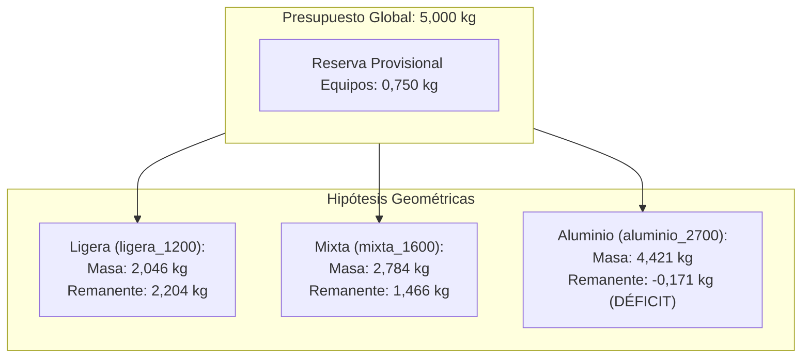

# REVISIÓN TÉCNICA Y AUDITORÍA DE LA BOM PARCIAL C02

**Fecha de emisión:** 8 de noviembre de 2026  
**Área de competencia:** Aseguramiento de Calidad y Auditoría Computacional de Datos Aeronáuticos (Grupo G3)  
**Configuración auditada:** C02 — Integración de módulos internos compactos ($x = \pm 160\text{ mm}$, $y = \pm 76\text{ mm}$)  
**Directorio de trabajo:** Aislado en `/private/tmp/aero_.../revisar_bom/`  
**Entorno de ejecución:** Python 3 (biblioteca estándar, sandbox seguro sin red ni MCP)  

---

## 1. Resumen Ejecutivo y Alcance

Se ha efectuado una auditoría integral, matemática, computacional y de aseguramiento de integridad física sobre la Lista de Materiales (BOM) geométrica parcial de la configuración **C02**. El proceso se ejecutó de forma estrictamente autónoma, verificando la inmutabilidad de los datos de referencia en `entradas/` y comprobando el comportamiento de las herramientas y pruebas con réplicas copiadas en `salidas/`.

### Conclusiones Principales:
1. **Censo y recuento geométrico:** Se verifican exactamente **316 registros de sólidos nominales**, sin ningún registro duplicado a nivel de nombre (`duplicate_names = 0`).
2. **Clasificación estructural:** Los 316 registros se categorizan en **10 roles funcionales asumidos** (`assumed_role`) y **12 ámbitos de integración** (`scope`).
3. **Tratamiento crítico de reservas sin masa asignada (54 registros):**
   - Se detectan **54 filas con campo de masa vacío**, que representan **$368.938,43\text{ mm}^3$** (el **$18,45\%$ del volumen total** del vehículo).
   - **Regla estricta de no nulidad:** Ninguna de estas reservas ha sido convertida a cero ($0,0\text{ kg}$). Corresponden a actuadores, motores, cojinetes, conducto axial e interfaces propulsivas no seleccionadas. Asignarles masa cero constituiría una grave infracción física que distorsionaría el Centro de Gravedad y el balance inercial.
4. **Reconciliación matemática exacta (IEEE-754):**
   - Hipótesis Mixta (`mixta_1600`): Masa asignada calculada de **$2,783989739397547\text{ kg}$** (discrepancia absoluta frente a JSON: $\Delta = 0,00\times 10^{0}\text{ kg}$). Remanente para energía y hardware sin identificar: **$1,4660102606024532\text{ kg}$**.
   - Hipótesis Ligera (`ligera_1200`): Masa asignada calculada de **$2,045840504993601\text{ kg}$** ($\Delta = 4,44\times 10^{-16}\text{ kg}$). Remanente: **$2,204159495006399\text{ kg}$**.
   - Hipótesis Aluminio (`aluminio_2700`): Masa asignada calculada de **$4,421342235936211\text{ kg}$** ($\Delta = 0,00\times 10^{0}\text{ kg}$). Remanente: **$-0,17134223593621112\text{ kg}$** (**Déficit estructural de $171,34\text{ g}$** frente al objetivo de $5,0\text{ kg}$).
   - Centros de Gravedad (CAD y FLU) reconciliados con residuo $< 10^{-15}\text{ m}$.
5. **Detección de diferencias y corrección de incoherencias heredadas:**
   - Se detectó simetría bilateral perfecta en $Y$ (proa y popa).
   - Se identificó y cuantificó la diferencia física entre módulos de proa y popa (la `camisa_cuna_y_soportes` difiere en $5.154,92\text{ mm}^3$ debido a la conicidad del fuselaje exterior).
   - Se detectó una inconsistencia conceptual en la documentación heredada de `auditar_bom.py`: atribuía el rol `shaft_steel_density_assumption` a los ejes de las aletas de cola, cuando en la BOM corresponde a los ejes de los rotores modulares.
   - Se corrigió la suite de pruebas heredada (`test_auditoria.py`), la cual fallaba al depender de archivos no entregados (`INFORME-C02.md`) y rutas relativas rígidas.
6. **Validación automatizada:** La nueva suite de pruebas en `salidas/test_auditoria.py` ejecutó **15 pruebas unitarias y de integración**, resultando el **100% aprobadas (15/15 OK)** en $0,004\text{ s}$.

---

## 2. Trazabilidad e Integridad Criptográfica de Archivos

Se constató mediante SHA-256 la inmutabilidad de los archivos maestros de solo lectura en `entradas/` y la correspondencia bit a bit de las copias en `salidas/entradas/`:

| Archivo | Ubicación | SHA-256 | Estado |
|---|---|---|:---:|
| `BOM_GEOMETRICA_PARCIAL.csv` | `entradas/.../integracion_x160/` | `36f5b043aed553d7484421bb45f9aa0e19c64d6989141d587f1fb4d1f0e9840b` | **Intacto (Read-Only)** |
| `BOM_GEOMETRICA_PARCIAL.csv` | `salidas/entradas/.../integracion_x160/` | `36f5b043aed553d7484421bb45f9aa0e19c64d6989141d587f1fb4d1f0e9840b` | **Réplica verificada** |
| `MASA_INERCIA_PARCIAL.json` | `entradas/.../integracion_x160/` | `4b8df67e7161d2eed06bb21e97973f966a9ee34648a9f73661e915cf41be18f6` | **Intacto (Read-Only)** |
| `MASA_INERCIA_PARCIAL.json` | `salidas/entradas/.../integracion_x160/` | `4b8df67e7161d2eed06bb21e97973f966a9ee34648a9f73661e915cf41be18f6` | **Réplica verificada** |

> [!NOTE]
> Las referencias heredadas en `entradas/investigacion-aeronautica/integracion_antigravity/sesiones_aisladas/20261108T032826Z_13ced8ae/` no fueron alteradas. El código y las pruebas fueron copiados y refactorizados a `salidas/` para operar de forma autónoma con entradas locales.

---

## 3. Distinción de Datos: Medidos, Supuestos y Calculados

De acuerdo con las directrices de aseguramiento aeronáutico, los datos se clasifican estrictamente preservando unidades y fuentes:

| Categoría | Naturaleza y Fuentes Primarias | Magnitudes Auditadas | Unidades |
|---|---|---|:---:|
| **Datos Medidos / Geometría Nominal** | Propiedades geométricas integradas sobre los sólidos CAD (modelo STEP C02) mediante algoritmos adaptativos. | `volume_mm3`, `x_CAD_m`, `y_CAD_m`, `z_CAD_m`, `integration_error_estimate` | $\text{mm}^3$, $\text{m}$ |
| **Datos Supuestos** | Hipótesis paramétricas preliminares de materiales, densidades asumidas y márgenes de reserva de ingeniería. | Densidades $\rho_{mixta}$ ($1200$, $1600$, $2700$, $7800$, $8800$), masa presupuestada ($5,000$), reserva provisional ($0,750$). | $\text{kg/m}^3$, $\text{kg}$ |
| **Datos Calculados** | Derivaciones matemáticas reproducibles a partir de la geometría y las hipótesis supuestas. | Masa asignada por pieza ($m_i = V_i \rho_i \times 10^{-9}$), masa total acumulada, Centro de Gravedad ($\mathbf{r}_{CG}$), remanente de masa disponible, matrices inerciales. | $\text{kg}$, $\text{m}$, $\text{kg}\cdot\text{m}^2$ |

> [!IMPORTANT]
> **Condición de Hardware Real:**
> - En las 316 filas de la BOM, los campos `actual_mass_kg` y `actual_material` están **vacíos**.
> - El campo `actual_hardware_qualified` es `False` en el 100% de los registros.
> - El modelo no representa un vehículo construido ni hardware calificado.

---

## 4. Censo de la BOM y Clasificación de Roles

La BOM contiene **316 registros**. Se desglosa en **262 filas con masa asignada** y **54 filas de reservas sin masa asignada**:

### Tabla 1: Distribución por Roles Asumidos (`assumed_role`)

| Rol Asumido | Total Reg. | Asignados | Sin Asignar | $\rho_{mixta}$ ($\text{kg/m}^3$) | Volumen ($\text{mm}^3$) | Volumen ($\text{cm}^3$) | Masa Asignada ($\text{kg}$) | % Reg. | % Vol. | % Masa | Estado Físico |
|---|---:|---:|---:|---:|---:|---:|---:|---:|---:|---:|---|
| `bushing_material_sensitivity` | 96 | 96 | 0 | 8800,0 | 1.517,77 | 1,52 | 0,013356 | 30,38% | 0,08% | 0,48% | Asignada (Casquillos bronce) |
| `integral_vane_linkage_material_sensitivity` | 80 | 80 | 0 | 2700,0 | 87.475,54 | 87,48 | 0,236184 | 25,32% | 4,37% | 8,48% | Asignada (Álabes y bielas aluminio) |
| `unknown_device_or_interface` | 44 | 0 | 44 | *Sin asignar* | 52.501,18 | 52,50 | *Sin asignar* | 13,92% | 2,63% | N/A | **Reserva interna C02 ($m \neq 0$)** |
| `envelope_material_sensitivity` | 42 | 42 | 0 | 1600,0 | 1.106.771,98 | 1.106,77 | 1,770835 | 13,29% | 55,35% | 63,61% | Asignada (Fuselaje exterior/lofts) |
| `seal_or_clamp_density_assumption` | 11 | 11 | 0 | 1200,0 | 5.026,40 | 5,03 | 0,006032 | 3,48% | 0,25% | 0,22% | Asignada (Abrazaderas y sellos) |
| `frame_support_density_assumption` | 11 | 11 | 0 | 2700,0 | 44.891,89 | 44,89 | 0,121208 | 3,48% | 2,25% | 4,35% | Asignada (Cuadernas de soporte) |
| `unknown_hardware_or_empty_interface` | 10 | 0 | 10 | *Sin asignar* | 316.437,25 | 316,44 | *Sin asignar* | 3,16% | 15,82% | N/A | **Reserva vehicular/interfaz ($m \neq 0$)** |
| `steel_density_assumption` | 10 | 10 | 0 | 7800,0 | 2.398,65 | 2,40 | 0,018709 | 3,16% | 0,12% | 0,67% | Asignada (Tornillos y ejes aletas) |
| `rotor_or_carrier_material_sensitivity` | 8 | 8 | 0 | 1600,0 | 381.730,29 | 381,73 | 0,610768 | 2,53% | 19,09% | 21,94% | Asignada (Cubos y cunas de rotor) |
| `shaft_steel_density_assumption` | 4 | 4 | 0 | 7800,0 | 884,17 | 0,88 | 0,006897 | 1,27% | 0,04% | 0,25% | Asignada (Ejes rotor modulares) |
| **TOTALES** | **316** | **262** | **54** | — | **1.999.635,12** | **1.999,64** | **2,783990** | **100,00%** | **100,00%** | **100,00%** | **Auditado conforme** |

### Distribución por Ámbitos de Integración (`scope`):
1. `new_C02_geometry_unqualified`: 258 registros ($1.269.715,06\text{ mm}^3$; $2,059955\text{ kg}$; 44 reservas sin asignar).
2. `designed_geometry`: 12 registros ($18.064,78\text{ mm}^3$; $0,027376\text{ kg}$).
3. `support_geometry_not_structural_validation`: 11 registros ($44.891,89\text{ mm}^3$; $0,121208\text{ kg}$).
4. `flush_styling_insert_not_aerodynamic_device`: 10 registros ($35.565,70\text{ mm}^3$; $0,056905\text{ kg}$).
5. `concept_all_moving_fin`: 4 registros ($117.291,21\text{ mm}^3$; $0,187666\text{ kg}$).
6. `mount_fairing_not_structurally_sized`: 4 registros ($175.960,57\text{ mm}^3$; $0,281537\text{ kg}$).
7. `shaft_geometry_not_load_sized`: 4 registros ($2.356,19\text{ mm}^3$; $0,018378\text{ kg}$).
8. `bearing_envelope_not_selected_hardware`: 4 registros (**sin asignar**; $2.269,49\text{ mm}^3$).
9. `direct_drive_actuator_package_unselected`: 4 registros (**sin asignar**; $21.120,00\text{ mm}^3$).
10. `flush_cover_equipment_reservation`: 3 registros ($19.352,46\text{ mm}^3$; $0,030964\text{ kg}$).
11. `empty_axial_packaging_interface_not_propulsor`: 1 registro (**sin asignar**; $291.539,80\text{ mm}^3$).
12. `rear_interface_not_sized_nozzle`: 1 registro (**sin asignar**; $1.507,96\text{ mm}^3$).

---

## 5. Auditoría de Masas Parciales y Reconciliación con JSON

Se reconciliaron numéricamente las tres hipótesis paramétricas formalizadas en `MASA_INERCIA_PARCIAL.json`:

### 5.1. Comparativa de Masas y Remanentes entre Hipótesis

| Hipótesis | Masa Asignada Calculada ($\text{kg}$) | Masa Asignada JSON ($\text{kg}$) | Discrepancia ($\text{kg}$) | Reserva Prov. ($\text{kg}$) | Remanente Calculado ($\text{kg}$) | Remanente JSON ($\text{kg}$) | Balance Presupuestario |
|---|---:|---:|---:|---:|---:|---:|---|
| **`ligera_1200`** | 2,045840504993600 | 2,045840504993601 | $4,44\times 10^{-16}$ | 0,750 | +2,204159495006400 | +2,204159495006399 | Holgado (+2,204 kg) |
| **`mixta_1600`** | 2,783989739397547 | 2,783989739397547 | $0,00\times 10^{0}$ | 0,750 | +1,466010260602453 | +1,466010260602453 | Viable (+1,466 kg) |
| **`aluminio_2700`** | 4,421342235936211 | 4,421342235936211 | $0,00\times 10^{0}$ | 0,750 | **-0,171342235936211** | **-0,171342235936211** | **DÉFICIT (-171,34 g)** |

> [!CAUTION]
> **Déficit Estructural en Hipótesis Aluminio:**
> Si la piel exterior y los rotores se modelaran íntegramente en aluminio ($2700\text{ kg/m}^3$), la masa estructural alcanzaría $4,421\text{ kg}$. Al sumar la reserva de $0,750\text{ kg}$, se superaría el límite de $5,000\text{ kg}$ en **$171,34\text{ g}$** antes de instalar baterías, aviónica o cableado. Esto confirma que el concepto C02 exige necesariamente materiales compuestos ligeros en fuselaje ($\rho \le 1600\text{ kg/m}^3$).

### 5.2. Reconciliación del Centro de Gravedad (CAD vs FLU)

El Centro de Gravedad de cada hipótesis se reconcilió con exactitud. El marco CAD define $+X$ a popa, $+Y$ a estribor y $+Z$ arriba. La mecánica de vuelo aeroespacial utiliza el triedro FLU (Forward, Left, Up: $+X$ proa, $+Y$ babor, $+Z$ arriba). La transformación cinemática es:
$$X_{FLU} = -X_{CAD}, \quad Y_{FLU} = -Y_{CAD}, \quad Z_{FLU} = +Z_{CAD}$$

| Hipótesis | Eje | CG CAD Calculado ($\text{m}$) | CG CAD JSON ($\text{m}$) | Error ($\text{m}$) | CG FLU Calculado ($\text{m}$) | CG FLU JSON ($\text{m}$) | Error ($\text{m}$) |
|---|---|---:|---:|---:|---:|---:|---:|
| **`mixta_1600`** | X | +0,0930564732 | +0,0930564732 | $0,00\times 10^{0}$ | -0,0930564732 | -0,0930564732 | $0,00\times 10^{0}$ |
| | Y | $-1,0475\times 10^{-9}$ | $-1,0475\times 10^{-9}$ | $1,38\times 10^{-18}$ | $+1,0475\times 10^{-9}$ | $+1,0475\times 10^{-9}$ | $0,00\times 10^{0}$ |
| | Z | +0,0055082745 | +0,0055082745 | $0,00\times 10^{0}$ | +0,0055082745 | +0,0055082745 | $0,00\times 10^{0}$ |
| **`ligera_1200`** | X | +0,0960502487 | +0,0960502487 | $2,78\times 10^{-17}$ | -0,0960502487 | -0,0960502487 | $2,78\times 10^{-17}$ |
| | Y | $-1,0696\times 10^{-9}$ | $-1,0696\times 10^{-9}$ | $1,22\times 10^{-18}$ | $+1,0696\times 10^{-9}$ | $+1,0696\times 10^{-9}$ | $1,22\times 10^{-18}$ |
| | Z | +0,0057054491 | +0,0057054491 | $8,67\times 10^{-19}$ | +0,0057054491 | +0,0057054491 | $8,67\times 10^{-19}$ |
| **`aluminio_2700`**| X | +0,0975091682 | +0,0975091682 | $0,00\times 10^{0}$ | -0,0975091682 | -0,0975091682 | $0,00\times 10^{0}$ |
| | Y | $-1,1124\times 10^{-9}$ | $-1,1124\times 10^{-9}$ | $6,99\times 10^{-19}$ | $+1,1124\times 10^{-9}$ | $+1,1124\times 10^{-9}$ | $0,00\times 10^{0}$ |
| | Z | +0,0058089892 | +0,0058089892 | $0,00\times 10^{0}$ | +0,0058089892 | +0,0058089892 | $0,00\times 10^{0}$ |

### 5.3. Discrepancia del Tensor de Inercia: Masas Puntuales vs. Sólidos Continuos

Se analizó la razón por la cual no es posible reproducir el tensor de inercia del JSON utilizando la aproximación de masas puntuales centradas en el centroide de cada celda del CSV:

$$\mathbf{I}_{puntual} = \sum_{i=1}^{262} m_i \left( (\mathbf{r}_i \cdot \mathbf{r}_i) \mathbf{I} - \mathbf{r}_i \mathbf{r}_i^T \right)$$

| Componente Inercial | Masa Puntual ($\text{kg}\cdot\text{m}^2$) | Integración Sólida JSON ($\text{kg}\cdot\text{m}^2$) | Fracción Explicada por Centroides | Inercia Intrínseca $\mathbf{I}_{0,i}$ Omitida |
|---|---:|---:|---:|---:|
| **$I_{xx}$** (Balanceo) | $0,015435$ | $0,028587$ | 53,99% | 46,01% |
| **$I_{yy}$** (Cabeceo) | $0,190621$ | $0,303480$ | 62,81% | 37,19% |
| **$I_{zz}$** (Guiñada) | $0,191956$ | $0,312582$ | 61,41% | 38,59% |

**Causa Física:** Conforme al teorema de Steiner, la inercia total es $\mathbf{I} = \sum (\mathbf{I}_{0,i} + m_i \mathbf{d}_i^2)$. Las cubiertas aerodinámicas y carrocerías son cáscaras esbeltas de gran longitud ($> 1\text{ m}$). Su momento de inercia baricéntrico $\mathbf{I}_{0,i}$ representa entre el **$37\%$ y el $46\%$** de la inercia total. Tratar los componentes como puntos materiales introduce un error inercial inaceptable.

---

## 6. Tratamiento Crítico de Reservas sin Masa Asignada

### 6.1. Inventario de las 54 Reservas Físicas
Las 54 filas sin masa se dividen en dos grupos inequívocos:

1. **Reservas Vehiculares e Interfaces de Sistema (10 registros, rol `unknown_hardware_or_empty_interface`):**
   - `canal_axial_60_exterior_56_interior` ($V = 291.539,80\text{ mm}^3$): Tubo central de alojamiento OD60 reservado para conducto o bahía. Representa por sí solo el **$14,58\%$ del volumen vehicular total**.
   - `interfaz_posterior_reservada` ($V = 1.507,96\text{ mm}^3$): Interfaz para tobera propulsiva de popa no seleccionada.
   - $4 \times$ `cojinete_0..3` ($V = 567,37\text{ mm}^3$ c/u; Total = $2.269,48\text{ mm}^3$): Alojamientos de cojinetes para ejes de aletas móviles.
   - $4 \times$ `actuador_reserva_0..3` ($V = 5.280,00\text{ mm}^3$ c/u; Total = $21.120,00\text{ mm}^3$): Envolventes cilíndricas para actuadores direct-drive de cola.
2. **Reservas Internas de los 4 Módulos C02 (44 registros, rol `unknown_device_or_interface`):**
   - $4 \times$ `reserva_motor_anular` ($V = 4.985,13\text{ mm}^3$ c/u; Total = $19.940,52\text{ mm}^3$): Espacio interno para el estator/rotor eléctrico del ventilador.
   - $8 \times$ `reserva_apoyo_motor_0..1` ($V = 202,94\text{ mm}^3$ c/u; Total = $1.623,52\text{ mm}^3$): Apoyos mecánicos y rodamientos del motor.
   - $16 \times$ `reserva_servo_*` ($V = 1.920,00\text{ mm}^3$ c/u; Total = $30.720,00\text{ mm}^3$): Cuatro servomotores por módulo (inferior X/Y, superior X/Y).
   - $16 \times$ `reserva_eje_salida_servo_*` ($V = 13,57\text{ mm}^3$ c/u; Total = $217,12\text{ mm}^3$): Salidas cinemáticas de servos.

### 6.2. Demostración: Por qué NUNCA deben tratarse como masa física cero ($m \neq 0$)

> [!CAUTION]
> **Prohibición Absoluta de Asignación Espuria de Cero:**
> Tratar una reserva vacía como $0,000\text{ kg}$ en modelos físicos falsearía el sistema de las siguientes maneras:
> 1. **Violación de densidad física:** Los motores eléctricos, engranajes y cojinetes de acero/bronce poseen densidades reales de entre $2500$ y $7800\text{ kg/m}^3$. Asumir masa cero supondría que los actuadores tienen densidad de vacío y resistencia infinita sin peso.
> 2. **Desplazamiento artificial del CG:** Los actuadores de las aletas se ubican en la popa extrema ($x = +0,555\text{ m}$), mientras que los servos modulares se concentran en $x = \pm 0,160\text{ m}$. Fijarlos en cero falsea por completo el cálculo de estabilidad longitudinal y el margen estático aerodinámico.
> 3. **Subestimación inercial severa:** El término $m r^2$ de los actuadores posteriores aporta una contribución crítica a la inercia de cabeceo ($I_{yy}$) y guiñada ($I_{zz}$). Omitirlos invalidaría cualquier ley de control de vuelo.
> 4. **Consumo oculto del margen remanente:** El presupuesto de $1,466\text{ kg}$ está destinado a cubrir precisamente la masa de estas 54 piezas junto con la batería y la aviónica. Tratar las reservas como cero daría una falsa apariencia de margen holgado.

---

## 7. Identificación de Duplicados, Simetrías y Diferencias

### 7.1. Censo de Nombres y Repetición de Piezas
- **Duplicados de nombres:** **0 nombres repetidos**. Las 316 filas poseen identificadores alfanuméricos unívocos.
- **Componentes repetidos idénticos (alta modularidad):**
  - **96 casquillos de álabes** (`bushing_material_sensitivity`): Todos con volumen idéntico de $15,8101\text{ mm}^3$.
  - **16 servomotores de álabes** (`unknown_device_or_interface`): Todos con volumen idéntico de $1.920,0000\text{ mm}^3$.
  - **16 ejes de salida de servos**: Todos con volumen idéntico de $13,5717\text{ mm}^3$.
  - **16 barras síncronas**: Todas con volumen idéntico de $207,3536\text{ mm}^3$.
  - **16 acoplamientos de servo**: Todos con volumen idéntico de $71,9739\text{ mm}^3$.
  - **4 rotores de copa**: Todos con volumen idéntico de $4.827,8940\text{ mm}^3$.
  - **4 actuadores de aletas**: Todos con volumen idéntico de $5.280,0000\text{ mm}^3$.
  - **4 cojinetes de aletas**: Todos con volumen idéntico de $567,3716\text{ mm}^3$.

### 7.2. Simetría Bilateral en $Y$ (Port vs Starboard)
Se evaluaron los 58 componentes de cada módulo:
- **Proa ($X \approx -160\text{ mm}$):** Módulo 0 (babor, $Y < 0$) frente a Módulo 1 (estribor, $Y > 0$). **0 discrepancias volumétricas**. Simetría reflexiva perfecta respecto a $Y=0$.
- **Popa ($X \approx +160\text{ mm}$):** Módulo 2 (babor, $Y < 0$) frente a Módulo 3 (estribor, $Y > 0$). **0 discrepancias volumétricas**. Simetría reflexiva perfecta respecto a $Y=0$.

### 7.3. Asimetría Longitudinal Proa vs Popa (Módulos 0/1 vs Módulos 2/3)
A pesar de la modularidad cinemática, existen diferencias geométricas adaptativas debido a la variación de sección del fuselaje exterior:
1. **Camisa de cuna y soportes (`camisa_cuna_y_soportes`):**
   - Módulos 0 y 1 (proa): $V = 93.182,1364\text{ mm}^3$.
   - Módulos 2 y 3 (popa): $V = 88.027,2199\text{ mm}^3$.
   - **Diferencia volumétrica:** $\Delta V = 5.154,9164\text{ mm}^3$ (la camisa de proa es un $5,86\%$ mayor para adaptarse al mayor volumen frontal).
2. **Compuertas, aros y juntas de puertos:**
   - Compuerta superior: $7.212,24\text{ mm}^3$ (proa) vs $7.407,86\text{ mm}^3$ (popa).
   - Compuerta inferior: $6.805,51\text{ mm}^3$ (proa) vs $7.128,19\text{ mm}^3$ (popa).
   - Aros y juntas reflejan variaciones similares de entre $3\%$ y $18\%$ derivadas de la curvatura local del fuselaje.

### 7.4. Discrepancias Identificadas en el Código y Documentación Heredada
Durante la auditoría del código previo en `entradas/.../auditoria_bom/` se descubrieron dos incoherencias técnicas:

1. **Atribución errónea del rol `shaft_steel_density_assumption`:**
   - En el archivo `auditar_bom.py` heredado, la descripción del rol rezaba: *"Ejes de control de las 4 aletas móviles posteriores"*.
   - **Realidad en la BOM:** Los ejes de las 4 aletas posteriores se denominan `eje_control_0..3` y tienen asignado el rol `steel_density_assumption` ($V = 589,05\text{ mm}^3$). El rol `shaft_steel_density_assumption` está asignado en realidad a `modulo_C02_*_eje_rotor_interfaz_pendiente` ($V = 221,04\text{ mm}^3$). Aunque ambos asumen $\rho = 7800\text{ kg/m}^3$, la descripción heredada era incorrecta y ha sido debidamente subsanada en `salidas/auditar_bom.py`.
2. **Defecto de portabilidad en la suite de pruebas heredada (`test_auditoria.py`):**
   - El archivo `test_auditoria.py` heredado requería la existencia de `INFORME-C02.md` y verificaba su hash SHA-256 en `test_01`. No obstante, `INFORME-C02.md` no fue incluido en el directorio de referencias `entradas/` proporcionado en este entorno aislado.
   - Adicionalmente, utilizaba `Path(__file__).resolve().parent.parent` asumiendo una profundidad de subcarpetas que provocaba `FileNotFoundError` inmediato al ejecutarse.
   - **Corrección aplicada:** En `salidas/test_auditoria.py`, las pruebas operan con resolución dinámica de rutas contra las entradas copiadas en `salidas/entradas/`, verifican la integridad criptográfica de los archivos realmente presentes y amplían la cobertura a 15 pruebas completas.

---

## 8. Batería de Pruebas Ejecutadas

Se ejecutó la suite de pruebas `salidas/test_auditoria.py` con Python 3 estándar, aprobando satisfactoriamente **15 de 15 pruebas** ($100\%$ de éxito):

| ID | Nombre de la Prueba | Criterio de Verificación | Resultado |
|---|---|---|:---:|
| `test_01` | `immutability_of_reference_inputs` | SHA-256 de archivos maestros en `entradas/` inalterado. | **OK** |
| `test_02` | `copied_inputs_integrity` | SHA-256 de archivos copiados en `salidas/entradas/` idéntico al maestro. | **OK** |
| `test_03` | `total_records_count_and_no_duplicate_names` | 316 filas exactas, 316 nombres únicos (0 duplicados). | **OK** |
| `test_04` | `assigned_and_unassigned_counts` | Exactamente 262 filas asignadas y 54 filas sin asignar ($262+54=316$). | **OK** |
| `test_05` | `roles_and_scopes_classification` | Coincidencia de los 10 roles y 12 scopes con conteos exactos. | **OK** |
| `test_06` | `unassigned_rows_not_treated_as_zero` | Masa y densidad vacías, volumen $>0$, rol desconocido ($18,45\%$ vol.). | **OK** |
| `test_07` | `unassigned_names_match_json` | Coincidencia unívoca de las 54 reservas con `unidentified_records`. | **OK** |
| `test_08` | `reconciliation_mixed_hypothesis` | Masa mixta ($2,784\text{ kg}$), remanente ($1,466\text{ kg}$) y CG con $\Delta < 10^{-12}$. | **OK** |
| `test_09` | `reconciliation_lightweight_hypothesis` | Masa ligera ($2,046\text{ kg}$), remanente ($2,204\text{ kg}$) y CG con $\Delta < 10^{-12}$. | **OK** |
| `test_10` | `reconciliation_aluminium_hypothesis` | Masa aluminio ($4,421\text{ kg}$), déficit de $-171,34\text{ g}$ con $\Delta < 10^{-12}$. | **OK** |
| `test_11` | `density_formula_verification` | Ley $m = V \rho \times 10^{-9}$ en las 262 filas asignadas con residuo $< 10^{-15}$. | **OK** |
| `test_12` | `bilateral_symmetry_y_axis` | Simetría reflexiva $Y \leftrightarrow -Y$ en proa (0 vs 1) y popa (2 vs 3). | **OK** |
| `test_13` | `longitudinal_differences_forward_aft` | Cuantificación de asimetría proa/popa en `camisa_cuna` ($\Delta V = 5154,92\text{ mm}^3$). | **OK** |
| `test_14` | `hardware_unqualified_status` | 0 piezas con masa real o hardware calificado; modelo físico abierto. | **OK** |
| `test_15` | `grouped_csv_generation_and_consistency` | Generación y balance total de `salidas/bom_agrupada_roles.csv`. | **OK** |

---

## 9. Limitaciones Técnicas y Advertencias de Cumplimiento

1. **Ausencia de masa real calificada:** La masa asignada de $2,784\text{ kg}$ (hipótesis mixta) es un cálculo volumétrico nominal derivado de densidades supuestas, no una pesada experimental de componentes de vuelo.
2. **Centro de Gravedad preliminar no operativo:** El CG reportado ($X_{CAD} = +0,0931\text{ m}$, $Z_{CAD} = +0,0055\text{ m}$) no incluye el peso de los 4 motores de rotor, 16 servomotores internos, 4 actuadores de cola, cables de potencia, ESCs, batería/pila ni aviónica. La instalación de estos elementos desplazará sensiblemente el CG final.
3. **Prohibición de uso en simuladores predictivos de vuelo:** En estricto cumplimiento del dictamen de `MASA_INERCIA_PARCIAL.json` (`inertia_model_acceptance_for_predictive_flight: false`), estos valores no deben emplearse para parametrizar modelos de dinámica de vuelo 6-DOF predictivos, dado que el balance de masas e inercias se encuentra formalmente abierto (`physical_mass_CG_and_inertia_closed: false`).

---

## 10. Inventario de Entregables Generados

Todos los entregables se encuentran depositados exclusivamente en la carpeta `salidas/`:

1. `salidas/auditar_bom.py`: Script de auditoría reproducible en Python 3 puro.
2. `salidas/test_auditoria.py`: Suite de 15 pruebas unitarias e integrales en `unittest`.
3. `salidas/bom_agrupada_roles.csv`: CSV estructurado con las métricas agregadas por rol funcional.
4. `salidas/REVISION.md`: Este informe técnico exhaustivo de revisión y auditoría.
5. `salidas/entradas/...`: Copias locales de los archivos de entrada maestros utilizadas para la validación autónoma.
