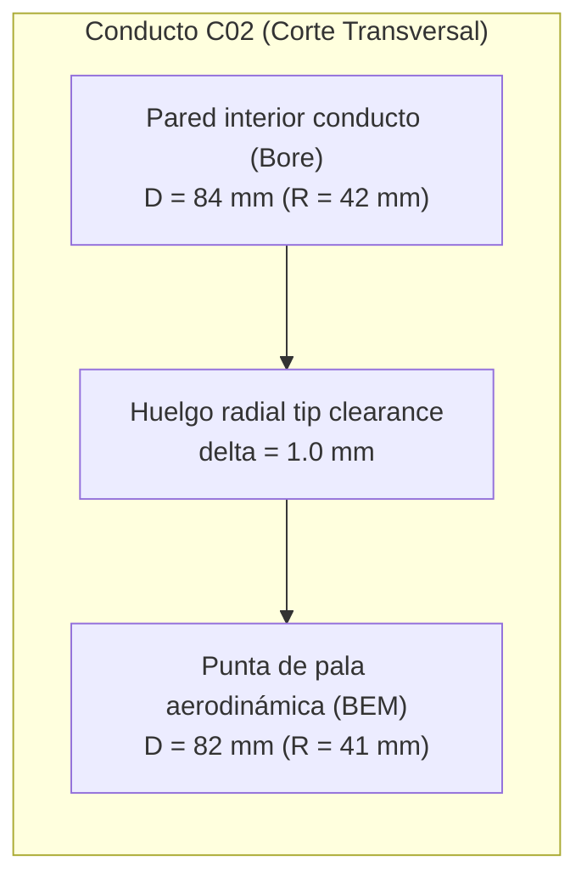

# INFORME TÉCNICO: ESCALADO GEOMÉTRICO SEMEJANTE (2 kg, 5 kg, 10 kg)
## Análisis Aerodinámico Condicional de Rotores Ideales Abiertos D82 vs D84

**Fecha de emisión:** 2026-11-08  
**Autor:** Antigravity (Entorno de Cálculo Automatizado Aislado)  
**Proyecto:** `investigacion-aeronautica` / Arquitectura `A_internal_fans`  
**Referencia de configuración:** `C02_CANDIDATA.json` (`C02_COMPACTA_x160_5kg_2026-11-03_r2`)  
**Línea base comparativa previa:** `REFERENCIA_DISCO.csv` (`ejecucion/G1`)  

---

## 1. Resumen Ejecutivo y Delimitación de Alcance

El presente estudio desarrolla una comparación matemática condicional para los tres objetivos de masa del proyecto (2 kg, 5 kg y 10 kg), aplicando la hipótesis de **semejanza geométrica isométrica** ($D \propto m^{1/3}$) a partir del rotor aerodinámico nominal **D82** ($D = 82\text{ mm}$, $R = 41\text{ mm}$) correspondiente a la configuración de referencia de 5 kg de `C02_CANDIDATA`. El modelo de evaluación aerodinámica emplea la **teoría clásica de cantidad de movimiento unidimensional** (Rankine-Froude) para cuatro discos actuadores abiertos ideales en atmósfera estándar ($\rho = 1.225\text{ kg/m}^3$, $g = 9.80665\text{ m/s}^2$).

### Delimitaciones críticas de alcance:
1. **NO es el diseño de las variantes de 2 kg ni de 10 kg:**  
   Este modelo constituye una proyección analítica abstracta. En los registros maestros del proyecto (`C02_CANDIDATA.json`), las variantes de 2 kg y 10 kg están expresamente catalogadas como `pending_own_configuration`. La masa de 5 kg corresponde a un candidato preliminar de integración CAD (`partial_CAD_candidate`), cuyos componentes críticos no han sido calificados (`rotor_motor_servo_and_cooling_qualified: false`).
2. **NO es una cota universal de un ventilador entubado:**  
   Un disco actuador abierto ideal no establece una cota inferior termodinámica o aerodinámica absoluta para un propulsor entubado (*ducted fan*). Teóricamente, un conducto difusor bien diseñado puede generar sustentación por succión en el labio y expandir la estela ($A_e > A_{\text{rotor}}$), requiriendo menor potencia inducida para un mismo empuje total. En contrapartida, un ventilador entubado real introduce pérdidas por huelgo de punta (*tip clearance*), bloqueo de buje, fricción superficial en paredes y arrastre de perfil en las palas, operando con potencias eléctricas reales sustancialmente superiores.

---

## 2. Clasificación Rigurosa de Datos

Para garantizar la trazabilidad de la ingeniería, se distingue explícitamente el origen de cada parámetro:

### 2.1. Datos Medidos y Parámetros Geométricos CAD (Nominales)
*Fuente:* `entradas/investigacion-aeronautica/configuraciones/C02_CANDIDATA.json`
- **Diámetro nominal de conducto / bore (`nominal_bore_diameter_m`):** $0.084\text{ m}$ ($84.0\text{ mm}$).
- **Radio BEM nominal de pala (`BEM_nominal_radius_m`):** $0.041\text{ m}$ $\rightarrow$ Diámetro aerodinámico del rotor **D82** = $0.082\text{ m}$ ($82.0\text{ mm}$).
- **Radio envolvente conservador de rotación (`full_rotation_conservative_enclosing_radius_m`):** $0.0415\text{ m}$ ($83.0\text{ mm}$).
- **Huelgo radial de punta de pala (cálculo de holgura nominal):**  
  $\delta_{\text{tip}} = R_{\text{bore}} - R_{\text{BEM}} = 0.042\text{ m} - 0.041\text{ m} = 0.001\text{ m}$ ($1.0\text{ mm}$).
- **Número de propulsores (`fan_reference.count`):** 4 ventiladores.
- **Centros de ventiladores en plano CAD (`centres_xy_m`):**  
  $(-0.16, -0.076)\text{ m}$, $(-0.16, +0.076)\text{ m}$, $(+0.16, -0.076)\text{ m}$, $(+0.16, +0.076)\text{ m}$.
- **Estado de calificación física:**  
  `actual_mass_kg: null`, `actual_CG_m: null`, `actual_inertia_kgm2: null`, `rotor_motor_servo_and_cooling_qualified: false`, `installed_map_available: false`.

### 2.2. Supuestos de Modelado Aerodinámico
*Fuente:* Definición normativa del estudio y constantes de `C02_CANDIDATA.json`.
- **Densidad del aire de referencia (`operating_reference.rho_kg_m3`):** $\rho = 1.225\text{ kg/m}^3$.
- **Aceleración gravitacional estándar (`operating_reference.g_m_s2`):** $g = 9.80665\text{ m/s}^2$.
- **Discos actuadores:** 4 discos abiertos independientes, aislados, sin interacción aerodinámica mutua, sin conducto circundante (*unshrouded*), sin buje central (*hubless* ideal).
- **Flujo:** Unidimensional, incompresible, cuasiestacionario, no viscoso, distribución uniforme de velocidad inducida, sin rotación residual en la estela (*zero swirl*), sin pérdidas de punta de pala (*tip loss factor* = 1.0).
- **Condición de estacionario (Hover):** Aceleración vertical neta $a = 0\text{ g}$, empuje total igual al peso $T = m \cdot g$.

### 2.3. Cálculos y Fórmulas de Escalado
- **Factor de escala geométrico lineal:**  
  $$\lambda_m = \left(\frac{m}{5.0\text{ kg}}\right)^{1/3}$$
- **Diámetro escalado del rotor:**  
  $$D(m) = D_5 \cdot \lambda_m$$
- **Área total de 4 rotores:**  
  $$A_{\text{tot}} = 4 \times \left(\frac{\pi D^2}{4}\right) = \pi D^2$$
- **Empuje requerido (con aceleración vertical neta $a$):**  
  $$T = m \cdot g \cdot (1 + a)$$
- **Velocidad inducida ideal en el disco (teoría de cantidad de movimiento):**  
  $$v_i = \sqrt{\frac{T}{2 \rho A_{\text{tot}}}}$$
- **Potencia inducida ideal:**  
  $$P_i = T \cdot v_i = \frac{T^{3/2}}{\sqrt{2 \rho A_{\text{tot}}}}$$
- **Carga de disco (*Disk Loading*):**  
  $$DL = \frac{T}{A_{\text{tot}}} = 2 \rho v_i^2$$
- **Carga de potencia (*Power Loading*):**  
  $$PL = \frac{T}{P_i} = \frac{1}{v_i}$$

---

## 3. Discrepancia de Base: D82 vs D84

En la referencia previa (`REFERENCIA_DISCO.csv`), el diámetro asignado a la condición de 5 kg fue **0.084 m** (84.0 mm). El origen y repercusión técnica de esta cifra se detallan a continuación:

### 3.1. Causa Raíz
- **D84 (0.084 m):** Es el diámetro interno del conducto (`nominal_bore_diameter_m`) en el modelo CAD de integración. El archivo `REFERENCIA_DISCO.csv` adoptó este diámetro asumiendo implícitamente que el disco actuador ocupaba la totalidad de la sección transversal del conducto sin holgura de punta.
- **D82 (0.082 m):** Es el diámetro aerodinámico real del rotor giratorio, correspondiente al radio de pala BEM nominal de 41 mm (`BEM_nominal_radius_m`). 
- **Holgura de diseño:** La diferencia geométrica de 2 mm en diámetro (1 mm radial) corresponde a la tolerancia de separación mecánica entre las puntas de las palas y la pared interna para prevenir roces por flexión aerodinámica o vibración.

### 3.2. Deducción Analítica de las Relaciones Exactas
Dado que ambas bases se escalan con la misma ley $D \propto m^{1/3}$, el cociente entre cualquier parámetro de la base D82 y la base D84 es **estrictamente idéntico y constante** para todas las masas (2 kg, 5 kg y 10 kg):

1. **Relación de diámetros:**  
   $$\frac{D_{82}}{D_{84}} = \frac{82}{84} = \frac{41}{42} \approx 0.976190 \quad (-2.3810\%)$$
2. **Relación de área de disco:**  
   $$\frac{A_{82}}{A_{84}} = \left(\frac{41}{42}\right)^2 = \frac{1681}{1764} \approx 0.952948 \quad (-4.7052\%)$$
3. **Relación de velocidad inducida (para igual empuje $T$):**  
   $$\frac{v_{i,82}}{v_{i,84}} = \sqrt{\frac{A_{84}}{A_{82}}} = \frac{42}{41} \approx 1.024390 \quad (+2.4390\%)$$
4. **Relación de potencia inducida ideal:**  
   $$\frac{P_{i,82}}{P_{i,84}} = \frac{v_{i,82}}{v_{i,84}} = \frac{42}{41} \approx 1.024390 \quad (+2.4390\%)$$
5. **Relación de carga de disco ($DL$):**  
   $$\frac{DL_{82}}{DL_{84}} = \left(\frac{42}{41}\right)^2 = \frac{1764}{1681} \approx 1.049375 \quad (+4.9375\%)$$

Al sustituir el diámetro de conducto (84 mm) por el diámetro aerodinámico del rotor (82 mm), **el área del disco útil se contrae en un 4.71%**, lo que exige que el chorro inducido sea **2.44% más veloz** y que la potencia inducida ideal crezca en un **2.44%**.

---

## 4. Resultados Matemáticos del Escalado Base D82

A continuación se presentan los resultados numéricos rigurosos del escalado de rotor D82 para las tres masas de interés en condición de estacionario puro ($a = 0\text{ g}$, $T = m \cdot g$).

### 4.1. Tabla Resumen en Estacionario Puro (Hover, 0 g netos)
*Condiciones:* $\rho = 1.225\text{ kg/m}^3$, $g = 9.80665\text{ m/s}^2$, $N = 4$ rotores abiertos ideales.

| Masa Objetivo (kg) | Factor Escala $\lambda_m$ | Diámetro Rotor (mm) | Diámetro Rotor (m) | Área Total $A_{\text{tot}}$ ($\text{cm}^2$) | Empuje Total $T$ (N) | Velocidad Inducida $v_i$ (m/s) | Potencia Ideal $P_i$ (W) | Carga Disco $DL$ ($\text{N/m}^2$) | Carga Potencia $PL$ (N/kW) |
|:---:|:---:|:---:|:---:|:---:|:---:|:---:|:---:|:---:|:---:|
| **2.0** | 0.736806 | **60.42** | 0.060418 | 114.68 | 19.613 | **26.42** | **518.20** | 1710.28 | 37.85 |
| **5.0** | 1.000000 | **82.00** | 0.082000 | 211.24 | 49.033 | **30.78** | **1509.26** | 2321.20 | 32.49 |
| **10.0** | 1.259921 | **103.31** | 0.103314 | 335.32 | 98.066 | **34.55** | **3388.18** | 2924.53 | 28.94 |

### 4.2. Comportamiento de las Leyes de Escala Analíticas
Bajo la hipótesis de semejanza isométrica ($D \propto m^{1/3}$):
- **Área total:** Crece como $m^{2/3}$. Al pasar de 2 a 5 kg aumenta un $+84.20\%$; de 5 a 10 kg aumenta un $+58.74\%$.
- **Carga de disco ($DL = T / A$):** Crece como $m / m^{2/3} = m^{1/3}$. Aumenta un $+35.72\%$ de 2 a 5 kg, y un $+25.99\%$ de 5 a 10 kg.
- **Velocidad inducida ($v_i$):** Crece como $m^{1/6}$. Aumenta un $+16.50\%$ de 2 a 5 kg, y un $+12.25\%$ de 5 a 10 kg.
- **Potencia inducida ideal ($P_i$):** Crece como $m^{7/6} \approx m^{1.1667}$ (superlineal). De 2 a 5 kg casi se triplica ($+191.25\%$, factor 2.91), y de 5 a 10 kg crece un $+124.49\%$ (factor 2.24).
- **Rendimiento específico ($PL$):** Se degrada como $m^{-1/6}$, cayendo de $37.85\text{ N/kW}$ a 2 kg hasta $28.94\text{ N/kW}$ a 10 kg.

---

## 5. Comparativa Detallada: Base D82 vs Base D84 (CSV Previo)

La siguiente tabla desglosa la comparación punto a punto entre la nueva base de rotor D82 y los datos registrados previamente en `REFERENCIA_DISCO.csv` (base D84), incluyendo los escenarios de maniobra vertical con aceleración positiva ($a = 0.5\text{ g}$ y $a = 1.0\text{ g}$).

| Masa (kg) | Acel. (g) | Empuje (N) | D82 (mm) | D84 (mm) | $\Delta D$ (%) | Área D82 ($\text{m}^2$) | Área D84 ($\text{m}^2$) | $\Delta A$ (%) | $v_i$ D82 (m/s) | $v_i$ D84 (m/s) | $\Delta v_i$ (%) | $P_i$ D82 (W) | $P_i$ D84 (W) | $\Delta P_i$ (W) | $\Delta P_i$ (%) |
|:---:|:---:|:---:|:---:|:---:|:---:|:---:|:---:|:---:|:---:|:---:|:---:|:---:|:---:|:---:|:---:|
| **2** | 0.0 | 19.613 | 60.42 | 61.89 | -2.38% | 0.011468 | 0.012034 | -4.71% | 26.42 | 25.79 | +2.44% | 518.20 | 505.87 | +12.34 | +2.44% |
| **2** | 0.5 | 29.420 | 60.42 | 61.89 | -2.38% | 0.011468 | 0.012034 | -4.71% | 32.36 | 31.59 | +2.44% | 952.00 | 929.34 | +22.67 | +2.44% |
| **2** | 1.0 | 39.227 | 60.42 | 61.89 | -2.38% | 0.011468 | 0.012034 | -4.71% | 37.37 | 36.48 | +2.44% | 1465.70 | 1430.80 | +34.90 | +2.44% |
| **5** | 0.0 | 49.033 | 82.00 | 84.00 | -2.38% | 0.021124 | 0.022167 | -4.71% | 30.78 | 30.05 | +2.44% | 1509.26 | 1473.33 | +35.93 | +2.44% |
| **5** | 0.5 | 73.550 | 82.00 | 84.00 | -2.38% | 0.021124 | 0.022167 | -4.71% | 37.70 | 36.80 | +2.44% | 2772.69 | 2706.67 | +66.02 | +2.44% |
| **5** | 1.0 | 98.066 | 82.00 | 84.00 | -2.38% | 0.021124 | 0.022167 | -4.71% | 43.53 | 42.49 | +2.44% | 4268.83 | 4167.19 | +101.64 | +2.44% |
| **10** | 0.0 | 98.066 | 103.31 | 105.83 | -2.38% | 0.033532 | 0.035188 | -4.71% | 34.55 | 33.73 | +2.44% | 3388.18 | 3307.50 | +80.67 | +2.44% |
| **10** | 0.5 | 147.100 | 103.31 | 105.83 | -2.38% | 0.033532 | 0.035188 | -4.71% | 42.31 | 41.31 | +2.44% | 6224.48 | 6076.27 | +148.20 | +2.44% |
| **10** | 1.0 | 196.133 | 103.31 | 105.83 | -2.38% | 0.033532 | 0.035188 | -4.71% | 48.86 | 47.70 | +2.44% | 9583.21 | 9355.03 | +228.17 | +2.44% |

En todos los casos, el incremento sistemático de potencia inducida es de **+2.44%**, representando una diferencia absoluta en estacionario de $+12.34\text{ W}$ para 2 kg, $+35.93\text{ W}$ para 5 kg y $+80.67\text{ W}$ para 10 kg.

---

## 6. Separación Estricta: Modelo Matemático vs Diseño Físico Real

Es un principio de ingeniería aeronáutica fundamental no confundir un escalado matemático idealizado con la arquitectura física de un vehículo no tripulado.

### 6.1. Por qué este escalado NO representa el diseño de las variantes
1. **Estado de madurez en el árbol de configuración (`C02_CANDIDATA.json`):**  
   Las variantes de 2 kg y 10 kg no cuentan con geometría CAD, distribución de masa ni subsistemas validados (`variants: {"2": "pending_own_configuration", "10": "pending_own_configuration"}`). No existen modelos tridimensionales ni asignaciones de componentes para dichas escalas.
2. **Las masas objetivo no son masas reales:**  
   El propio campo maestro declara `mass_targets_are_actual_masses: false`. Se trata de puntos de diseño contractuales o metas de requisitos, no de masas físicas pesadas ni auditadas.
3. **Violación de la semejanza isométrica estricta en subsistemas reales:**
   - **Espesor de pared y manufactura:** Si la geometría exterior escalara con $m^{1/3}$, los espesores de los conductos de carbono o termoplásticos deberían reducirse en un $26.3\%$ para 2 kg. En la práctica, las tecnologías de laminado o manufactura aditiva tienen espesores mínimos de pared (*minimum gauge*, 0.8 mm - 1.2 mm), lo que incrementa desproporcionadamente la fracción estructural en vehículos pequeños.
   - **Aviónica y cargas de pago fijas:** Los ordenadores de vuelo, receptores, cableado e IMU no reducen su masa a escala cúbica ($m_{\text{avionica}} \approx \text{constante}$). En 2 kg, la electrónica absorbe un porcentaje de masa útil mucho más severo que en 10 kg.
   - **Cinemática y accionamientos:** El mecanismo de apertura de tapas (`door_motion: conceptual lift10mm/rotate110deg`) y los álaves directrices (`actuator_kinematics: -45 a +45 deg`) requieren pares de servomotores que no escalan linealmente debido a fuerzas aerodinámicas y restricciones de espacio de empaquetamiento.
   - **Disipación térmica y motores eléctricos:** En motores brushless pequeños, la densidad de par y la eficiencia electromagnética decaen debido a mayor resistencia por espira y menor factor de llenado de ranura.

### 6.2. Por qué el disco abierto ideal NO es una cota universal de un ventilador entubado
El disco actuador ideal abierto no delimita de manera universal el rendimiento de un ventilador entubado por dos razones físicas contrapuestas:

#### A. Efecto aerodinámico favorable del conducto (Aumento de empuje)
La teoría de cantidad de movimiento para ventiladores entubados demuestra que un conducto con labio curvado y difusor posterior genera una fuerza aerodinámica de succión neta ($T_{\text{duct}}$). El empuje total es compartido entre rotor y conducto:
$$T_{\text{total}} = T_{\text{rotor}} + T_{\text{duct}} = \frac{T_{\text{rotor}}}{1 - \sigma_d}$$
donde $\sigma_d = T_{\text{duct}} / T_{\text{total}}$ es la fracción de empuje del conducto (habitualmente entre $0.3$ y $0.5$ en hover).  
Si el conducto expande el área de salida de la estela ($A_e > A_{\text{rotor}}$), la velocidad inducida final se reduce, de modo que la potencia inducida teórica requerida para generar $T_{\text{total}}$ puede ser **inferior** a la de un disco abierto con el mismo diámetro de rotor:
$$P_{i,\text{entubado}} = \frac{T_{\text{total}}^{3/2}}{\sqrt{2 \rho A_e}} < \frac{T_{\text{total}}^{3/2}}{\sqrt{2 \rho A_{\text{rotor}}}} = P_{i,\text{disco\_abierto}}$$
Por consiguiente, el disco abierto **no representa una cota inferior termodinámica infranqueable**.

#### B. Pérdidas instaladas y penalizaciones en propulsores reales
En un ventilador entubado real, operan fenómenos disipativos complejos que hacen que la **potencia eléctrica real consumida** sea típicamente entre **1.8 y 2.5 veces superior** a la potencia ideal calculada:
1. **Pérdidas de punta (*Tip Clearance Losses*):** El huelgo radial de 1 mm ($\approx 2.4\%$ del radio de pala) induce vórtices de fuga de punta que destruyen el gradiente de presión en las puntas y aumentan las pérdidas por fricción.
2. **Bloqueo del buje (*Hub Blockage*):** El motor central y la góndola reducen el área de paso efectiva en un 15% - 25%, acelerando localmente el flujo y aumentando la velocidad requerida.
3. **Arrastre de perfil de pala (*Blade Profile Drag*):** Pérdidas viscosas en los perfiles alares de las palas girando a alta velocidad angular. La Figura de Mérito aerodinámica suele situarse en $FM = P_i / P_{\text{eje}} \approx 0.55 - 0.70$.
4. **Pérdidas por remolino (*Swirl Losses*):** Energía cinética angular no recuperada por los estatores.
5. **Rendimiento electromecánico:** Rendimiento del motor $\eta_{\text{motor}} \approx 80\% - 85\%$ y del controlador ESC $\eta_{\text{ESC}} \approx 95\%$.

*Estimación de potencia eléctrica en hover para 5 kg (D82):*
$$P_{\text{eléctrica, real}} \approx \frac{P_{i,\text{ideal}}}{FM \cdot \eta_{\text{motor}} \cdot \eta_{\text{ESC}}} \approx \frac{1509\text{ W}}{0.60 \times 0.83 \times 0.95} \approx 3190\text{ W}$$
(Consumo de aproximadamente $800\text{ W}$ por ventilador, frente a los $377\text{ W}$ ideales por rotor).

---

## 7. Verificación Numérica y Suite de Pruebas

Para garantizar la reproducibilidad y robustez de los cálculos, se ejecutó una batería de 8 pruebas unitarias automatizadas (`salidas/test_escalado.py`), cuyos resultados fueron registrados en `salidas/pruebas_ejecutadas.log`.

### Resumen de Pruebas Realizadas:
1. **`test_01_reference_reproduction_d84`:** Comprobó la reproducción idéntica de las 9 filas de `REFERENCIA_DISCO.csv` para la base D84 con error relativo inferior a $10^{-9}$.
2. **`test_02_geometric_similarity_diameter`:** Verificó el cumplimiento exacto de $D(m) = D_5 \cdot (m/5)^{1/3}$ para $m \in \{2, 5, 10\}$ kg.
3. **`test_03_geometric_similarity_area`:** Comprobó que el área total escala como $A_{\text{tot}}(m) = A_5 \cdot (m/5)^{2/3}$ y que $A_{\text{tot}} = \pi D^2$ para 4 discos.
4. **`test_04_momentum_theory_induced_velocity_scaling`:** Verificó que la velocidad inducida escala con el exponente $m^{1/6}$.
5. **`test_05_momentum_theory_power_scaling`:** Verificó que la potencia inducida en hover escala estrictamente con el exponente $m^{7/6}$.
6. **`test_06_d82_vs_d84_exact_analytical_relations`:** Validó las proporciones analíticas $D_{82}/D_{84} = 41/42$, $A_{82}/A_{84} = (41/42)^2$, y $P_{82}/P_{84} = 42/41$ en todas las filas.
7. **`test_07_physical_governing_equations`:** Verificó las ecuaciones fundamentales de conservación de cantidad de movimiento ($T = 2 \rho A v_i^2$, $P_i = T v_i$, $P_i = T^{3/2}/\sqrt{2 \rho A}$).
8. **`test_08_deliverable_files_integrity`:** Validó la existencia física, formato CSV/MD, legibilidad y ausencia de valores nulos o corruptos en los entregables.

**Resultado de la ejecución:** 8 tests superados exitosamente (`Ran 8 tests in 0.002s - OK`).

---

## 8. Limitaciones del Estudio

1. **Ausencia de efectos de compresibilidad y Reynolds:** A pesar de que las velocidades inducidas son moderadas ($26 - 35\text{ m/s}$), las velocidades tangenciales en punta de pala ($U_{\text{tip}} = \Omega R$) pueden alcanzar números de Mach locales elevados ($M > 0.4$), donde la compresibilidad y el número de Reynolds alteran el arrastre de perfil.
2. **Interferencia aerodinámica entre conductos adyacentes:** El modelo asume 4 discos actuadores aislados. En la plataforma real, los ventiladores están emparejados a una distancia entre centros de $152\text{ mm}$ lateralmente y $320\text{ mm}$ longitudinalmente, lo que puede generar interferencias aerodinámicas e interacciones con el cuerpo fuselado.
3. **Inexistencia de ensayos experimentales:** Los datos se fundamentan en un modelo analítico preliminar; no se cuenta con datos de banco dinamométrico ni túnel de viento para la hélice de 82 mm dentro del conducto de 84 mm.

---

## 9. Inventario de Entregables Generados

Todos los entregables han sido generados de forma autónoma en el directorio asignado `salidas/`:
- `salidas/escalado_geometrico.py`: Script de cálculo de escalado, exportación y comparativa analítica.
- `salidas/test_escalado.py`: Suite de pruebas unitarias y verificación matemática.
- `salidas/pruebas_ejecutadas.log`: Registro completo de la ejecución y verificación de pruebas.
- `salidas/TABLA_ESCALADO_D82.csv`: Tabla de resultados para la base D82 con el esquema de campos estándar.
- `salidas/COMPARATIVA_D82_VS_D84.csv`: Tabla comparativa exhaustiva D82 vs D84 para 2, 5 y 10 kg (0g, 0.5g, 1.0g).
- `salidas/TABLA_ESTACIONARIO_COMPARADA.md`: Tabla en formato Markdown para consulta rápida en hover.
- `salidas/INFORME_ESCALADO_2_5_10.md`: Este informe técnico completo y detallado.
