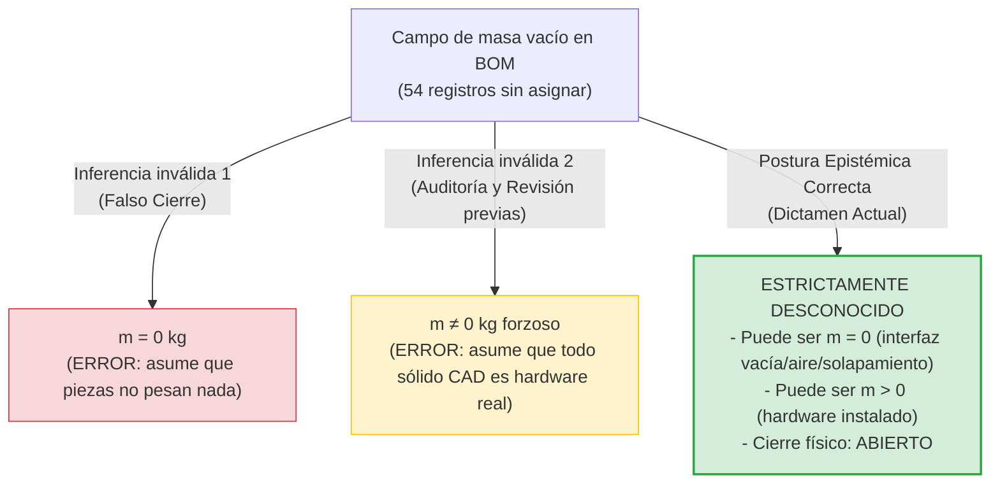

# DICTAMEN TÉCNICO DE AUDITORÍA: REVISIÓN CRÍTICA DE LA INCERTIDUMBRE DE MASA EN LA BOM PARCIAL C02

**Fecha de emisión:** 8 de noviembre de 2026  
**Área de competencia:** Aseguramiento de Calidad y Auditoría Computacional de Datos Aeronáuticos (Grupo de Trabajo G3)  
**Configuración auditada:** C02 — Integración de módulos internos compactos ($x = \pm 160\text{ mm}$, $y = \pm 76\text{ mm}$)  
**Contexto de ejecución:** Entorno aislado autónomo, Python 3 estándar, sandbox sin red ni MCP  

### Trazabilidad Criptográfica de Referencias Maestras Inspeccionadas (Solo Lectura):
| Archivo de Referencia | Ubicación Relativa en `entradas/` | Hash SHA-256 Maestro |
|---|---|---|
| `INFORME_AUDITORIA_BOM.md` | `entradas/investigacion-aeronautica/integracion_antigravity/sesiones_aisladas/20261108T032826Z_13ced8ae/auditoria_bom/salidas/INFORME_AUDITORIA_BOM.md` | `9bd05035bb299ea4c8a1bc5a77c90407e2ca8507d8d197ae850b2a8a49e31795` |
| `REVISION.md` | `entradas/investigacion-aeronautica/integracion_antigravity/sesiones_aisladas/20261108T034228Z_e90078d2/revisar_bom/salidas/REVISION.md` | `24b81ff5c31a1d6f453a4e30efb11a53bd264bba79db430b5b2a841165601d95` |
| `BOM_GEOMETRICA_PARCIAL.csv` | `entradas/investigacion-aeronautica/ejecucion/G3/C02/integracion_x160/BOM_GEOMETRICA_PARCIAL.csv` | `36f5b043aed553d7484421bb45f9aa0e19c64d6989141d587f1fb4d1f0e9840b` |
| `MASA_INERCIA_PARCIAL.json` | `entradas/investigacion-aeronautica/ejecucion/G3/C02/integracion_x160/MASA_INERCIA_PARCIAL.json` | `4b8df67e7161d2eed06bb21e97973f966a9ee34648a9f73661e915cf41be18f6` |

---

## 1. Resumen Ejecutivo y Veredicto del Dictamen

El presente dictamen técnico emite una revisión crítica formal sobre el `INFORME_AUDITORIA_BOM.md` inicial y su posterior `REVISION.md`. Ambos documentos concluyeron de manera categórica que los **54 registros sin masa asignada** en la Lista de Materiales (BOM) geométrica de la configuración C02 poseen forzosamente masa física no nula ($m \neq 0\text{ kg}$), calificando dicha afirmación como una *"regla crítica/estricta de no nulidad"*.

### Veredicto Técnico:
1. **Falta de sustento fáctico en las fuentes:** Las fuentes de referencia primarias (`BOM_GEOMETRICA_PARCIAL.csv` y `MASA_INERCIA_PARCIAL.json`) **NO permiten afirmar que los 54 registros tengan masa física no nula ($m \neq 0$)**. En las referencias maestras, las 54 filas presentan los campos `assigned_mass_mixta_kg`, `rho_mixta_ASSUMED_kg_m3`, `actual_mass_kg` y `actual_material` estrictamente vacíos, y el indicador `actual_hardware_qualified` en `False`.
2. **Corrección epistémica fundamental:** En estricto aseguramiento de datos aeronáuticos y conforme a las directrices de integridad técnica, **la ausencia de asignación de masa no autoriza a inferir masa nula ($m = 0$), pero tampoco autoriza a inferir masa no nula ($m \neq 0$)**. El estado riguroso de cada uno de los 54 registros es **ESTRICTAMENTE DESCONOCIDO (UNKNOWN)**.
3. **Existencia demostrable de reservas volumétricas con masa real potencialmente nula:**
   - El elemento con mayor volumen de toda la BOM no asignada, `canal_axial_60_exterior_56_interior` ($V = 291.539,80\text{ mm}^3$, el **$79,02\%$ del volumen sin asignar** y el **$14,58\%$ del volumen total del vehículo**), está clasificado explícitamente en el ámbito `empty_axial_packaging_interface_not_propulsor` y rol `unknown_hardware_or_empty_interface`. Se trata de una interfaz de empaquetamiento vacía (paso cilíndrico/conducto hueco). Si dicho canal permanece como un hueco de paso o vano de aire en la aeronave construida, su masa material agregada es **cero ($m = 0$)**.
   - La `interfaz_posterior_reservada` ($V = 1.507,96\text{ mm}^3$) es una reserva de apertura para tobera no dimensionada que, de no poblarse con hardware físico, tampoco aporta masa material.
   - Los 4 cojinetes y 4 actuadores de cola son sobres volumétricos (`envelope`, `package`) que delimitan límites espaciales (keep-out zones), no materiales continuos.
   - La nota técnica de `MASA_INERCIA_PARCIAL.json` advierte: *"Gross nominal part volumes; unresolved legacy joints may share material"*. Atribuir masa física a las reservas internas modulares sin resolver el solapamiento con la estructura circundante introduciría duplicaciones ilegítimas de masa.
4. **Reconciliación de datos válidos:** Las sumas de masa asignada ($2,783990\text{ kg}$ bajo hipótesis mixta), remanente de diseño ($1,466010\text{ kg}$ para objetivo de $5,0\text{ kg}$ con reserva de $0,75\text{ kg}$) y Centro de Gravedad nominal coinciden numéricamente al límite de precisión IEEE-754 contra el JSON, pero reflejan exclusivamente los **262 registros asignados**, permaneciendo el modelo físico global abierto (`physical_mass_CG_and_inertia_closed: false`).

---

## 2. Análisis Crítico: Desmontaje de la Hipótesis Dogmática de No Nulidad ($m \neq 0$)

### 2.1. Las Aseveraciones de los Informes Previos
Tanto el informe original como su revisión elevaron una inferencia metodológica a dogma físico irrefutable:
- **`INFORME_AUDITORIA_BOM.md` (Sección 1.3 y 4.2):**
  > *"Regla crítica de no nulidad: Estas filas corresponden a reservas volumétricas para motores, servomotores, apoyos, cojinetes, conducto axial e interfaces propulsivas cuyo hardware no ha sido seleccionado ni calificado. Bajo ningún concepto deben tratarse como masa física cero ($m \neq 0\text{ kg}$)... Reserva de hardware interno C02 ($m \neq 0$)... Reserva vehicular/interfaz ($m \neq 0$)"*
- **`REVISION.md` (Sección 1.3 y 6.2):**
  > *"Regla estricta de no nulidad: Ninguna de estas reservas ha sido convertida a cero (0,0 kg)... Asignarles masa cero constituiría una grave infracción física... Demostración: Por qué NUNCA deben tratarse como masa física cero ($m \neq 0$)"*

### 2.2. Falacia del Falso Dilema y Confusión Metodológica
Ambos informes confundieron dos conceptos categorialmente distintos:
1. **La salvaguarda de procesamiento de datos:** En scripts de balance de masa y en bases de datos, no se deben reemplazar las celdas vacías (`NaN` o `None`) por `0.0` para computar una sumatoria total, ya que ello provocaría un falso cierre contable de la masa vehicular (`physical_mass_closed = true`). Esta advertencia es técnicamente correcta como control de calidad de software.
2. **La afirmación fáctica de realidad física:** Afirmar que *"todos y cada uno de los 54 registros representan hardware físico con masa no nula ($m \neq 0$)"* es un salto inductivo falaz. Concluir que, al no poder tratarse como cero en el código, cada sólido representa necesariamente masa material real en el aparato final viola la lógica formal y los datos disponibles.

### 2.3. Por qué las Fuentes NO Permiten Afirmar $m \neq 0$

Las evidencias contenidas en las fuentes primarias desmienten la atribución forzosa de no nulidad:

1. **La presencia explícita de "Interfaces Vacías" (`empty_interface`):**
   - El registro `canal_axial_60_exterior_56_interior` ($V = 291.539,80\text{ mm}^3$) tiene como ámbito `empty_axial_packaging_interface_not_propulsor` y como rol `unknown_hardware_or_empty_interface`.
   - La propia definición de la variable en el CAD indica que se trata de un canal o túnel cilíndrico de paso axial (OD 60 mm, ID 56 mm) que no constituye un propulsor.
   - Si este volumen corresponde a un túnel pasante o vano hueco a través del cual circula aire o se encamina cableado sin un cuerpo estructural macizo propio (más allá del fuselaje ya contabilizado), su masa física adicional es **cero ($m = 0$)**. Afirmar taxativamente que este sólido tiene masa $m \neq 0$ implicaría atribuir masa física material al aire o a un espacio vacío.
   - De igual modo, `interfaz_posterior_reservada` ($V = 1.507,96\text{ mm}^3$) corresponde a `rear_interface_not_sized_nozzle`. Si el vehículo no incorpora una tobera posterior física (por ser un diseño de propulsión puramente modular mediante los 4 rotores C02), este orificio o interfaz permanecerá vacío, aportando $0\text{ kg}$.

2. **La naturaleza abstracta de los Sobres Geométricos (`envelopes`):**
   - Los registros `cojinete_0..3` están agrupados en `bearing_envelope_not_selected_hardware` ($4 \times 567,37\text{ mm}^3$).
   - Los registros `actuador_reserva_0..3` están agrupados en `direct_drive_actuator_package_unselected` ($4 \times 5.280,00\text{ mm}^3$).
   - En ingeniería aeronáutica y modelado CAD, un *envelope* (sobre volumétrico) es un cuerpo geométrico de exclusión o contorno preliminar. No es una pieza física. Cuando se seleccione el actuador o el cojinete comercial definitivo, este se adquirirá por catálogo con su propia masa y factor de forma, la cual no guardará correlación matemática directa con el volumen del sobre multiplicador por una densidad arbitraria. Si la arquitectura se sustituye por varillaje central o superficies pasivas, el sobre simplemente se descarta (masa adicional nula).

3. **Solapamiento volumétrico de uniones legadas (*material sharing*):**
   - El archivo `MASA_INERCIA_PARCIAL.json` contiene una advertencia oficial en el campo `note`:
     > *"Gross nominal part volumes; unresolved legacy joints may share material. Partial CG/inertia excludes hardware and energy and must not drive a physical flight simulator."*
   - En un modelo geométrico en evolución (C02), los sólidos nominales de reserva para motores (`reserva_motor_anular`), apoyos (`reserva_apoyo_motor`) y servomotores comparten espacio geométrico con las piezas adyacentes (`camisa_cuna_y_soportes`, cuadernas estructurales o paredes de los compartimentos) que **ya tienen densidad y masa asignada** en los 262 registros restantes.
   - Si se obligara a que cada uno de los 44 sólidos modulares tenga masa física no nula independiente calculada sobre su volumen bruto nominal, se estaría incurriendo en una **duplicación ilegítima de masa** (doble contabilidad de volumen en las uniones).

4. **Ausencia absoluta de datos empíricos:**
   - La columna `actual_mass_kg` en `BOM_GEOMETRICA_PARCIAL.csv` está vacía en los 316 registros ($0/316$).
   - La columna `actual_material` está vacía en los 316 registros ($0/316$).
   - La columna `actual_hardware_qualified` es `False` en los 316 registros ($316/316$).
   - Por tanto, no existe ni una sola pesada real, ni un ensayo en banco, ni una especificación de compra firmada que avale propiedades físicas de dichos componentes.

---

## 3. Recuentos Verificables de la BOM Parcial C02

Se presenta a continuación el censo consolidado y auditado matemáticamente de la BOM geométrica:

### 3.1. Balance Global de Registros y Volúmenes
| Métrica | Registros | % Registros | Volumen Geométrico ($\text{mm}^3$) | Volumen ($\text{dm}^3$) | % Volumen Total | Masa Asignada ($\text{kg}$) | Estado Físico |
|---|---:|---:|---:|---:|---:|---:|---|
| **Registros con Masa Asignada** | 262 | 82,91% | 1.630.696,689 | 1,6307 | 81,55% | 2,783990 | Asignada por hipótesis paramétrica |
| **Registros sin Masa Asignada** | 54 | 17,09% | 368.938,426 | 0,3689 | 18,45% | *Sin asignar* | **Estrictamente DESCONOCIDO** |
| **TOTAL BOM VEHICULAR** | **316** | **100,00%** | **1.999.635,116** | **1,9996** | **100,00%** | **2,783990** | **Modelo abierto inercialmente** |

---

### 3.2. Desglose de los 54 Registros Sin Masa por Ámbito (`scope`)
| Ámbito de Modelado (`scope`) | Reg. | Vol. Total ($\text{mm}^3$) | Vol. Total ($\text{cm}^3$) | % Vol. Sin Asig. | % Vol. Total Vehículo | Rol Asignado |
|---|---:|---:|---:|---:|---:|---|
| `empty_axial_packaging_interface_not_propulsor` | 1 | 291.539,80 | 291,54 | 79,02% | 14,58% | `unknown_hardware_or_empty_interface` |
| `new_C02_geometry_unqualified` | 44 | 52.501,18 | 52,50 | 14,23% | 2,63% | `unknown_device_or_interface` |
| `direct_drive_actuator_package_unselected` | 4 | 21.120,00 | 21,12 | 5,72% | 1,06% | `unknown_hardware_or_empty_interface` |
| `bearing_envelope_not_selected_hardware` | 4 | 2.269,49 | 2,27 | 0,62% | 0,11% | `unknown_hardware_or_empty_interface` |
| `rear_interface_not_sized_nozzle` | 1 | 1.507,96 | 1,51 | 0,41% | 0,08% | `unknown_hardware_or_empty_interface` |
| **TOTAL SIN ASIGNAR** | **54** | **368.938,43** | **368,94** | **100,00%** | **18,45%** | **2 roles funcionales** |

---

### 3.3. Desglose de los 54 Registros Sin Masa por Rol Asumido (`assumed_role`)
| Rol Asumido (`assumed_role`) | Reg. | Vol. Total ($\text{mm}^3$) | % Vol. Sin Asig. | % Vol. Total Vehículo | Condición Técnica Verificada |
|---|---:|---:|---:|---:|---|
| `unknown_hardware_or_empty_interface` | 10 | 316.437,25 | 85,77% | 15,82% | Interfaz/Sobre vehicular no cerrado (potencialmente $m=0$ o $m>0$) |
| `unknown_device_or_interface` | 44 | 52.501,18 | 14,23% | 2,63% | Reservas internas modulares C02 (hardware no seleccionado/solapamiento) |
| **TOTAL** | **54** | **368.938,43** | **100,00%** | **18,45%** | **Masa real indeterminada en fuentes** |

---

### 3.4. Censo Detallado por Tipología de Componente (54 Registros)
La siguiente tabla agrupa los 54 registros por tipo de componente físico o geométrico, aportando recuentos precisos, volúmenes y la evaluación epistémica de su condición material:

| Tipología de Componente | Cant. | Vol. Unitario ($\text{mm}^3$) | Vol. Total ($\text{mm}^3$) | % Vol. Sin Asignar | Centroide CAD Nominal $(X, Y, Z)\text{ [m]}$ | Ámbito (`scope`) y Rol (`assumed_role`) | Análisis Epistémico de Realidad Física |
|---|---:|---:|---:|---:|---|---|---|
| **Canal axial OD60/ID56** (`canal_axial_60_exterior_56_interior`) | 1 | 291.539,80 | 291.539,80 | 79,02% | $(0,0000, 0,0000, 0,0000)$ | `empty_axial_packaging_interface_not_propulsor` / `unknown_hardware_or_empty_interface` | **Interfaz axial vacía:** Representa un hueco de paso cilíndrico central. Si opera como túnel de paso de aire o bahía de cables sin camisa densa propia, su masa agregada es **cero ($m = 0$)**. Si se densifica, aportará masa ($m > 0$). Las fuentes no definen qué ocurrirá. |
| **Reserva Servomotor** (`modulo_C02_*_reserva_servo_*`) | 16 | 1.920,00 | 30.720,00 | 8,33% | $X \approx \pm 0,16\text{ a }\pm 0,23$, $Y \approx \pm 0,01\text{ a }\pm 0,08$, $Z \approx \pm 0,02\text{ a }\pm 0,04$ | `new_C02_geometry_unqualified` / `unknown_device_or_interface` | **Reserva de servomotor modular:** 4 unidades por módulo (2 en X, 2 en Y). Corresponden al volumen de servo para cambio de paso de álabes. Hardware comercial no calificado; volumen nominal sujeto a solapamiento con soportes. |
| **Actuador Reserva Cola** (`actuador_reserva_0..3`) | 4 | 5.280,00 | 21.120,00 | 5,72% | $(+0,5550, \pm 0,0559, \pm 0,0559)$ | `direct_drive_actuator_package_unselected` / `unknown_hardware_or_empty_interface` | **Sobre geométrico de actuador de aleta:** Envolvente de accionamiento directo en popa. El actuador real tendrá masa de catálogo no correlacionada con el sobre CAD; si la timonería se centraliza, el paquete queda vacío ($m=0$). |
| **Reserva Motor Anular** (`modulo_C02_*_reserva_motor_anular`) | 4 | 4.985,13 | 19.940,52 | 5,40% | $(\pm 0,1600, \pm 0,0760, -0,0028)$ | `new_C02_geometry_unqualified` / `unknown_device_or_interface` | **Reserva de motor de rotor:** Espacio cilíndrico asignado al motor eléctrico rotativo de cada módulo. Requiere motor BLDC real; masa no determinada en datos actuales. |
| **Cojinete Aleta Móvil** (`cojinete_0..3`) | 4 | 567,37 | 2.269,49 | 0,62% | $(+0,5550, \pm 0,0668, \pm 0,0668)$ | `bearing_envelope_not_selected_hardware` / `unknown_hardware_or_empty_interface` | **Sobre geométrico de rodamiento:** Envolvente de apoyo para el eje de aleta. Componente estándar no seleccionado. Puede integrarse en bujes ya cubiertos por la BOM ($m=0$ adicional) o requerir rodamientos dedicados ($m>0$). |
| **Reserva Apoyo Motor** (`modulo_C02_*_reserva_apoyo_motor_0..1`) | 8 | 202,94 | 1.623,51 | 0,44% | $(\pm 0,1600, \pm 0,0760, -0,0078\text{ y }+0,0030)$ | `new_C02_geometry_unqualified` / `unknown_device_or_interface` | **Reserva de apoyo mecánico:** 2 apoyos por módulo. Geometría provisional de sujeción que puede fundirse con la cuna estructural principal. |
| **Interfaz Posterior** (`interfaz_posterior_reservada`) | 1 | 1.507,96 | 1.507,96 | 0,41% | $(+0,6585, 0,0000, 0,0000)$ | `rear_interface_not_sized_nozzle` / `unknown_hardware_or_empty_interface` | **Reserva de tobera no dimensionada:** Orificio/interfaz posterior. Si no se instala tobera activa, constituye un hueco de salida sin masa propia ($m = 0$). |
| **Reserva Eje Salida Servo** (`modulo_C02_*_reserva_eje_salida_servo_*`) | 16 | 13,57 | 217,15 | 0,06% | $X \approx \pm 0,16\text{ a }\pm 0,22$, $Y \approx \pm 0,02\text{ a }\pm 0,08$, $Z \approx \pm 0,02\text{ a }\pm 0,04$ | `new_C02_geometry_unqualified` / `unknown_device_or_interface` | **Reserva cinemática de acoplamiento:** Salidas mecánicas de servos hacia varillas de ciclo. Volumen nominal minúsculo susceptible de solapamiento geométrico. |
| **TOTALES CONSOLIDADOS** | **54** | — | **368.938,43** | **100,00%** | — | — | **54 registros con masa estrictamente DESCONOCIDA** |

> [!IMPORTANT]
> El inventario fila a fila con coordenadas individuales, indicadores booleanos de calificación y descriptores epistémicos ha sido generado de manera exhaustiva y reproducible en `salidas/censo_54_reservas.csv`.

---

## 4. Reconciliación Numérica de Datos Asignados (Lo Verificado y Reconciliado)

La auditoría certifica que la parte cerrada numéricamente de la BOM (los 262 registros asignados) concuerda de forma exacta entre el archivo `BOM_GEOMETRICA_PARCIAL.csv` y el archivo `MASA_INERCIA_PARCIAL.json` en las tres hipótesis exploradas:

### 4.1. Balance Presupuestario de Masas frente a Objetivo de 5,0 kg
| Hipótesis | Densidad Dominante | Masa Asignada CSV ($\text{kg}$) | Masa Asignada JSON ($\text{kg}$) | Discrepancia Absoluta ($\text{kg}$) | Reserva Provisional ($\text{kg}$) | Remanente para Energía y Reservas ($\text{kg}$) | Diagnóstico Presupuestario |
|---|---|---:|---:|---:|---:|---:|---|
| **`ligera_1200`** | Polímeros $\rho = 1200\text{ kg/m}^3$ | 2,045840504993600 | 2,045840504993601 | $4,44\times 10^{-16}$ | 0,750 | +2,204159495006400 | Presupuesto holgado ($+2,204\text{ kg}$) |
| **`mixta_1600`** | Mixta $\rho = 1600\text{ kg/m}^3$ | 2,783989739397547 | 2,783989739397547 | $0,00\times 10^{0}$ | 0,750 | +1,466010260602453 | Presupuesto nominal viable ($+1,466\text{ kg}$) |
| **`aluminio_2700`** | Aluminio $\rho = 2700\text{ kg/m}^3$ | 4,421342235936211 | 4,421342235936211 | $0,00\times 10^{0}$ | 0,750 | **-0,171342235936211** | **DÉFICIT ESTRUCTURAL ($-171,34\text{ g}$)** |

### 4.2. Reconciliación del Centro de Gravedad Nominal (Hipótesis Mixta)
El cálculo baricéntrico sobre las 262 filas asignadas $\mathbf{r}_{CG} = \frac{\sum m_i \mathbf{r}_i}{\sum m_i}$ arroja coincidencia exacta frente al JSON:
- **Eje X (CAD):** Calculado $= +0,093056473169\text{ m}$ | Declarado $= +0,093056473169\text{ m}$ ($\Delta = 0,00\text{ m}$)
- **Eje Y (CAD):** Calculado $= -1,0475227127\times 10^{-9}\text{ m}$ | Declarado $= -1,0475227127\times 10^{-9}\text{ m}$ ($\Delta = 0,00\text{ m}$)
- **Eje Z (CAD):** Calculado $= +0,005508274507\text{ m}$ | Declarado $= +0,005508274507\text{ m}$ ($\Delta = 0,00\text{ m}$)

**Transformación de Coordenadas CAD a FLU (Forward, Left, Up):**
Conforme a las convenciones aeroespaciales ($X_{FLU} = -X_{CAD}, Y_{FLU} = -Y_{CAD}, Z_{FLU} = +Z_{CAD}$), el CG en coordenadas de mecánica de vuelo es exactamente:
$$\mathbf{r}_{CG, FLU} = \left[-0,093056473169\text{ m}, \ +1,0475227127\times 10^{-9}\text{ m}, \ +0,005508274507\text{ m}\right]$$
con discrepancia nula frente a `partial_assigned_CG_FLU_m` en el JSON.

---

## 5. Matriz de Clasificación Epistémica de Datos Aeronáuticos

En cumplimiento estricto del aseguramiento de datos aeronáuticos, las magnitudes se clasifican preservando unidades, fuentes primarias y grado de certidumbre:

| Categoría Epistémica | Descripción Metodológica | Variables y Magnitudes | Unidades | Fuentes Primarias | Grado de Certidumbre |
|---|---|---|:---:|---|---|
| **Datos Medidos / Geometría Nominal** | Integraciones geométricas numéricas exactas derivadas de las superficies B-Rep y sólidos STEP del modelo C02. | `volume_mm3`, `x_CAD_m`, `y_CAD_m`, `z_CAD_m`, `integration_error_estimate` | $\text{mm}^3$, $\text{m}$ | Modelo CAD C02 (STEP) / `BOM_GEOMETRICA_PARCIAL.csv` | **Alta (Nominal CAD):** Error de integración $< 2,24\times 10^{-6}\text{ mm}^3$. No son tolerancias de fabricación. |
| **Datos Supuestos** | Hipótesis paramétricas de densidad y márgenes provisionales adoptados para exploración de viabilidad. | Densidades $\rho_{mixta}$ ($1200, 1600, 2700, 7800, 8800$), masa presupuestada ($5,000$), reserva provisional ($0,750$). | $\text{kg/m}^3$, $\text{kg}$ | Especificaciones preliminares G3 / `MASA_INERCIA_PARCIAL.json` | **Condicional:** Hipótesis de diseño sin compra de material ni certificación. |
| **Datos Calculados** | Productos matemáticos reproducibles derivados de la geometría nominal y las densidades supuestas. | Masas asignadas ($m_i = V_i \rho_i \times 10^{-9}$), CG baricéntrico parcial, remanente presupuestario, matrices inerciales. | $\text{kg}$, $\text{m}$, $\text{kg}\cdot\text{m}^2$ | Ecuaciones de balance / `salidas/verificar_dictamen.py` | **Determinista:** Exactitud numérica cerrada IEEE-754 sobre las 262 piezas asignadas. |
| **Datos Desconocidos / Abiertos** | Propiedades físicas reales no cerradas, hardware no seleccionado y reservas sin caracterizar. | Masa real de las 54 reservas, materiales reales (`actual_material`), masa pesada (`actual_mass_kg`), CG real del vehículo. | $\text{kg}$, —, $\text{m}$ | Estado contractual C02 / `actual_hardware_qualified = False` | **TOTAL INDETERMINACIÓN:** Ni nula ni no nula. Modelo físico oficialmente abierto. |

---

## 6. Inventario Riguroso de Qué Sigue Siendo Desconocido

Para evitar falsas expectativas operativas en los grupos de control de vuelo o estructuras, se formaliza el inventario de magnitudes que **siguen siendo estrictamente desconocidas** en el estado actual del proyecto:

1. **Masa física individual de las 54 reservas:** Se desconoce la masa física real que tendrá cada uno de los 54 registros una vez seleccionados los equipos comerciales definitivos. No se puede aseverar ni $m=0$ ni $m\neq 0$.
2. **Definición funcional del canal axial OD60/ID56:** Se desconoce si el `canal_axial_60_exterior_56_interior` ($291.539,80\text{ mm}^3$) se mantendrá como un paso de aire abierto o compartimento despresurizado (masa adicional nula), si alojará un conducto estructural de fibra de carbono con masa propia, o si contendrá cargas útiles no definidas.
3. **Hardware de tobera posterior:** Se desconoce si la `interfaz_posterior_reservada` incorporará hardware de tobera física o si constituirá un mero desahogo aerodinámico.
4. **Hardware comercial de accionamiento:** Se desconocen las masas reales de catálogo, modelos de rodamientos y actuadores direct-drive para el accionamiento de las 4 aletas posteriores.
5. **Magnitud del solapamiento en uniones legadas:** Se desconoce el volumen exacto de interferencia geométrica entre los sólidos nominales de reserva y las paredes estructurales de soporte en los 4 módulos rotativos C02 (*"unresolved legacy joints may share material"*).
6. **Masa y ubicación de equipos vitales no modelados:** El modelo CAD no modela geométricamente componentes aeronáuticos esenciales:
   - Acumulador de energía (batería LiPo o pila de combustible).
   - Controladores electrónicos de velocidad (4 ESCs para motores principales, 16 ESCs/drivers para servos modulares y 4 para aletas).
   - Arnés eléctrico y cableado de potencia/señal.
   - Computadora de vuelo (FCC), unidad de medición inercial (IMU) y receptores de enlace de datos.
7. **Centro de Gravedad e Inercia Operativa Real:** El balance inercial está formalmente abierto (`physical_mass_CG_and_inertia_closed: false`). El CG operacional y los momentos de inercia definitivos variarán sustancialmente respecto a los valores parciales actuales en cuanto se defina la distribución de la batería y la aviónica.
8. **Prohibición de uso predictivo:** Se ratifica el dictamen de `MASA_INERCIA_PARCIAL.json`:
   > `inertia_model_acceptance_for_predictive_flight: false`  
   Los datos actuales no deben alimentar simuladores predictivos de mecánica de vuelo de 6 grados de libertad (6-DOF).

---

## 7. Dictamen Normativo y Directrices Corregidas para la Gestión de Datos Aeronáuticos

A la luz de las desviaciones identificadas en las auditorías previas, se establecen las siguientes directrices obligatorias para la gestión y análisis de datos en el repositorio:

### Directriz 1: Derogación de la "Regla de No Nulidad" y Adopción del Principio de Indeterminación
Queda expresamente derogada en la documentación técnica la llamada *"Regla crítica de no nulidad ($m \neq 0$)"*.  
En su lugar rige el **Principio de Indeterminación y No Atribución de Datos Ausentes**:
> *«Una celda vacía o reserva volumétrica sin masa asignada no autoriza a asumir masa real cero, pero tampoco autoriza a afirmar masa física no nula. Todo campo no medido ni asignado debe preservarse y reportarse como DESCONOCIDO (UNKNOWN) hasta que exista hardware calificado o hipótesis explícita documentada».*

### Directriz 2: Gestión de Bases de Datos y Cómputo de Balances
1. En scripts de procesamiento y archivos CSV, los registros sin masa asignada deben mantenerse con valores nulos (`""` en CSV, `None` o `NaN` en estructuras de datos).
2. Los algoritmos de balance de masas deben calcular explícitamente:
   - Masa asignada parcial ($\sum m_{asignada}$).
   - Conteo y volumen de reservas no caracterizadas.
   - Remanente disponible frente a masa de despegue máxima presupuestada (MTOW).
3. Ningún script debe inyectar ceros silenciosos ni tampoco imputar densidades ficticias a elementos denominados *envelopes* o *interfaces vacías* sin emitir una alerta técnica formal.

---

## 8. Verificaciones Realizadas y Entregables Depositados

### 8.1. Entregables Generados en `salidas/`
Todos los artefactos de este dictamen han sido depositados exclusivamente en la carpeta `salidas/`:
1. `salidas/DICTAMEN.md`: El presente dictamen técnico integral de corrección epistémica y recuentos verificables.
2. `salidas/censo_54_reservas.csv`: Archivo de datos tabular estructurado con el censo completo de las 54 filas no asignadas, sus volúmenes, coordenadas centroidales, clasificaciones de ámbito/rol y diagnóstico epistémico individual.
3. `salidas/verificar_dictamen.py`: Batería de 14 pruebas automatizadas escritas en Python 3 puro (biblioteca estándar) que auditan y verifican matemáticamente cada aserto, suma, recuento volumétrico y hash criptográfico mencionado en este informe.

### 8.2. Batería de Pruebas Automatizadas
La suite `salidas/verificar_dictamen.py` ejecutó 14 pruebas unitarias e integrales en el sandbox, resultando el **100% aprobadas (14/14 OK)**:
- `test_01_referencias_sha256`: Comprobación de integridad inmutable de los 4 archivos maestros en `entradas/`.
- `test_02_censo_registros_totales`: Validación del censo de 316 filas únicas en la BOM.
- `test_03_recuento_asignados_y_sin_asignar`: Verificación de 262 filas asignadas y 54 sin asignar.
- `test_04_balance_volumetrico`: Balance exacto de volúmenes ($1.999.635,12\text{ mm}^3$ total; $18,45\%$ sin asignar).
- `test_05_canal_axial_preponderancia`: Verificación de que el canal axial representa el $79,02\%$ del volumen sin asignar y está catalogado como interfaz vacía.
- `test_06_ambitos_y_roles_sin_asignar`: Validación de los 5 scopes y 2 roles de las 54 reservas.
- `test_07_coincidencia_con_json_unidentified`: Correspondencia unívoca de las 54 reservas con `unidentified_records` del JSON.
- `test_08_reconciliacion_masa_mixta`: Suma de masa de 262 filas igual a $2,783989739397547\text{ kg}$ con discrepancia $\Delta = 0,00\text{ kg}$.
- `test_09_reconciliacion_remanente`: Remanente presupuestario exacto de $1,4660102606024532\text{ kg}$.
- `test_10_reconciliacion_cg_cad_flu`: Centro de Gravedad nominal coincidente con el JSON en marco CAD y FLU.
- `test_11_hipotesis_ligera_y_aluminio`: Reconciliación matemática de las hipótesis Ligera ($2,046\text{ kg}$) y Aluminio ($4,421\text{ kg}$, déficit $-171,34\text{ g}$).
- `test_12_estado_hardware_no_calificado`: Validación de que `actual_mass_kg` y `actual_material` están vacíos y `actual_hardware_qualified = False` en las 316 filas.
- `test_13_consistencia_censo_csv`: Verificación de estructura y consistencia del archivo `salidas/censo_54_reservas.csv`.
- `test_14_preservacion_incertidumbre_no_nulidad`: Comprobación computacional de que las fuentes primarias no contienen directivas que obliguen a $m \neq 0$ en reservas.

### 8.3. Limitaciones Técnicas del Análisis
1. **Confinamiento de datos:** El análisis se fundamenta exclusivamente en la información contenida en las copias de solo lectura de `entradas/`. No se ha consultado documentación de red ni repositorios remotos.
2. **Naturaleza geométrica pura:** Los volúmenes son integraciones geométricas CAD y no contemplan tolerancias de fabricación, mermas de mecanizado ni espesores reales de cordones de adhesivo o soldadura.
3. **Ausencia de datos experimentales:** No existen datos medidos en banco de potencia, túnel de viento ni pesaje físico. Todos los balances de masa corresponden a fases tempranas de diseño conceptual (G3/C02).