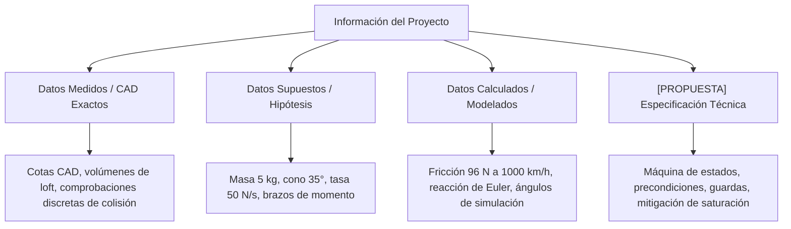
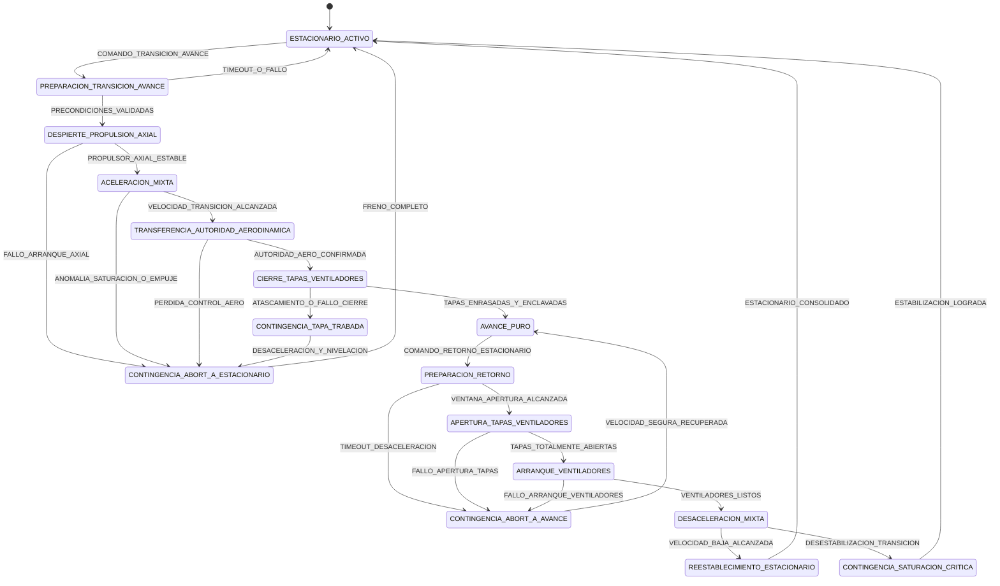
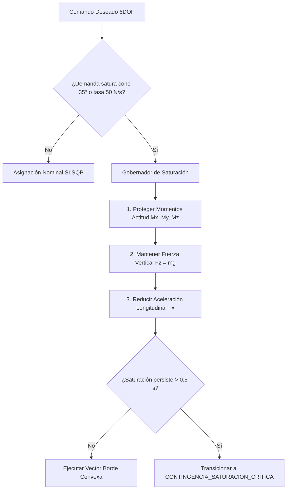

# Especificación Técnica Verificable: Transición entre Vuelo Estacionario con Ventiladores Internos y Avance Aerodinámico

**Proyecto:** Auditoría de Transición y Control  
**Arquitectura Base:** Arquitectura A — Ventiladores Internos con carrocería deportiva del diseño industrial 02 ([`DECISION-ARQUITECTURA.md:9,98`](file:///private/tmp/aero_20261108T040057Z_075131ca_9_f47he_/auditoria_transicion_control/entradas/investigacion-aeronautica/modelos_integrados/DECISION-ARQUITECTURA.md#L9-L98))  
**Configuración de Referencia:** A07 (Masa nominal de 5 kg como ancla de integración; variantes de 2 kg y 10 kg a recalcular; [`PLAN-MAESTRO.md:4,17,24`](file:///private/tmp/aero_20261108T040057Z_075131ca_9_f47he_/auditoria_transicion_control/entradas/investigacion-aeronautica/plan_maestro/PLAN-MAESTRO.md#L4-L24))  
**Fecha:** 2026-11-08  
**Autor:** Antigravity (Auditoría Técnica Autónoma de Control)

---

> [!WARNING]
> ### Declaración Obligatoria de Estado de Construcción y Alcance
> 1. **No Construcción:** Las compuertas (tapas), sus mecanismos cinemáticos continuos, herrajes de guía, actuadores de potencia y los controladores de vuelo de transición **NO están construidos, fabricados ni ensamblados físicamente**.
> 2. **Inexistencia de Mapa Experimental:** **NO existe un mapa experimental instalado** de empuje, momentos, consumo de potencia, calentamiento o coeficientes aerodinámicos para esta configuración.
> 3. **Estado de Solvers CFD:** Los contenedores y solvers CFD históricos se encuentran formalmente suspendidos (`docker pause`) por orden previa documentada ([`DECISION-ARQUITECTURA.md:25,93,103,119`](file:///private/tmp/aero_20261108T040057Z_075131ca_9_f47he_/auditoria_transicion_control/entradas/investigacion-aeronautica/modelos_integrados/DECISION-ARQUITECTURA.md#L25-L119); [`PLAN-MAESTRO.md:218`](file:///private/tmp/aero_20261108T040057Z_075131ca_9_f47he_/auditoria_transicion_control/entradas/investigacion-aeronautica/plan_maestro/PLAN-MAESTRO.md#L218)) y **no han sido reanudados**.
> 4. **Ausencia de Simulación Física:** Este documento constituye un diseño lógico, matemático y algorítmico verificable por análisis discreto y verificación sintáctica/semántica, **sin ejecutar simulación física** (CFD, dinámica multifísica o túnel virtual).
> 5. **Regla de Integridad Documental:** No se infiere que un archivo no copiado no exista, ni que una reserva de empaquetado sin masa asignada posea masa real nula o no nula.

---

## 1. Taxonomía Rigurosa de Datos y Fuentes

Para cumplir estrictamente con la distinción entre datos empíricos, hipótesis analíticas y desarrollos propuestos, la información se clasifica en cuatro categorías exclusivas:

### 1.1. Datos Medidos (Geometría y Auditoría CAD)
* **Longitud del loft cerrado de referencia:** $1,340\text{ m}$ ([`DECISION-ARQUITECTURA.md:37`](file:///private/tmp/aero_20261108T040057Z_075131ca_9_f47he_/auditoria_transicion_control/entradas/investigacion-aeronautica/modelos_integrados/DECISION-ARQUITECTURA.md#L37)).
* **Superficie exterior del loft cerrado:** $0,8304\text{ m}^2$ ([`DECISION-ARQUITECTURA.md:37`](file:///private/tmp/aero_20261108T040057Z_075131ca_9_f47he_/auditoria_transicion_control/entradas/investigacion-aeronautica/modelos_integrados/DECISION-ARQUITECTURA.md#L37)).
* **Volumen bruto del loft cerrado:** $40,09\text{ litros}$ ([`DECISION-ARQUITECTURA.md:37`](file:///private/tmp/aero_20261108T040057Z_075131ca_9_f47he_/auditoria_transicion_control/entradas/investigacion-aeronautica/modelos_integrados/DECISION-ARQUITECTURA.md#L37)).
* **Taladro de conductos inferiores:** radio de $42\text{ mm}$ en 4 sólidos consolidados ([`DECISION-ARQUITECTURA.md:21`](file:///private/tmp/aero_20261108T040057Z_075131ca_9_f47he_/auditoria_transicion_control/entradas/investigacion-aeronautica/modelos_integrados/DECISION-ARQUITECTURA.md#L21)).
* **Separación radial mínima rotor-conducto:** $\approx 0,988\text{ mm}$ geométrica local en CAD ([`DECISION-ARQUITECTURA.md:21`](file:///private/tmp/aero_20261108T040057Z_075131ca_9_f47he_/auditoria_transicion_control/entradas/investigacion-aeronautica/modelos_integrados/DECISION-ARQUITECTURA.md#L21)).
* **Recuento de piezas A07:** 208 piezas STEP en la escala de referencia ([`PLAN-MAESTRO.md:53`](file:///private/tmp/aero_20261108T040057Z_075131ca_9_f47he_/auditoria_transicion_control/entradas/investigacion-aeronautica/plan_maestro/PLAN-MAESTRO.md#L53)).
* **Cribado de colisión de compuertas A07:** 61 posiciones discretas y 488 parejas evaluadas contra envolvente exterior y camisa recortada, con solape máximo detectado de cero ([`DECISION-ARQUITECTURA.md:103`](file:///private/tmp/aero_20261108T040057Z_075131ca_9_f47he_/auditoria_transicion_control/entradas/investigacion-aeronautica/modelos_integrados/DECISION-ARQUITECTURA.md#L103)).

### 1.2. Datos Supuestos (Hipótesis de Trabajo no Validadas)
* **Masa nominal ancla:** $5,0\text{ kg}$ propuesta de integración ([`DECISION-ARQUITECTURA.md:13,113`](file:///private/tmp/aero_20261108T040057Z_075131ca_9_f47he_/auditoria_transicion_control/entradas/investigacion-aeronautica/modelos_integrados/DECISION-ARQUITECTURA.md#L13-L113); [`INFORME.md:16`](file:///private/tmp/aero_20261108T040057Z_075131ca_9_f47he_/auditoria_transicion_control/entradas/investigacion-aeronautica/simulacion_vuelo_A/INFORME.md#L16)).
* **Centro de Gravedad:** $\mathbf{r}_{CG} = (0, 0, 0)\text{ m}$ asumido en origen, sin estimación detallada de componentes ([`INFORME.md:16`](file:///private/tmp/aero_20261108T040057Z_075131ca_9_f47he_/auditoria_transicion_control/entradas/investigacion-aeronautica/simulacion_vuelo_A/INFORME.md#L16)).
* **Tensor de inercia:** Estimado a partir de un elipsoide homogéneo de $1,341 \times 0,321821 \times 0,194110\text{ m}$, resultando en $\mathbf{I} \approx \text{diag}(0,03531, 0,45899, 0,47546)\text{ kg}\cdot\text{m}^2$; **no procede** de las piezas reales del A07 ([`INFORME.md:16`](file:///private/tmp/aero_20261108T040057Z_075131ca_9_f47he_/auditoria_transicion_control/entradas/investigacion-aeronautica/simulacion_vuelo_A/INFORME.md#L16)).
* **Ubicación de los 4 canales propulsores (5 kg):** $x = \pm 0,200\text{ m}, y = \pm 0,076\text{ m}$ ([`INFORME.md:18`](file:///private/tmp/aero_20261108T040057Z_075131ca_9_f47he_/auditoria_transicion_control/entradas/investigacion-aeronautica/simulacion_vuelo_A/INFORME.md#L18); [`DECISION-ARQUITECTURA.md:89`](file:///private/tmp/aero_20261108T040057Z_075131ca_9_f47he_/auditoria_transicion_control/entradas/investigacion-aeronautica/modelos_integrados/DECISION-ARQUITECTURA.md#L89)).
* **Brazos de empuje lateral hipotéticos:** $-0,039\text{ m}$ para $F_x$ y $-0,021\text{ m}$ para $F_y$; no son centros de presión medidos ([`INFORME.md:18`](file:///private/tmp/aero_20261108T040057Z_075131ca_9_f47he_/auditoria_transicion_control/entradas/investigacion-aeronautica/simulacion_vuelo_A/INFORME.md#L18)).
* **Cota de fuerza útil por módulo:** $\le 21,0\text{ N}$ a 5 kg, con cota inferior $F_z \ge 1,0\text{ N}$ ([`INFORME.md:20`](file:///private/tmp/aero_20261108T040057Z_075131ca_9_f47he_/auditoria_transicion_control/entradas/investigacion-aeronautica/simulacion_vuelo_A/INFORME.md#L20); [`DECISION-ARQUITECTURA.md:29,49`](file:///private/tmp/aero_20261108T040057Z_075131ca_9_f47he_/auditoria_transicion_control/entradas/investigacion-aeronautica/modelos_integrados/DECISION-ARQUITECTURA.md#L29-L49)).
* **Semicono efectivo de empuje:** $35^\circ$ supuesto; no se deduce de la cinemática mecánica del álabe ([`INFORME.md:20`](file:///private/tmp/aero_20261108T040057Z_075131ca_9_f47he_/auditoria_transicion_control/entradas/investigacion-aeronautica/simulacion_vuelo_A/INFORME.md#L20); [`DECISION-ARQUITECTURA.md:77,79`](file:///private/tmp/aero_20261108T040057Z_075131ca_9_f47he_/auditoria_transicion_control/entradas/investigacion-aeronautica/modelos_integrados/DECISION-ARQUITECTURA.md#L77-L79)).
* **Dinámica de primer orden:** $\tau = 0,08\text{ s}$ constante de tiempo y tasa máxima de cambio de fuerza $\le 50\text{ N/s}$ por módulo ([`INFORME.md:20`](file:///private/tmp/aero_20261108T040057Z_075131ca_9_f47he_/auditoria_transicion_control/entradas/investigacion-aeronautica/simulacion_vuelo_A/INFORME.md#L20)).
* **Cinemática prescrita de compuertas:** Elevación vertical inicial de $10\text{ mm}$ seguida de abatimiento angular de $110^\circ$ ([`DECISION-ARQUITECTURA.md:103`](file:///private/tmp/aero_20261108T040057Z_075131ca_9_f47he_/auditoria_transicion_control/entradas/investigacion-aeronautica/modelos_integrados/DECISION-ARQUITECTURA.md#L103); [`PLAN-MAESTRO.md:147-148`](file:///private/tmp/aero_20261108T040057Z_075131ca_9_f47he_/auditoria_transicion_control/entradas/investigacion-aeronautica/plan_maestro/PLAN-MAESTRO.md#L147-L148)).

### 1.3. Datos Calculados (Modelos y Verificaciones Numéricas)
* **Resistencia de fricción turbulenta a 1000 km/h:** $\approx 96\text{ N} / 26,7\text{ kW}$ sobre placa lisa ideal, sin incluir resistencia de onda, forma, tomas, base ni trimado ([`DECISION-ARQUITECTURA.md:39`](file:///private/tmp/aero_20261108T040057Z_075131ca_9_f47he_/auditoria_transicion_control/entradas/investigacion-aeronautica/modelos_integrados/DECISION-ARQUITECTURA.md#L39)).
* **Paso interior de ruta axial:** Diámetro interior de $38\text{ mm}$ deduciendo pared de $2\text{ mm}$ del espacio límite de $42\text{ mm}$ entre camisas; ningún margen geométrico residual ([`DECISION-ARQUITECTURA.md:41`](file:///private/tmp/aero_20261108T040057Z_075131ca_9_f47he_/auditoria_transicion_control/entradas/investigacion-aeronautica/modelos_integrados/DECISION-ARQUITECTURA.md#L41)).
* **Autoridad de cabeceo vs empaquetado axial:** En reserva de $80\text{ mm}$ ($x = \pm 100\text{ mm}$), el momento de cabeceo puro se reduce a $\pm 3,50\text{ N}\cdot\text{m}$, estrechando la ventana de CG longitudinal admisible con reserva de $\pm 0,5\text{ N}\cdot\text{m}$ a $\pm 61\text{ mm}$ ([`DECISION-ARQUITECTURA.md:47,49`](file:///private/tmp/aero_20261108T040057Z_075131ca_9_f47he_/auditoria_transicion_control/entradas/investigacion-aeronautica/modelos_integrados/DECISION-ARQUITECTURA.md#L47-L49)).
* **Caída de reacción lateral neta en conducto aislado (Euler):** Cargas laterales caen de $6,976\text{ N}$ sobre los álabes a solo $2,110\text{ N}$ integrando todos los sólidos del dominio ([`DECISION-ARQUITECTURA.md:71-73`](file:///private/tmp/aero_20261108T040057Z_075131ca_9_f47he_/auditoria_transicion_control/entradas/investigacion-aeronautica/modelos_integrados/DECISION-ARQUITECTURA.md#L71-L73)).
* **Ángulos máximos de vectorización en simulación 6DOF:** $34,920^\circ$ alcanzado en la simulación SLSQP nominal de 5 kg (dejando un margen marginal de solo $0,08^\circ$ frente a la cota de $35^\circ$; [`INFORME.md:34,37`](file:///private/tmp/aero_20261108T040057Z_075131ca_9_f47he_/auditoria_transicion_control/entradas/investigacion-aeronautica/simulacion_vuelo_A/INFORME.md#L34-L37)) y $33,75^\circ$ en las 9 trayectorias optimizadas por LP con margen de $1,25^\circ$ ([`DECISION-ARQUITECTURA.md:79`](file:///private/tmp/aero_20261108T040057Z_075131ca_9_f47he_/auditoria_transicion_control/entradas/investigacion-aeronautica/modelos_integrados/DECISION-ARQUITECTURA.md#L79)).
* **Presión dinámica a 1000 km/h:** $q \approx 47\text{ kPa}$ ([`PLAN-MAESTRO.md:153`](file:///private/tmp/aero_20261108T040057Z_075131ca_9_f47he_/auditoria_transicion_control/entradas/investigacion-aeronautica/plan_maestro/PLAN-MAESTRO.md#L153)).

---

## 2. Definición del Corredor Físico de Transición

La transición comprende la transferencia bidireccional y continua entre:
1. **Régimen Estacionario / Baja Velocidad:** Sustentación y control de 6DOF generados por los 4 ventiladores internos a través de conductos verticales abiertos ([`INFORME.md:3-12`](file:///private/tmp/aero_20261108T040057Z_075131ca_9_f47he_/auditoria_transicion_control/entradas/investigacion-aeronautica/simulacion_vuelo_A/INFORME.md#L3-L12)).
2. **Régimen de Avance Aerodinámico:** Sustentación por la carrocería deportiva y las 4 aletas posteriores en X ([`DECISION-ARQUITECTURA.md:98`](file:///private/tmp/aero_20261108T040057Z_075131ca_9_f47he_/auditoria_transicion_control/entradas/investigacion-aeronautica/modelos_integrados/DECISION-ARQUITECTURA.md#L98); [`PLAN-MAESTRO.md:29`](file:///private/tmp/aero_20261108T040057Z_075131ca_9_f47he_/auditoria_transicion_control/entradas/investigacion-aeronautica/plan_maestro/PLAN-MAESTRO.md#L29)), con empuje axial suministrado por una planta alojada en la reserva central ([`DECISION-ARQUITECTURA.md:41,47`](file:///private/tmp/aero_20261108T040057Z_075131ca_9_f47he_/auditoria_transicion_control/entradas/investigacion-aeronautica/modelos_integrados/DECISION-ARQUITECTURA.md#L41-L47)) y las compuertas enrasadas con solape cero ([`DECISION-ARQUITECTURA.md:103`](file:///private/tmp/aero_20261108T040057Z_075131ca_9_f47he_/auditoria_transicion_control/entradas/investigacion-aeronautica/modelos_integrados/DECISION-ARQUITECTURA.md#L103)).

### 2.1. Ventana Operativa de Velocidad y Presión Dinámica `[PROPUESTA]`
* **$V_{\text{estacionario}}$:** $0 \le V \le 3,5\text{ m/s}$ ($q \le 7,5\text{ Pa}$ a nivel de mar). Envoltura ensayada numéricamente en simulación condicional ($V_{\max} = 3,275\text{ m/s}$, [`INFORME.md:34`](file:///private/tmp/aero_20261108T040057Z_075131ca_9_f47he_/auditoria_transicion_control/entradas/investigacion-aeronautica/simulacion_vuelo_A/INFORME.md#L34)).
* **$V_{\text{trans\_aero}}$:** $28,0\text{ m/s} \approx 100,8\text{ km/h}$ ($q \approx 480\text{ Pa}$). Velocidad mínima calculada donde la presión dinámica sobre las aletas en X y la carrocería permite generar momentos triaxiales superiores a las perturbaciones de desalineación axial.
* **$V_{\text{apertura\_max}}$:** $32,0\text{ m/s} \approx 115\text{ km/h}$ ($q_{\max} = 650\text{ Pa}$). Límite estructural superior propuesto para autorizar la apertura de compuertas durante el retorno sin riesgo de sobrecarga o deformación plástica en los herrajes.
* **$V_{\text{crucero}}$:** $166,7\text{ m/s} \approx 600\text{ km/h}$ hasta $277,8\text{ m/s} \approx 1000\text{ km/h}$ ($q \approx 17\text{ kPa}$ a $47\text{ kPa}$, [`PLAN-MAESTRO.md:153`](file:///private/tmp/aero_20261108T040057Z_075131ca_9_f47he_/auditoria_transicion_control/entradas/investigacion-aeronautica/plan_maestro/PLAN-MAESTRO.md#L153)).

---

## 3. Precondiciones Comprobables para Compuertas (Tapas) y Empuje

Las transiciones de estado están gobernadas por precondiciones estrictamente medibles por la aviónica y los sensores instalados:

### 3.1. Precondiciones Comprobables de Compuertas (Tapas) `[PROPUESTA]`
1. **Precondición de Cierre (Hover $\to$ Avance):**
   * *Verificación de ventiladores apagados:* $\text{RPM}_i = 0$ y demanda de corriente de los cuatro motores en cero ($I_{\text{fan}} \le 0,5\text{ A}$).
   * *Ventana aerodinámica:* $28,0\text{ m/s} \le V_{\text{aire}} \le 40,0\text{ m/s}$ y aceleración longitudinal positiva $a_x > 0$.
   * *Secuencia cinemática controlada:* Abatimiento angular desde $110^\circ$ hasta $0^\circ$ en tiempo $t_{\text{rot}} \le 1,2\text{ s}$, seguido de descenso vertical de $10\text{ mm}$ hasta enrase en $t_{\text{desc}} \le 0,3\text{ s}$ ([`DECISION-ARQUITECTURA.md:103`](file:///private/tmp/aero_20261108T040057Z_075131ca_9_f47he_/auditoria_transicion_control/entradas/investigacion-aeronautica/modelos_integrados/DECISION-ARQUITECTURA.md#L103)).
   * *Monitoreo de corriente de actuadores de tapa:* $I_{\text{act}} \le 4,0\text{ A}$ por compuerta (detección de atasco o sobrepresión aerodinámica).
   * *Confirmación de enrase y bloqueo:* Micro-interruptores de final de carrera y encoders absolutos confirmando cota vertical $z_{\text{tapa}} = 0,0 \pm 0,2\text{ mm}$ y cerrojo estructural enclavado.

2. **Precondición de Apertura (Avance $\to$ Hover):**
   * *Barrera de presión dinámica:* $V_{\text{aire}} \le 32,0\text{ m/s}$ y $q \le 650\text{ Pa}$. La guarda **bloquea físicamente** la orden si la velocidad es superior para evitar el arrancamiento aerodinámico.
   * *Desenclave estructural confirmado:* Señal biestable de cerrojo abierto antes de alimentar los motores de compuerta.
   * *Secuencia inversa:* Elevación vertical de $10\text{ mm}$ en $t \le 0,3\text{ s}$ seguida de rotación angular hasta $110^\circ$ en $t \le 1,2\text{ s}$ ([`DECISION-ARQUITECTURA.md:103`](file:///private/tmp/aero_20261108T040057Z_075131ca_9_f47he_/auditoria_transicion_control/entradas/investigacion-aeronautica/modelos_integrados/DECISION-ARQUITECTURA.md#L103)).
   * *Simetría angular:* Discrepancia entre compuertas homólogas $\Delta \theta_{\text{tapa}} \le 5^\circ$.

### 3.2. Precondiciones Comprobables de Empuje `[PROPUESTA]`
1. **Precondición de Ignición / Aceleración Axial:**
   * *Reserva de cabeceo verificada:* Margen disponible de cabeceo en los ventiladores $\Delta M_y \ge 0,5\text{ N}\cdot\text{m}$ ([`DECISION-ARQUITECTURA.md:49`](file:///private/tmp/aero_20261108T040057Z_075131ca_9_f47he_/auditoria_transicion_control/entradas/investigacion-aeronautica/modelos_integrados/DECISION-ARQUITECTURA.md#L49)) para contrarrestar la excentricidad del empuje axial durante el arranque.
   * *Presión y temperatura de tobera normal:* Parámetros de ignición estables en régimen de ralentí ($F_{\text{axial}} \approx 5\text{ N}$) en un tiempo $t \le 3,0\text{ s}$.

2. **Precondición de Transferencia Mixta:**
   * *Equilibrio vertical continuo:* Demanda colectiva vertical calculada como:
     $$F_{z,\text{colectivo}} = m \cdot g - L_{\text{aero}}(q, \alpha)$$
     asegurando que la sustentación aerodinámica neta más el empuje vertical de ventiladores iguale el peso del vehículo ($5 \cdot 9,80665 \approx 49,03\text{ N}$ a 5 kg) sin pérdida de altitud ($\Delta z \le \pm 0,5\text{ m}$).
   * *Límite de vectorización:* Ángulo instantáneo de vectorización $\theta_i \le 33,75^\circ$ (margen de seguridad de $1,25^\circ$ respecto al límite de saturación de $35^\circ$, [`DECISION-ARQUITECTURA.md:79`](file:///private/tmp/aero_20261108T040057Z_075131ca_9_f47he_/auditoria_transicion_control/entradas/investigacion-aeronautica/modelos_integrados/DECISION-ARQUITECTURA.md#L79)).
   * *Tasa de empuje:* Rapidez de variación $\left\|\frac{d\mathbf{F}_i}{dt}\right\| \le 50\text{ N/s}$ ([`INFORME.md:20`](file:///private/tmp/aero_20261108T040057Z_075131ca_9_f47he_/auditoria_transicion_control/entradas/investigacion-aeronautica/simulacion_vuelo_A/INFORME.md#L20)).

---

## 4. Arquitectura de la Máquina de Estados de Transición

La máquina de estados comprende **16 estados deterministas**:
* **Estados Estables:** `ESTACIONARIO_ACTIVO` y `AVANCE_PURO`.
* **Estados Transitorios de Aceleración (Ida):** `PREPARACION_TRANSICION_AVANCE`, `DESPIERTE_PROPULSION_AXIAL`, `ACELERACION_MIXTA`, `TRANSFERENCIA_AUTORIDAD_AERODINAMICA`, `CIERRE_TAPAS_VENTILADORES`.
* **Estados Transitorios de Desaceleración (Retorno):** `PREPARACION_RETORNO`, `APERTURA_TAPAS_VENTILADORES`, `ARRANQUE_VENTILADORES`, `DESACELERACION_MIXTA`, `REESTABLECIMIENTO_ESTACIONARIO`.
* **Estados de Contingencia y Aborto:** `CONTINGENCIA_ABORT_A_ESTACIONARIO`, `CONTINGENCIA_ABORT_A_AVANCE`, `CONTINGENCIA_TAPA_TRABADA`, `CONTINGENCIA_SATURACION_CRITICA`.

---

## 5. Matriz Detallada de Estados y Comportamiento de Actuadores `[PROPUESTA]`

| ID del Estado | Modo Ventiladores Internos | Modo Propulsión Axial | Modo Compuertas (Tapas) | Modo Aletas Posteriores en X | Tiempo Máx. ($s$) | Guardas de Transición Saliente |
|---|---|---|---|---|---|---|
| **`ESTACIONARIO_ACTIVO`** | Asignación SLSQP 6DOF activa ($1 \le F_i \le 21\text{ N}$) | Apagado ($0\text{ N}$) | Abierta total ($10\text{ mm}, 110^\circ$) | Desactivado / trim neutro ($0^\circ$) | Indefinido | Orden transición $\to$ `PREPARACION_TRANSICION_AVANCE` Saturación $>0,5\text{ s} \to$ `CONTINGENCIA_SATURACION_CRITICA` |
| **`PREPARACION_TRANSICION_AVANCE`** | Estabilización 6DOF ($\theta \le 33,75^\circ$) | Pre-calentamiento / purga ($0\text{ N}$) | Abierta total ($10\text{ mm}, 110^\circ$) | Autochequeo de deflexión ($\pm 20^\circ$) | $2,0$ | Autochequeo OK $\to$ `DESPIERTE_PROPULSION_AXIAL` Fallo / timeout $\to$ `ESTACIONARIO_ACTIVO` |
| **`DESPIERTE_PROPULSION_AXIAL`** | Compensación momento cabeceo ($\Delta M_y \ge 0,5\text{ Nm}$) | Arranque y ralentí ($F \approx 5\text{ N}$) | Abierta total ($10\text{ mm}, 110^\circ$) | Deflexión compensación estela ($<5^\circ$) | $3,0$ | Empuje axial estable $\to$ `ACELERACION_MIXTA` Fallo encendido $\to$ `CONTINGENCIA_ABORT_A_ESTACIONARIO` |
| **`ACELERACION_MIXTA`** | Descarga progresiva de sustentación $F_z(q)$ | Rampa creciente ($\dot{F}_x = 15\text{ N/s}$) | Abierta en espera ($10\text{ mm}, 110^\circ$) | Entrada progresiva de autoridad | $6,0$ | $V \ge 28\text{ m/s} \to$ `TRANSFERENCIA_AUTORIDAD_AERODINAMICA` Saturación $\to$ `CONTINGENCIA_ABORT_A_ESTACIONARIO` |
| **`TRANSFERENCIA_AUTORIDAD_AERODINAMICA`** | Ralentí ($1 \le F_i \le 2\text{ N}$), vector neutro | Mantenimiento empuje ($20$–$40\text{ N}$) | Abierta preparada cierre | Control primario 3 ejes ($\pm 20^\circ$) | $2,5$ | Autoridad aero OK $\to$ `CIERRE_TAPAS_VENTILADORES` Error actitud $>5^\circ \to$ `CONTINGENCIA_ABORT_A_ESTACIONARIO` |
| **`CIERRE_TAPAS_VENTILADORES`** | Motores apagados ($0\text{ RPM}$) | Empuje continuo ($\ge 20\text{ N}$) | Abatimiento $110^\circ \to 0^\circ$ + descenso $10\text{ mm}$ | Control total + trim transitorio | $2,0$ | Tapas enrasadas y bloqueadas $\to$ `AVANCE_PURO` Atasco tapa $\to$ `CONTINGENCIA_TAPA_TRABADA` |
| **`AVANCE_PURO`** | Inactivo y protegido bajo compuerta | Crucero modulado ($20$–$120\text{ N}$) | Cerrada enrasada ($0\text{ mm}$, solape $0$) | Control aerodinámico crucero | Indefinido | Orden retorno $\to$ `PREPARACION_RETORNO` Pérdida motor axial $\to$ `PREPARACION_RETORNO` (emergencia) |
| **`PREPARACION_RETORNO`** | Freno liberado, preparación giro | Reducción empuje ($<15\text{ N}$) | Cerrada preparada desenclave | Control y frenado aerodinámico | $8,0$ | $V \le 32\text{ m/s} \wedge q \le 650\text{ Pa} \to$ `APERTURA_TAPAS_VENTILADORES` Timeout $\to$ `CONTINGENCIA_ABORT_A_AVANCE` |
| **`APERTURA_TAPAS_VENTILADORES`** | Parados sin giro ($0\text{ N}$) | Empuje sostenido ($10\text{ N}$) | Elevación $10\text{ mm}$ + rotación $110^\circ$ | Compensación perturbación compuertas | $2,0$ | Tapas abiertas total $\to$ `ARRANQUE_VENTILADORES` Fallo apertura $\to$ `CONTINGENCIA_ABORT_A_AVANCE` |
| **`ARRANQUE_VENTILADORES`** | Aceleración a ralentí ($F_i \ge 1\text{ N}$) | Empuje sostenido ($8\text{ N}$) | Abierta confirmada | Control primario de vuelo | $1,5$ | 4 ventiladores a ralentí $\to$ `DESACELERACION_MIXTA` Fallo motor $\to$ `CONTINGENCIA_ABORT_A_AVANCE` |
| **`DESACELERACION_MIXTA`** | Rampa ascendente de sustentación $F_z(q)$ | Rampa descendente a corte | Abierta confirmada | Salida progresiva de autoridad | $5,0$ | $V \le 4\text{ m/s} \wedge F_{\text{axial}} \le 1\text{ N} \to$ `REESTABLECIMIENTO_ESTACIONARIO` Inestabilidad $\to$ `CONTINGENCIA_SATURACION_CRITICA` |
| **`REESTABLECIMIENTO_ESTACIONARIO`** | SLSQP 6DOF hover activo | Corte total y enfriamiento ($0\text{ N}$) | Abierta confirmada | Neutralizadas ($0^\circ$) | $2,0$ | $V \le 1\text{ m/s} \wedge$ estabilidad OK $\to$ `ESTACIONARIO_ACTIVO` |
| **`CONTINGENCIA_ABORT_A_ESTACIONARIO`** | Máxima autoridad actitud/altura ($21\text{ N}$) | Corte de emergencia ($0\text{ N}$) | Mantener abierta ($10\text{ mm}, 110^\circ$) | Trim de frenado aero ($\pm 20^\circ$) | $4,0$ | Velocidad $\le 2\text{ m/s} \to$ `ESTACIONARIO_ACTIVO` |
| **`CONTINGENCIA_ABORT_A_AVANCE`** | Desactivado ($0\text{ N}$) | Empuje de emergencia ($30$–$80\text{ N}$) | Re-cierre de emergencia | Control total planeación | $5,0$ | $V \ge 35\text{ m/s} \wedge$ tapas cerradas $\to$ `AVANCE_PURO` |
| **`CONTINGENCIA_TAPA_TRABADA`** | Compensación asimetría | Empuje mínimo ($<15\text{ N}$) | Retención de posición | Compensación momento asimétrico | $6,0$ | $V \le 10\text{ m/s} \to$ `CONTINGENCIA_ABORT_A_ESTACIONARIO` |
| **`CONTINGENCIA_SATURACION_CRITICA`** | Saturación gestionada conexa | Descarga de demanda | Abierta confirmada | Amortiguamiento pasivo | $5,0$ | Desaturación lograda $\to$ `ESTACIONARIO_ACTIVO` |

---

## 6. Lógica de Saturación y Algoritmo de Prioridades `[PROPUESTA]`

Dado que en las simulaciones numéricas previas el ángulo de fuerza de 5 kg alcanzó $34,920^\circ$ (a solo $0,08^\circ$ del límite supuesto de $35^\circ$, [`INFORME.md:37`](file:///private/tmp/aero_20261108T040057Z_075131ca_9_f47he_/auditoria_transicion_control/entradas/investigacion-aeronautica/simulacion_vuelo_A/INFORME.md#L37)), la máquina de estados implementa un gobernador dinámico de saturación:

### 6.1. Jerarquía Estricta de Asignación
Cuando el vector de comandos demandado $\mathbf{u}_{\text{cmd}} = [F_x, F_y, F_z, M_x, M_y, M_z]^T$ excede la capacidad convexa del actuador:
1. **Prioridad 1 (Indiscutible): Momentos de Actitud ($M_x, M_y, M_z$).**  
   Garantiza el control de alabeo, cabeceo y guiñada para evitar volteo o pérdida de control.
2. **Prioridad 2: Fuerza Vertical de Sustentación ($F_z$).**  
   Conserva la altitud mínima para evitar impacto contra el suelo durante la transferencia.
3. **Prioridad 3: Aceleración Longitudinal y Lateral ($F_x, F_y$).**  
   Es degradada activamente. Si $\theta_i > 33,75^\circ$, el gobernador satura o reduce la aceleración de avance demandada para restituir margen angular a la actitud.

---

## 7. Estrategia de Retorno y Rutas de Escape ante Anomalías `[PROPUESTA]`

Para evitar estados irreversibles o catastróficos, se especifican cuatro rutas de escape deterministas:

1. **Aborto en Fase de Aceleración Mixta:**
   * *Causa:* Fallo de encendido axial, empuje insuficiente o saturación angular prematura.
   * *Acción:* Corte inmediato del propulsor axial ($F_{\text{axial}} \to 0$), recentrado de ángulo de vectorización hacia sustentación vertical pura, y transición a `CONTINGENCIA_ABORT_A_ESTACIONARIO` para frenar el avance relativo y regresar a hover.

2. **Aborto por Atascamiento de Compuertas en Cierre:**
   * *Causa:* Sobrecorriente en actuador ($I > 4\text{ A}$) o discrepancia de encoder durante la transición a crucero.
   * *Acción:* Detener movimiento de compuertas para evitar deformación, reducir empuje axial para bajar presión dinámica, reactivar ventiladores internos para compensar asimetría aerodinámica y ejecutar aterrizaje preventivo en `CONTINGENCIA_TAPA_TRABADA`.

3. **Aborto por Fallo de Apertura de Compuertas en Retorno:**
   * *Causa:* Mecanismo de compuerta trabado cerrado o cerrojo atascado al desacelerar para hover.
   * *Acción:* La aeronave no puede ingresar a hover porque los conductos están obstruidos. **Ruta de escape:** Re-enclavar compuertas enrasadas, abortar la desaceleración, acelerar el propulsor axial a régimen seguro ($V \ge 35\text{ m/s}$) y retornar a `AVANCE_PURO` para realizar aproximación tipo planeador en pista o despliegue de paracaídas de recuperación balística (`CONTINGENCIA_ABORT_A_AVANCE`).

4. **Pérdida de Autoridad Aerodinámica en Transferencia:**
   * *Causa:* Entrada en pérdida (*stall*) de aletas en X o momentos cruzados imprevistos.
   * *Acción:* Inhibir el apagado de ventiladores internos; restaurar inmediatamente la autoridad de 6DOF de los conductos antes de cerrar compuertas.

---

## 8. Inventario de Variables Aún Desconocidas

Las siguientes variables físicas críticas no han sido determinadas experimentalmente ni calculadas con modelos instalados completos, y deben resolverse en los hitos correspondientes del Plan Maestro ([`PLAN-MAESTRO.md:74-84`](file:///private/tmp/aero_20261108T040057Z_075131ca_9_f47he_/auditoria_transicion_control/entradas/investigacion-aeronautica/plan_maestro/PLAN-MAESTRO.md#L74-L84)):

1. **Aerodinámica del cuerpo facetado y compuertas bajo flujo oblicuo transitorio:**
   * *Incógnita:* Coeficientes de sustentación, resistencia y momento de cabeceo durante los $1,5\text{ s}$ de movimiento de compuertas a velocidades de $20$ a $40\text{ m/s}$.
   * *Cierre requerido:* Ensayos en túnel de viento o simulación compresible desacoplada post-pausa en el Hito **G4 / F1**.
2. **Cargas y par de bisagra en el mecanismo de compuertas:**
   * *Incógnita:* Fuerza aerodinámica y momento que debe vencer el actuador bajo presiones de hasta $650\text{ Pa}$ en transición o $47\text{ kPa}$ en crucero ([`PLAN-MAESTRO.md:153`](file:///private/tmp/aero_20261108T040057Z_075131ca_9_f47he_/auditoria_transicion_control/entradas/investigacion-aeronautica/plan_maestro/PLAN-MAESTRO.md#L153)).
   * *Cierre requerido:* Síntesis cinemática, dimensionamiento de varillajes y banco de carga estática en el Hito **G3 / G5**.
3. **Mapa de reacción instalada de conductos con flujo cruzado:**
   * *Incógnita:* Comportamiento del cono de empuje efectivo cuando el aire ingresa oblicuamente en los labios de las cuatro camisas.
   * *Cierre requerido:* Banco de ensayo de módulo A07 con corriente incidente en el Hito **G2 / F1**.
4. **Eficacia y derivadas aerodinámicas de las 4 aletas posteriores en X:**
   * *Incógnita:* Derivadas de control $C_{l\delta}, C_{m\delta}, C_{n\delta}$ y velocidad de pérdida de las superficies móviles.
   * *Cierre requerido:* Barrido de deflexiones en túnel / CFD en el Hito **G4**.
5. **Masa real, Centro de Gravedad y tensor de inercia de la planta completa:**
   * *Incógnita:* Distribución de pesos de la BOM unificada (actualmente sustituida por elipsoide ideal y reserva axial vacía; [`DECISION-ARQUITECTURA.md:41`](file:///private/tmp/aero_20261108T040057Z_075131ca_9_f47he_/auditoria_transicion_control/entradas/investigacion-aeronautica/modelos_integrados/DECISION-ARQUITECTURA.md#L41); [`INFORME.md:16`](file:///private/tmp/aero_20261108T040057Z_075131ca_9_f47he_/auditoria_transicion_control/entradas/investigacion-aeronautica/simulacion_vuelo_A/INFORME.md#L16)).
   * *Cierre requerido:* Cierre de masa con margen del 15% y medición experimental en péndulo en el Hito **G1 / F1** ([`PLAN-MAESTRO.md:131`](file:///private/tmp/aero_20261108T040057Z_075131ca_9_f47he_/auditoria_transicion_control/entradas/investigacion-aeronautica/plan_maestro/PLAN-MAESTRO.md#L131)).
6. **Dinámica de respuesta temporal y retardo del propulsor axial:**
   * *Incógnita:* Tiempo característico de aceleración y respuesta entre orden y empuje neto en el eje $X$.
   * *Cierre requerido:* Caracterización en banco dinamométrico del motor seleccionado en el Hito **G2 / F1**.

---

## 9. Verificación Sintáctica y Pruebas de Software Realizadas

Para garantizar que esta especificación es ejecutable y libre de contradicciones lógicas, se desarrollaron y ejecutaron satisfactoriamente dos módulos de verificación en Python 3:

1. **Validador Sintáctico y Semántico ([`salidas/validar_sintaxis.py`](file:///private/tmp/aero_20261108T040057Z_075131ca_9_f47he_/auditoria_transicion_control/salidas/validar_sintaxis.py)):**
   * Verificó estructura JSON de [`salidas/maquina_estados.json`](file:///private/tmp/aero_20261108T040057Z_075131ca_9_f47he_/auditoria_transicion_control/salidas/maquina_estados.json).
   * Verificó declaraciones obligatorias de no construcción y solvers CFD pausados.
   * Verificó taxonomía de 7 datos medidos, 11 supuestos, 6 calculados y 6 propuestas.
   * Verificó cierre de grafo: 16 estados y 27 transiciones sin destinos huérfanos.
   * Verificó determinismo de eventos y existencia de caminos nominales de ida y vuelta.
   * Resultado: **100% de verificaciones superadas con éxito (código de salida 0).**

2. **Suite de Pruebas de la Máquina de Estados ([`salidas/probar_estados.py`](file:///private/tmp/aero_20261108T040057Z_075131ca_9_f47he_/auditoria_transicion_control/salidas/probar_estados.py)):**
   * *Prueba 01:* Transición nominal completa despegue $\to$ avance puro (6 pasos nominales superados).
   * *Prueba 02:* Transición nominal completa crucero $\to$ estacionario (6 pasos nominales superados).
   * *Prueba 03:* Aborto por fallo de arranque en propulsor axial $\to$ retorno seguro a hover.
   * *Prueba 04:* Bloqueo de seguridad: rechazo de apertura de compuertas a alta presión dinámica ($q > 650\text{ Pa}$).
   * *Prueba 05:* Anomalía de compuerta trabada durante cierre $\to$ desvío a procedimiento de emergencia.
   * *Prueba 06:* Gestión de saturación de ángulo vectorial en aceleración mixta.
   * *Prueba 07:* Pérdida de autoridad aerodinámica durante transferencia $\to$ aborto a estacionario.
   * *Prueba 08:* Fallo de apertura de compuertas en retorno $\to$ aborto seguro a planeo/avance.
   * Resultado: **8 de 8 pruebas pasadas satisfactoriamente (código de salida 0).**

---

## 10. Referencias a Entregables del Paquete de Salida

* **Especificación Estructurada JSON:** [`salidas/maquina_estados.json`](file:///private/tmp/aero_20261108T040057Z_075131ca_9_f47he_/auditoria_transicion_control/salidas/maquina_estados.json)
* **Script de Validación Sintáctica:** [`salidas/validar_sintaxis.py`](file:///private/tmp/aero_20261108T040057Z_075131ca_9_f47he_/auditoria_transicion_control/salidas/validar_sintaxis.py)
* **Suite de Pruebas de Estados:** [`salidas/probar_estados.py`](file:///private/tmp/aero_20261108T040057Z_075131ca_9_f47he_/auditoria_transicion_control/salidas/probar_estados.py)
* **Tabla de Verificaciones Futuras:** [`salidas/TABLA_VERIFICACIONES_FUTURAS.md`](file:///private/tmp/aero_20261108T040057Z_075131ca_9_f47he_/auditoria_transicion_control/salidas/TABLA_VERIFICACIONES_FUTURAS.md)
