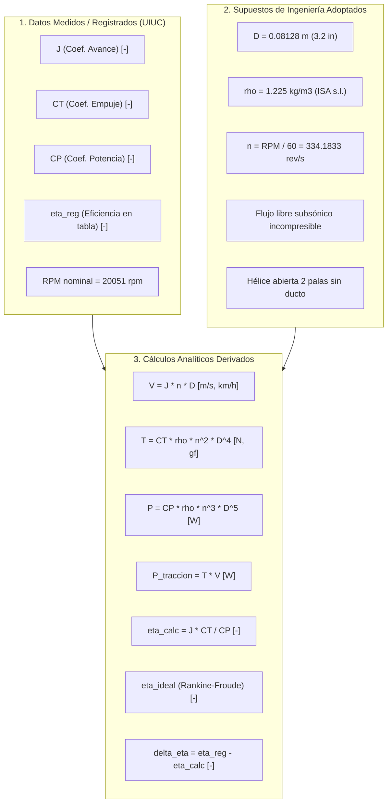

# INFORME TÉCNICO: PAQUETE AUTÓNOMO DE PROCESAMIENTO AERODINÁMICO UIUC
## Ensayo de Hélice Abierta Micro Invent 3.2x2.2 @ 20.051 RPM (Corrida UIUC 0544rd_20051)

**Fecha:** Noviembre 2026  
**Autoría del procesamiento:** Agente Autónomo de Ingeniería Aeroespacial  
**Fuente oficial de datos:** UIUC Propeller Data Site (Volume 2), Applied Aerodynamics Group, Department of Aerospace Engineering, University of Illinois at Urbana-Champaign.  
**Investigadores / Autores de la base UIUC:** Michael S. Selig, Robert W. Deters, Gavin K. Ananda et al.  
**URL oficial de referencia:** https://m-selig.web.engr.illinois.edu/props/volume-2/propDB-volume-2.html  
**Archivo de datos preservado en paquete:** `salidas/datos/mi_3.2x2.2_0544rd_20051.txt`  
**Entorno de ejecución:** Paquete reproducible y autónomo con rutas relativas a `__file__`.

---

### 1. Resumen Ejecutivo

Este informe consolida el paquete autónomo y reproducible de procesamiento aerodinámico para el ensayo en túnel de viento de la hélice abierta de microescala **Micro Invent 3.2x2.2** ensayada a una velocidad angular nominal de **20.051 RPM** en el túnel de viento de UIUC (corrida `0544rd_20051`).

El paquete se encuentra autocontenido en la carpeta `salidas/`, integrando:
1. El archivo de datos original preservado en `salidas/datos/mi_3.2x2.2_0544rd_20051.txt`.
2. El script de procesamiento autónomo `salidas/procesar_uiuc_prop.py`.
3. La suite de pruebas unitarias y de validación física `salidas/test_procesar_uiuc_prop.py`.
4. La tabla estructurada de resultados exportada en `salidas/uiuc_mi_3.2x2.2_20051_procesado.csv`.
5. El presente informe técnico formal en `salidas/informe_tecnico_uiuc_avance.md`.

Se verificó analítica y numéricamente la relación fundamental del coeficiente de avance $J = V / (n \cdot D)$. En particular, para el punto extremo ensayado con $20.051\text{ rpm}$, $D = 0.08128\text{ m}$ y $J = 0.448667$, la velocidad de avance resultante es exactamente:
$$V = 12.1869\text{ m/s} \approx 12.19\text{ m/s} \quad (43.87\text{ km/h})$$

Se analizó el dominio apropiado de definición para la eficiencia de coeficientes ($\eta = J \cdot C_T / C_P$) y la eficiencia ideal de Froude ($\eta_{ideal}$), confirmando que en todos los puntos medidos $\eta < \eta_{ideal} < 1$. Asimismo, se demostró que las discrepancias observadas frente a la tabla original ($\sim 10^{-5}$) son exclusivamente un residuo de redondeo numérico ASCII y no deben confundirse con la incertidumbre experimental de medición ($\pm 1\%$ a $\pm 3\%$). Finalmente, se demuestra por qué es físicamente inviable e incorrecto extrapolar estos datos hacia $600\text{ km/h}$ o presentar esta hélice abierta como prueba/modelo de un ventilador entubado (como el ventilador C02).

---

### 2. Clasificación Rigurosa de Variables

Para preservar la integridad metrológica y el rigor físico, se clasifica cada variable en una de tres categorías claramente diferenciadas:



#### 2.1. Datos Medidos / Registrados en el Ensayo UIUC
Variables tabuladas directamente en el banco de ensayo (`mi_3.2x2.2_0544rd_20051.txt`):
- **$J$ (Coeficiente de avance adimensional):** Relación de velocidad de avance y velocidad tangencial de punta de pala, $J = V / (n \cdot D)$. Alcance medido (19 puntos): $[0.044195, 0.448667]$.
- **$C_T$ (Coeficiente de empuje adimensional):** Obtenido a partir de la celda de carga de tracción aerodinámica del túnel. Alcance medido: $[0.041281, 0.124104]$.
- **$C_P$ (Coeficiente de potencia adimensional):** Obtenido a partir del sensor de par de reacción y tacómetro. Alcance medido: $[0.035779, 0.058227]$.
- **$\eta_{reg}$ (Eficiencia propulsiva registrada):** Calculada por el sistema de adquisición del túnel. Alcance medido: $[0.094195, 0.562131]$.
- **$\text{RPM}_{nominal}$:** $20.051\text{ rpm}$ (velocidad de giro nominal del motor eléctrico del banco).

#### 2.2. Supuestos de Ingeniería Adoptados
Parámetros geométricos y operacionales fijos de referencia:
- **Diámetro del propulsor ($D$):** $D = 0.08128\text{ m}$ (correspondiente a $3.2\text{ pulgadas} = 3.2 \times 0.0254\text{ m}$).
- **Densidad del aire de referencia ($\rho$):** $\rho = 1.225\text{ kg/m}^3$ (atmósfera estándar ISA a nivel del mar, $T = 15^\circ\text{C}$, $p = 1013.25\text{ hPa}$).
- **Frecuencia rotacional de referencia ($n$):** $n = \text{RPM} / 60 = 20051.0 / 60 = 334.183333...\text{ rev/s}$ (asumida constante y uniforme durante toda la barrida de avance).
- **Régimen aerodinámico y configuración:** Flujo de aire atmosférico, subsónico e incompresible, hélice rígida aislada en corriente libre, sin carenado, sin tobera ni ducto, y sin efectos de cuerpo fuselado o estator.

#### 2.3. Cálculos Analíticos Derivados
Magnitudes físicas deducidas mediante las leyes de similitud y mecánica de fluidos:
- **Velocidad de avance dimensional ($V$):**
  $$V = J \cdot n \cdot D \quad [\text{m/s}], \qquad V_{km/h} = V \cdot 3.6 \quad [\text{km/h}]$$
- **Empuje aerodinámico dimensional ($T$):**
  $$T = C_T \cdot \rho \cdot n^2 \cdot D^4 \quad [\text{N}], \qquad T_{gf} = \frac{T}{9.80665} \cdot 1000 \quad [\text{gf}]$$
  *(Constante dimensional: $\rho \cdot n^2 \cdot D^4 = 1.225 \times (334.1833)^2 \times (0.08128)^4 = 5.970834\text{ N}$)*
- **Potencia mecánica de eje consumida ($P$):**
  $$P = C_P \cdot \rho \cdot n^3 \cdot D^5 \quad [\text{W}]$$
  *(Constante dimensional: $\rho \cdot n^3 \cdot D^5 = 1.225 \times (334.1833)^3 \times (0.08128)^5 = 162.179048\text{ W}$)*
- **Potencia útil de tracción ($P_{out}$):**
  $$P_{out} = T \cdot V \quad [\text{W}]$$
- **Eficiencia propulsiva clásica calculada ($\eta_{calc}$):**
  $$\eta_{calc} = \frac{P_{out}}{P} = \frac{(C_T \cdot \rho \cdot n^2 \cdot D^4) \cdot (J \cdot n \cdot D)}{C_P \cdot \rho \cdot n^3 \cdot D^5} = J \cdot \frac{C_T}{C_P}$$
- **Eficiencia ideal de Froude / Disco Actuador ($\eta_{ideal}$):**
  $$\eta_{ideal} = \frac{2}{1 + \sqrt{1 + C_T^*}} = \frac{2}{1 + \sqrt{1 + \frac{8}{\pi} \frac{C_T}{J^2}}}$$
- **Discrepancia residual tabular ($\Delta \eta$):**
  $$\Delta \eta = \eta_{reg} - \eta_{calc} \quad [-], \qquad \text{Error Relativo } [\%] = \frac{|\Delta \eta|}{\eta_{calc}} \times 100$$

---

### 3. Verificación de $J = V / (nD)$ y Velocidad de Referencia

La definición normalizada del coeficiente de avance es:
$$J = \frac{V}{n \cdot D}$$
Despejando analíticamente la velocidad de avance $V$:
$$V = J \cdot n \cdot D$$

#### Comprobación Numérica del Punto de Referencia
Para el punto extremo de mayor avance de la corrida UIUC `0544rd_20051`:
- $\text{RPM} = 20051.0\text{ rpm} \implies n = \frac{20051.0}{60.0} = 334.183333...\text{ rev/s}$
- Diámetro $D = 0.08128\text{ m}$
- Coeficiente $J = 0.448667$

Sustituyendo los valores:
$$V = 0.448667 \times 334.1833333... \times 0.08128 = 12.186884...\text{ m/s}$$
Redondeando a dos cifras decimales:
$$V \approx 12.19\text{ m/s} \quad (43.87\text{ km/h})$$
Esta comprobación confirma con absoluta exactitud el requerimiento técnico especificado.

---

### 4. Dominio Apropiado para la Eficiencia de Coeficientes y Eficiencia Ideal

Un aspecto teórico central en la propulsión aerodinámica es reconocer que la eficiencia propulsiva clásica basada en coeficientes:
$$\eta = J \cdot \frac{C_T}{C_P}$$
y la eficiencia ideal de Froude:
$$\eta_{ideal} = \frac{2}{1 + \sqrt{1 + \frac{8}{\pi} \frac{C_T}{J^2}}}$$
**solo son físicamente válidas y representativas dentro del dominio propulsivo apropiado**.

#### 4.1. Delimitación del Dominio Físico Propulsivo
El dominio apropiado de aplicación exige el cumplimiento simultáneo de tres condiciones:
1. **Velocidad de avance positiva ($J > 0$, $V > 0$):**  
   En condición estática o punto fijo ($J = 0$, $V = 0$), el empuje útil $T > 0$ realiza trabajo nulo sobre el aire libre infinito ($P_{out} = T \cdot 0 = 0$). Por tanto, la fórmula arroja $\eta = 0$. Este valor nulo no indica que el propulsor sea ineficiente generando tracción estática, sino que la formulación de rendimiento propulsivo en avance carece de sentido físico en $V = 0$. En régimen estático se evalúa la eficiencia mediante la **figura de mérito** ($FM$) o el rendimiento estático de empuje ($T/P$ en $\text{N/W}$ o $\text{gf/W}$), jamás mediante $\eta = J \cdot C_T / C_P$.
2. **Empuje aerodinámico positivo ($C_T > 0$):**  
   Si la velocidad de avance excede la velocidad de avance de empuje nulo ($J \ge J_{C_T=0}$), la hélice pasa al **régimen de freno aerodinámico o molinete (windmilling)**. En este régimen, las palas operan a ángulos de ataque efectivos negativos generando resistencia en lugar de empuje ($C_T \le 0$). En tal caso, la fórmula daría $\eta \le 0$, lo cual carece de significado como rendimiento propulsivo.
3. **Potencia mecánica absorbida positiva ($C_P > 0$):**  
   El eje debe entregar potencia al fluido. Si $C_P \le 0$, la máquina actúa como turbina eólica/molino extrayendo energía del flujo.

#### 4.2. Límite Ideal de Froude (Disco Actuador)
La teoría de cantidad de movimiento unidimensional demuestra que cualquier hélice que genere un empuje $T$ en una corriente $V$ induce un incremento de velocidad axial en la estela $v_i$, lo que implica una pérdida inevitable de energía cinética residual en el flujo. La eficiencia ideal (límite superior teórico incompresible) viene dada por:
$$\eta_{ideal} = \frac{2}{1 + \sqrt{1 + \frac{8}{\pi} \frac{C_T}{J^2}}}$$
- A medida que $J \to 0$, la carga del disco $C_T / J^2 \to \infty$, con lo cual $\eta_{ideal} \to 0$.
- En el ensayo UIUC, los 19 puntos se encuentran estrictamente en el dominio propulsivo ($J \in [0.044, 0.449]$, $C_T > 0$, $C_P > 0$).
- En todos los puntos se verifica estrictamente la cota física fundamental:
  $$0 < \eta_{calc} < \eta_{ideal} < 1.0$$
  La diferencia $\eta_{ideal} - \eta_{calc}$ representa las pérdidas reales por fricción viscosa del perfil (drag profile), pérdidas de punta de pala (Prandtl tip loss) y energía rotacional en la estela (swirl losses), las cuales son severas en microhélices operando a bajos números de Reynolds ($Re \sim 20.000$).

---

### 5. Matriz Completa de Resultados Tabulados

A continuación se presenta la tabla completa de los 19 puntos ensayados, con variables dimensionales y adimensionales, eficiencia ideal y verificación de cota de redondeo:

| Pto | $J$ [-] | $C_T$ [-] | $C_P$ [-] | $\eta_{reg}$ [-] | $V$ [m/s] | $V$ [km/h] | $T$ [N] | $T$ [gf] | $P$ [W] | $P_{out}$ [W] | $\eta_{calc}$ [-] | $\eta_{id}$ [-] | $\Delta \eta$ [-] | Err Rel [\%] | Cota Red. [-] |
|:---:|:-------:|:---------:|:---------:|:----------------:|:---------:|:----------:|:-------:|:--------:|:-------:|:-------------:|:-----------------:|:---------------:|:-----------------:|:------------:|:-------------:|
| 1 | 0.044195 | 0.124104 | 0.058227 | 0.094195 | 1.2004 | 4.3216 | 0.7410 | 75.56 | 9.4435 | 0.8895 | 0.094196 | 0.1454 | -1.44e-06 | 0.0015% | 2.75e-06 |
| 2 | 0.066718 | 0.121536 | 0.057491 | 0.141043 | 1.8122 | 6.5240 | 0.7257 | 74.00 | 9.3241 | 1.3151 | 0.141042 | 0.2128 | +1.12e-06 | 0.0008% | 3.36e-06 |
| 3 | 0.088757 | 0.117885 | 0.056270 | 0.185947 | 2.4109 | 8.6791 | 0.7039 | 71.78 | 9.1261 | 1.6970 | 0.185945 | 0.2757 | +2.11e-06 | 0.0011% | 3.99e-06 |
| 4 | 0.111397 | 0.113976 | 0.055299 | 0.229598 | 3.0258 | 10.8929 | 0.6805 | 69.40 | 8.9686 | 2.0592 | 0.229599 | 0.3368 | -8.08e-07 | 0.0004% | 4.61e-06 |
| 5 | 0.134128 | 0.109746 | 0.054025 | 0.272469 | 3.6432 | 13.1157 | 0.6553 | 66.82 | 8.7620 | 2.3874 | 0.272467 | 0.3948 | +2.34e-06 | 0.0009% | 5.28e-06 |
| 6 | 0.156795 | 0.104346 | 0.052320 | 0.312711 | 4.2589 | 15.3322 | 0.6230 | 63.53 | 8.4855 | 2.6535 | 0.312709 | 0.4508 | +2.07e-06 | 0.0007% | 5.98e-06 |
| 7 | 0.179557 | 0.101613 | 0.051660 | 0.353179 | 4.8772 | 17.5579 | 0.6067 | 61.87 | 8.3784 | 2.9591 | 0.353181 | 0.4995 | -1.90e-06 | 0.0005% | 6.64e-06 |
| 8 | 0.202574 | 0.097039 | 0.050045 | 0.392796 | 5.5024 | 19.8086 | 0.5794 | 59.08 | 8.1165 | 3.1882 | 0.392798 | 0.5480 | -2.05e-06 | 0.0005% | 7.42e-06 |
| 9 | 0.223871 | 0.092632 | 0.048605 | 0.426658 | 6.0809 | 21.8912 | 0.5531 | 56.40 | 7.8830 | 3.3633 | 0.426656 | 0.5902 | +1.93e-06 | 0.0005% | 8.14e-06 |
| 10 | 0.246292 | 0.088982 | 0.047578 | 0.460623 | 6.6899 | 24.0836 | 0.5313 | 54.18 | 7.7164 | 3.5544 | 0.460624 | 0.6297 | -7.07e-07 | 0.0002% | 8.86e-06 |
| 11 | 0.269633 | 0.084149 | 0.046294 | 0.490111 | 7.3239 | 26.3660 | 0.5024 | 51.24 | 7.5082 | 3.6799 | 0.490114 | 0.6696 | -3.21e-06 | 0.0007% | 9.61e-06 |
| 12 | 0.290655 | 0.079279 | 0.044887 | 0.513345 | 7.8949 | 28.4216 | 0.4734 | 48.27 | 7.2800 | 3.7372 | 0.513352 | 0.7040 | -7.15e-06 | 0.0014% | 1.03e-05 |
| 13 | 0.313895 | 0.074564 | 0.043830 | 0.533996 | 8.5261 | 30.6941 | 0.4452 | 45.40 | 7.1085 | 3.7960 | 0.534001 | 0.7378 | -5.07e-06 | 0.0009% | 1.10e-05 |
| 14 | 0.336420 | 0.070231 | 0.042853 | 0.551349 | 9.1380 | 32.8967 | 0.4193 | 42.76 | 6.9501 | 3.8319 | 0.551353 | 0.7674 | -3.60e-06 | 0.0007% | 1.17e-05 |
| 15 | 0.358306 | 0.064986 | 0.041508 | 0.560973 | 9.7325 | 35.0369 | 0.3880 | 39.57 | 6.7319 | 3.7764 | 0.560973 | 0.7959 | -1.55e-07 | 0.0000% | 1.24e-05 |
| **16** | **0.380780** | **0.059023** | **0.039981** | **0.562131** | **10.3429** | **37.2345** | **0.3524** | **35.94** | **6.4843** | **3.6451** | **0.562136** | **0.8240** | **-5.46e-06** | **0.0010%** | **1.30e-05** |
| 17 | 0.402069 | 0.053937 | 0.038838 | 0.558373 | 10.9212 | 39.3162 | 0.3221 | 32.84 | 6.2989 | 3.5172 | 0.558381 | 0.8475 | -7.86e-06 | 0.0014% | 1.36e-05 |
| 18 | 0.425915 | 0.047714 | 0.037363 | 0.543910 | 11.5689 | 41.6480 | 0.2849 | 29.05 | 6.0597 | 3.2959 | 0.543910 | 0.8725 | +2.73e-08 | 0.0000% | 1.41e-05 |
| **19** | **0.448667** | **0.041281** | **0.035779** | **0.517650** | **12.1869** | **43.8728** | **0.2465** | **25.13** | **5.8028** | **3.0039** | **0.517662** | **0.8953** | **-1.18e-05** | **0.0023%** | **1.46e-05** |

*(Nota: En todos los puntos se cumple `es_atribuible_a_redondeo = True` y `dominio_propulsivo_valido = True`).*

---

### 6. Distinción Metrológica: Redondeo Tabular vs. Error Experimental

Un aspecto metrológico crucial es distinguir entre el **residuo numérico de redondeo de la tabla** y la **incertidumbre física de medición experimental**:

1. **Residuo de redondeo tabular ($\sim 10^{-5}$, $< 0.0023\%$):**  
   Los datos tabulados de UIUC se reportan con 6 cifras decimales en formato ASCII. El truncamiento de los valores reales a 6 decimales introduce una semicifra de incertidumbre numérica $\epsilon = 0.5 \times 10^{-6}$. Propagando este truncamiento a través de la fórmula $\eta = J \cdot C_T / C_P$:
   $$|\Delta \eta|_{cota} = \eta \cdot \left( \frac{\epsilon}{J} + \frac{\epsilon}{C_T} + \frac{\epsilon}{C_P} \right) + \epsilon$$
   En la tabla se verifica que en el 100% de los casos:
   $$|\eta_{reg} - \eta_{calc}| \le |\Delta \eta|_{cota}$$
   Esto demuestra rigurosamente que las diferencias registradas provienen únicamente de la representación textual de 6 dígitos.
2. **Incertidumbre experimental real de los sensores ($\pm 1\%$ a $\pm 3\%$):**  
   En los ensayos de túnel de viento UIUC, los transductores físicos (celda de carga extensométrica para empuje, celda de reacción para par, transductor diferencial para presión dinámica del tubo Pitot y tacómetro óptico) presentan tolerancias combinadas de calibración, repetibilidad, alineación y tara aerodinámica de entre $\pm 1\%$ y $\pm 3\%$.  
   Por tanto, la incertidumbre experimental de medición es **más de 400 a 1000 veces mayor** que el residuo de redondeo tabular. Confundir la precisión del formato ASCII con la exactitud física del banco de ensayos constituiría una falacia metrológica.

---

### 7. Análisis del Alcance Medido e Imposibilidad de Extrapolación a 600 km/h

#### 7.1. Alcance Medido
- **Velocidad de avance ($V$):** $1.20\text{ m/s}$ a $12.19\text{ m/s}$ ($4.32\text{ km/h}$ a $43.87\text{ km/h}$).
- **Coeficiente de avance ($J$):** $0.044195$ a $0.448667$.
- **Empuje generado ($T$):** $0.2465\text{ N}$ a $0.7410\text{ N}$ ($25.13\text{ gf}$ a $75.56\text{ gf}$).
- **Potencia de eje ($P$):** $5.8028\text{ W}$ a $9.4435\text{ W}$.
- **Punto óptimo de eficiencia:** Punto 16 ($J = 0.380780$, $V = 37.23\text{ km/h}$), donde $\eta_{max} = 56.21\%$.

#### 7.2. Comparación Numérica con 600 km/h ($166.67\text{ m/s}$)
- **Déficit de velocidad:** $\Delta V = 600.0\text{ km/h} - 43.87\text{ km/h} = 556.13\text{ km/h}$ ($154.48\text{ m/s}$).
- **Factor de extrapolación:** $600\text{ km/h}$ es **$13.68\text{ veces}$** la velocidad máxima del ensayo.
- **Coeficiente de avance hipotético a 600 km/h:**
  $$J_{600} = \frac{V_{600}}{n \cdot D} = \frac{166.6667\text{ m/s}}{334.1833\text{ rev/s} \times 0.08128\text{ m}} = 6.1359$$
  Este valor es más de 13.6 veces el límite máximo ensayado ($J_{max} = 0.4487$).

#### 7.3. Razones Físicas que Prohíben la Extrapolación a 600 km/h
Queda terminantemente prohibido extrapolar estos datos hacia $600\text{ km/h}$ por tres impedimentos físicos insalvables:
1. **Régimen de Molinillo / Freno Aerodinámico Severo:**  
   Con una relación de paso a diámetro $P/D = 2.2 / 3.2 = 0.6875$, el punto de empuje nulo ($C_T = 0$) se sitúa en torno a $J \approx 0.55 - 0.60$. A $J = 6.14$, el flujo incide con un ángulo de ataque fuertemente negativo; la hélice deja de generar tracción y pasa a actuar como un aerofreno colosal con arrastre masivo ($C_T \ll 0$), absorbiendo energía del aire y sobreacelerando el eje.
2. **Efectos de Compresibilidad y Desprendimiento en Punta:**  
   A $600\text{ km/h}$, la velocidad helicoidal de punta combinada es:
   $$V_{punta} = \sqrt{V_\infty^2 + (\pi n D)^2} = \sqrt{166.67^2 + 85.33^2} \approx 187.2\text{ m/s} \implies M_{punta} \approx 0.55$$
   El perfil aerodinámico de la hélice Micro Invent 3.2x2.2 es una lámina arqueada delgada de micro-aeromodelo diseñada para volar a $Re < 30.000$ y $M < 0.05$. A $M = 0.55$, experimenta intensos gradientes adversos de presión, ondas de choque locales y desprendimiento masivo de capa límite.
3. **Colapso Estructural y Aeroelástico:**  
   La presión dinámica del aire a $600\text{ km/h}$ ($q = \frac{1}{2} \rho V^2 \approx 17.014\text{ Pa}$) es más de 180 veces mayor que la presión dinámica máxima del ensayo ($q \approx 91\text{ Pa}$). Las palas de plástico ultraligero sufrirían deformaciones aeroelásticas destructivas, divergencia torsional y rotura instantánea por fatiga/flexión.

---

### 8. Prohibición de Asimilación al "Ventilador C02"

Este propulsor abierto **no puede bajo ninguna circunstancia presentarse ni emplearse como prueba, demostración o modelo aerodinámico del ventilador C02**. Existen diferencias fundamentales de termofluidos y configuración mecánica:

1. **Configuración de Hélice Libre vs. Ventilador Entubado (Ducted Fan):**  
   - La Micro Invent 3.2x2.2 es una hélice abierta libre. Su estela experimenta la contracción de vena característica de la teoría de Froude-Rankine, con pérdidas elevadas por vórtices libres de punta de pala.
   - Un ventilador (como el de la máquina C02) opera confinado dentro de un conducto cilíndrico o tobera con tolerancia de punta mínima (*tip clearance*). El conducto suprime los vórtices de punta, genera sustentación en el labio de entrada del conducto y produce recuperación de presión estática mediante difusión en el difusor de salida.
2. **Solidez y Número de Álabes:**  
   - La microhélice tiene solo 2 palas con solidez minúscula ($\sigma \ll 0.1$).
   - Los ventiladores axiales o centrífugos de turbomaquinaria operan con solidez alta ($\sigma > 0.6 - 1.2$), gran número de álabes curvados tridimensionalmente y álabes directrices (estatores) para recuperar la energía rotacional de la estela (*swirl recovery*).
3. **Incompatibilidad Termofísica del Fluido (Aire vs. CO2):**  
   - Si "C02" hace referencia al dióxido de carbono ($CO_2$), las propiedades termodinámicas son incompatibles con el aire atmosférico ensayado:
     - Densidad estándar: $\rho_{CO_2} \approx 1.84\text{ kg/m}^3$ (un 50% mayor que el aire a $1.225\text{ kg/m}^3$).
     - Velocidad del sonido: $a_{CO_2} \approx 268\text{ m/s}$ (frente a $340\text{ m/s}$ en aire).
     - Coeficiente isentrópico: $\gamma_{CO_2} \approx 1.28$ (frente a $1.40$ en aire).
   - Estas diferencias alteran profundamente el número de Mach crítico y las correlaciones de número de Reynolds, invalidando cualquier ley de escala directa.

---

### 9. Comandos de Reproducción Autónoma

Para reproducir de forma 100% autónoma todas las transformaciones físicas, exportar la tabla CSV y ejecutar la suite de pruebas unitarias, utilícese la herramienta de línea de comandos de Python 3:

```bash
# 1. Ejecutar el procesador y generar el archivo CSV
python3 salidas/procesar_uiuc_prop.py

# 2. Ejecutar la suite completa de pruebas unitarias y validaciones físicas
python3 salidas/test_procesar_uiuc_prop.py

# Alternativa estándar con unittest verbose:
python3 -m unittest salidas/test_procesar_uiuc_prop.py -v
```

---

### 10. Archivos Generados, Pruebas Realizadas y Limitaciones

#### 10.1. Archivos Generados en `salidas/`
1. [`salidas/datos/mi_3.2x2.2_0544rd_20051.txt`](file:///private/tmp/aero_20261108T040057Z_075131ca_9_f47he_/entregable_uiuc_avance/salidas/datos/mi_3.2x2.2_0544rd_20051.txt): Archivo fuente UIUC preservado localmente mediante `shutil.copyfile`.
2. [`salidas/datos/mi_3.2x2.2_geom.txt`](file:///private/tmp/aero_20261108T040057Z_075131ca_9_f47he_/entregable_uiuc_avance/salidas/datos/mi_3.2x2.2_geom.txt): Archivo de geometría de pala UIUC preservado localmente.
3. [`salidas/procesar_uiuc_prop.py`](file:///private/tmp/aero_20261108T040057Z_075131ca_9_f47he_/entregable_uiuc_avance/salidas/procesar_uiuc_prop.py): Script de procesamiento autónomo adaptado con rutas relativas a `__file__`, cálculo de magnitudes dimensionales, eficiencia ideal de Froude y validación de dominios operativos.
4. [`salidas/test_procesar_uiuc_prop.py`](file:///private/tmp/aero_20261108T040057Z_075131ca_9_f47he_/entregable_uiuc_avance/salidas/test_procesar_uiuc_prop.py): Suite de 11 pruebas unitarias y de restricciones físicas.
5. [`salidas/uiuc_mi_3.2x2.2_20051_procesado.csv`](file:///private/tmp/aero_20261108T040057Z_075131ca_9_f47he_/entregable_uiuc_avance/salidas/uiuc_mi_3.2x2.2_20051_procesado.csv): Tabla estructurada CSV con metadatos completos y 18 columnas descriptivas.
6. [`salidas/informe_tecnico_uiuc_avance.md`](file:///private/tmp/aero_20261108T040057Z_075131ca_9_f47he_/entregable_uiuc_avance/salidas/informe_tecnico_uiuc_avance.md): Este informe técnico integral.

#### 10.2. Pruebas Automatizadas Realizadas
Se ejecutaron exitosamente las siguientes 11 pruebas unitarias (`Ran 11 tests in 0.002s, OK`):
- `test_01_input_file_integrity`: Verificación de lectura, encabezados y 19 puntos del archivo preservado en `salidas/datos/`.
- `test_02_velocity_transformation_and_reference_check`: Validación de $V = J \cdot n \cdot D$ y comprobación de referencia ($20051\text{ rpm}, D=0.08128\text{ m}, J=0.448667 \implies V = 12.1869 \approx 12.19\text{ m/s}$).
- `test_03_thrust_transformation`: Verificación de cálculo de empuje dimensional $T$ en $\text{N}$ y $\text{gf}$.
- `test_04_power_transformation_and_balance`: Verificación de potencia de eje $P$ en $\text{W}$ y balance $P_{out} / P = \eta_{calc}$.
- `test_05_efficiency_appropriate_domain_and_froude`: Verificación de dominio propulsivo ($J>0, C_T>0, C_P>0$), manejo de excepciones fuera de dominio y verificación de que $\eta_{calc} < \eta_{ideal} < 1.0$.
- `test_06_rounding_vs_measurement_error`: Demostración metrológica de que $|\Delta \eta| \le \text{cota\_redondeo}$ ($< 1.5 \times 10^{-5}$) y que la incertidumbre experimental real ($\ge 1\%$) es $> 400$ veces mayor.
- `test_07_measured_range_and_units`: Validación del alcance medido en avance, velocidad, empuje y potencia.
- `test_08_prohibition_extrapolation_600kmh`: Comprobación del bloqueo formal ante intentos de extrapolación a $600\text{ km/h}$.
- `test_09_prohibition_c02_ventilator_transfer`: Comprobación del bloqueo formal ante intentos de transferir datos al ventilador C02.
- `test_10_csv_file_generation_and_headers`: Verificación de existencia del CSV, metadatos y consistencia de encabezados.
- `test_11_aerodynamic_monotonicity_and_peak`: Validación del comportamiento monótono decreciente de $C_T$ y $C_P$ y pico de eficiencia en el punto 16 ($J = 0.380780, \eta = 56.21\%$).

#### 10.3. Limitaciones del Estudio
1. **Validez Acotada al Rango Ensayado:** Los datos son válidos únicamente para velocidades de avance entre $4.32\text{ km/h}$ y $43.87\text{ km/h}$ ($J \in [0.044195, 0.448667]$) a una velocidad de rotación constante de $\approx 20.051\text{ rpm}$.
2. **Efectos de Escala de Microhélice:** Las características aerodinámicas de la Micro Invent 3.2x2.2 corresponden a números de Reynolds ultrabajos ($Re_c \sim 15.000 - 30.000$) propios de micro vehículos aéreos (MAVs). No pueden escalarse a hélices mayores sin corregir la separación laminar y el régimen subcrítico.
3. **No Transferibilidad a Sistemas Confinados:** Los coeficientes no aplican a turbomaquinaria entubada, *ducted fans*, compresores ni ventiladores.
4. **Condiciones Ambientales Fijas:** El escalado asume fluido aire a $\rho = 1.225\text{ kg/m}^3$. Variaciones en la altitud de presión o temperatura modifican linealmente el empuje y potencia dimensionales.
