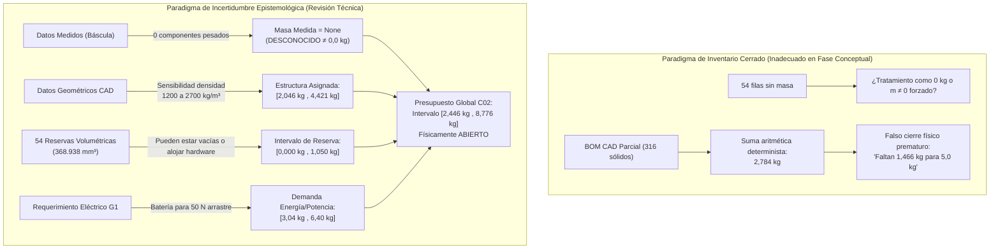
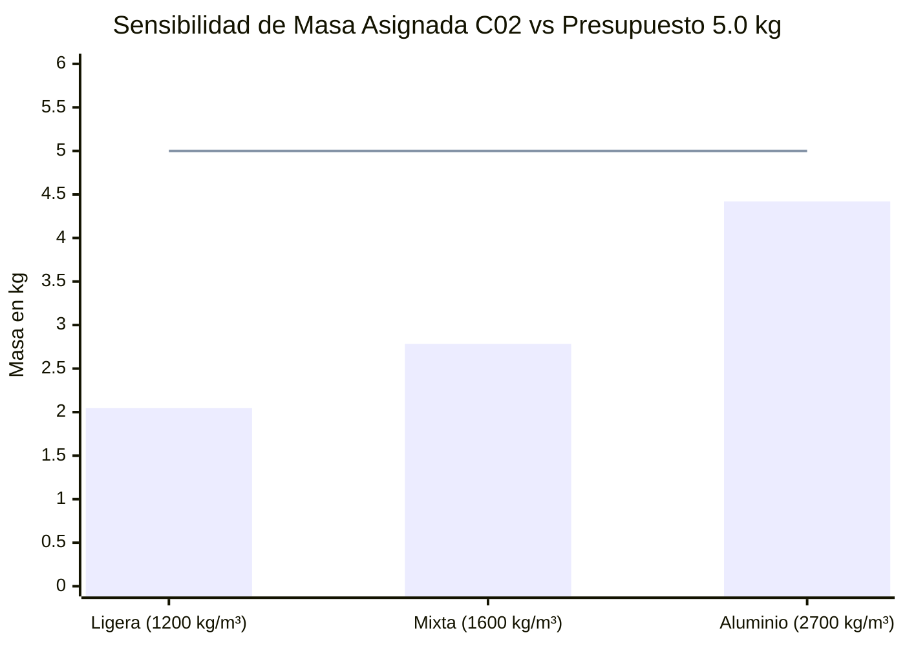

# Revisión Técnica: La BOM como Presupuesto con Incertidumbre Epistemológica

**Fecha:** 8 de noviembre de 2026  
**Ámbito:** Integridad de Masa, Cuantificación de Incertidumbre y Aseguramiento Técnico Aeronáutico  
**Configuración de estudio:** C02 (Integración modular compacta, $x=\pm 160\text{ mm}$, $y=\pm 76\text{ mm}$)  
**Archivos de referencia consultados (solo lectura):**
- `entradas/investigacion-aeronautica/configuraciones/C02_CANDIDATA.json`
- `entradas/investigacion-aeronautica/ejecucion/G1/potencia_simultanea_c02/INFORME.md`
- `entradas/investigacion-aeronautica/integracion_antigravity/sesiones_aisladas/20261108T032826Z_13ced8ae/auditoria_bom/salidas/INFORME_AUDITORIA_BOM.md`
- `entradas/investigacion-aeronautica/integracion_antigravity/sesiones_aisladas/20261108T032826Z_13ced8ae/auditoria_bom/salidas/bom_agrupada_roles.csv`

---

## 1. De la Contabilidad de Inventario Cerrado a la Cuantificación de Incertidumbre

En fases conceptuales y preliminares de diseño aeronáutico, una Lista de Materiales (BOM) se interpreta con frecuencia errónea como un **inventario cerrado**: se asume que la lista contiene la totalidad de los componentes del vehículo, que cada celda vacía equivale a masa nula ($0,0\text{ kg}$) y que la suma aritmética de los sólidos modelados en CAD define el peso físico real.

Esta revisión técnica reformula la auditoría previa bajo la metodología formal de **Presupuesto de Masa con Incertidumbre (Mass Budget Uncertainty Quantification)**, regida por los estándares de control de propiedades másicas (AIAA S-120-2006, SAWE RP 8/10 y directrices NASA SP-2016-6105).

### Principios Fundamentales del Nuevo Paradigma:
1. **Distinción ontológica entre Desconocido y Cero:** Un dato no medido o una asignación pendiente se modela en código como `None` y en tablas como celda vacía (`""`). Un valor numérico `0.0` o `0,000` se reserva con exclusividad para componentes donde se ha verificado físicamente la ausencia de masa.
2. **Naturaleza abierta de los volúmenes reservados:** Un volumen reservado en el modelo CAD representa una envolvente de espacio geométrico. **Puede permanecer vacío (cavidad o ducto diáfano, $m = 0\text{ kg}$) o puede alojar hardware funcional ($m > 0\text{ kg}$)**. No prueba masa cero ni prueba masa positiva.
3. **No inferencia sobre archivos no copiados:** En entornos de ejecución aislados, la ausencia local de copias de archivos del proyecto general (p.ej. el modelo STEP maestro o el CSV completo de 316 filas) no autoriza a inferir que tales archivos no existan en el repositorio de investigación.
4. **Objetivos de masa como requerimientos de exploración:** Los objetivos de 2 kg, 5 kg y 10 kg declarados en `C02_CANDIDATA.json` son metas de diseño (`mass_targets_are_actual_masses: false`), no masas reales de vehículos fabricados ni cotas cerradas.

---

## 2. Clasificación Epistemológica de los Datos

Conforme a las directrices de aseguramiento de integridad de datos, cada magnitud se cataloga en una de tres categorías estrictas:

| Categoría | Definición y Fuentes | Estado en la Candidata C02 | Tratamiento en Código / Presupuesto |
|---|---|---|---|
| **Datos Medidos** | Magnitudes físicas extraídas directamente de instrumentos calibrados (báscula de laboratorio, metrología óptica). | `actual_mass_kg` = `null` en el 100% de los 316 registros. **0 piezas pesadas en báscula.** No existe hardware calificado (`actual_hardware_qualified = False`). | Valor en Python: `None`. Celda en CSV: vacía (`""`). La masa medida global es estrictamente `None` (Desconocida). |
| **Datos Supuestos** | Parámetros de diseño, hipótesis de materiales y objetivos de misión asignados para exploración de viabilidad. | Densidades asumidas $\rho \in \{1200, 1600, 2700, 7800, 8800\}\text{ kg/m}^3$; reserva provisional de $0,75\text{ kg}$; arrastre de $50\text{ N}$ y eficiencias de batería en G1; metas de 2, 5 y 10 kg. | Valor numérico explícito en columna `masa supuesta`; documentado en `evidencia` y catalogado como `SUPUESTO_HIPOTETICO`. |
| **Datos Calculados** | Derivaciones matemáticas que combinan geometrías CAD con hipótesis paramétricas ($m = V \cdot \rho$). | Masa geométrica nominal $2,783990\text{ kg}$ (`mixta_1600`); límites de intervalo $[2,045841\text{ kg}, 4,421342\text{ kg}]$; remanente de energía $1,466010\text{ kg}$. | Columnas `intervalo inferior`, `intervalo superior`, balances acumulados y márgenes. |

---

## 3. Revisión Crítica de las 54 Reservas Volumétricas

La auditoría geométrica previa identificó 54 registros sin asignación de densidad ni masa en la BOM base, totalizando **$368.938,43\text{ mm}^3$** (el **$18,45\%$ del volumen geométrico total** del modelo CAD).

La auditoría anterior afirmaba de forma categórica: *"Bajo ningún concepto deben tratarse como masa física cero ($m \neq 0\text{ kg}$)"*.  
Bajo la perspectiva de incertidumbre, dicha afirmación debe ser refinada con rigor científico:

### 3.1. Por qué los volúmenes reservados pueden estar vacíos y no prueban masa positiva
1. **Canal axial central (`canal_axial_60_exterior_56_interior`):**
   - Este componente representa por sí solo **$291.539,80\text{ mm}^3$** (el **$14,58\%$ del volumen del vehículo** y el **$79,02\%$ del volumen total de reservas**).
   - El informe técnico C02 estipula taxativamente que es una *envolvente de empaquetamiento axial vacía*, no un propulsor integrado.
   - Si la arquitectura final adopta propulsión puramente modular en los 4 ductos y prescinde de un reactor o turbina axial, **este tubo puede quedar como un conducto aerodinámico pasivo, diáfano o hueco**.
   - Asumir que obligatoriamente posee masa $m > 0$ con densidad metálica falsearía el modelo inflando el peso estructural sin justificación física.
2. **Cojinetes y alojamientos de actuadores posteriores (8 registros):**
   - Corresponden a $4 \times \text{cojinete}$ ($2.269,48\text{ mm}^3$) y $4 \times \text{actuador\_reserva}$ ($21.120,00\text{ mm}^3$).
   - Representan cajas envolventes de contorno (*keep-out zones*) para comprobar holguras cinemáticas. Si las aletas adoptaran control aerodinámico pasivo, acoplamiento mecánico externo o superficies fijas, el espacio quedaría vacío.
3. **Reservas internas en los 4 módulos rotativos (44 registros):**
   - $4 \times \text{motor anular}$ ($19.940,52\text{ mm}^3$), $8 \times \text{apoyo motor}$ ($1.623,52\text{ mm}^3$), $16 \times \text{servos}$ ($30.720,00\text{ mm}^3$), $16 \times \text{ejes de servo}$ ($217,12\text{ mm}^3$).
   - Aunque la arquitectura cinemática conceptual prevé ventiladores internos orientables, **el hardware comercial específico no ha sido seleccionado, comprado ni calificado**. Su masa real es desconocida.

### 3.2. Formulación Matemática de la Incertidumbre en Reservas
Para no incurrir en el error de asignar $m = 0$ (omisión de equipos) ni en el de asumir una masa positiva arbitraria sin evidencia ($m > 0$ infundado), cada reserva volumétrica se modela como un intervalo acotado:

$$m_{\text{reserva}} \in [m_{\min}, m_{\max}] = [0,000\text{ kg}, V \cdot \rho_{\max} \cdot 10^{-9}\text{ kg}]$$

- **Cota inferior ($m_{\min} = 0,000\text{ kg}$):** Representa el escenario límite donde el volumen permanece vacío, hueco o como ducto de aire diáfano.
- **Cota superior ($m_{\max}$):** Representa el escenario conservador de peor caso donde el volumen es ocupado íntegramente por un conjunto electromecánico denso (densidad típica de actuador/motor entre $4000$ y $7800\text{ kg/m}^3$).
- **Masa supuesta nominal:** Se mantiene en `None` (no asignada) en la BOM base, y se cubre globalmente mediante una reserva provisional paramétrica parametrizada (p.ej. $0,75\text{ kg}$ en el JSON maestro).

---

## 4. Análisis de Sensibilidad de Densidad y Margen de Cierre en C02 (5 kg)

La masa de los 262 sólidos CAD asignados depende enteramente de la hipótesis de materiales:

1. **Hipótesis Ligera (`ligera_1200`, $2,046\text{ kg}$):**
   - Asume que la envolvente exterior, carenados y cubos se fabrican en compuestos ultraligeros de fibra de carbono/epoxi o termoplásticos técnicos avanzados ($\rho = 1200\text{ kg/m}^3$).
   - Deja un remanente teórico de $2,204\text{ kg}$ para batería y sistemas tras la reserva provisional de $0,75\text{ kg}$.
2. **Hipótesis Mixta (`mixta_1600`, $2,784\text{ kg}$):**
   - Asume densidad de laminado estándar ($\rho = 1600\text{ kg/m}^3$) y álabes en aluminio ($2700\text{ kg/m}^3$).
   - Deja un remanente teórico de $1,466\text{ kg}$ para batería y aviónica.
3. **Hipótesis Aluminio (`aluminio_2700`, $4,421\text{ kg}$):**
   - Modela una estructura mecanizada monolítica convencional en aleación de aluminio.
   - **Inviabilidad inmediata:** La estructura asignada sola consume el $88,4\%$ de los $5,0\text{ kg}$. Al sumar la reserva provisional de equipos ($0,75\text{ kg}$), la masa asciende a $5,171\text{ kg}$, arrojando un déficit neto de $-0,171\text{ kg}$ antes de colocar un solo gramo de batería o aviónica.

### 4.1. Contraste con el Cribado Eléctrico de Potencia Simultánea (Grupo G1)
El informe del Grupo G1 (`INFORME.md`) evaluó la viabilidad del crucero a 600 y 1.000 km/h con arrastres supuestos de hasta 50 N:
- Para sostener 50 N de arrastre a 600 km/h durante 30 s de crucero y aceleración en 60 s, **la masa mínima de batería requerida oscila entre $3,04\text{ kg}$ y $3,64\text{ kg}$**.
- A 1.000 km/h, la batería exigida asciende a entre **$5,81\text{ kg}$ y $6,40\text{ kg}$**.

> [!WARNING]
> **Conflicto Crítico de Cierre de Presupuesto:**  
> Ninguna de las hipótesis estructurales ($2,046$, $2,784$ o $4,421\text{ kg}$) dispone de un saldo remanente capaz de albergar los $3,04\text{ kg}$ a $6,40\text{ kg}$ de batería exigidos por el modelo de avance a alta velocidad bajo 50 N de arrastre.  
> Esto confirma que **la candidata C02 de 5,0 kg no está cerrada energéticamente ni físicamente**. Tratarla como un inventario cerrado ocultaría este desacople fundamental.

---

## 5. Modelos de Presupuesto Expresamente Hipotéticos (2 kg, 5 kg, 10 kg)

Conforme a la directriz de no inventar mediciones, marcas de hardware ni autores, se han estructurado presupuestos paramétricos basados exclusivamente en escalado dimensional de ingeniería y los datos explícitos de `C02_CANDIDATA.json`:

### 5.1. Variante Hipotética de 2,0 kg (`pending_own_configuration`)
- **Justificación física:** El volumen total del modelo C02 es de $\sim 2,0\text{ dm}^3$. Si se forzara la geometría de 5 kg a una masa de 2 kg, la densidad media global del vehículo sería de $1000\text{ kg/m}^3$ (igual a la densidad del agua). Dado que la piel en hipótesis ligera pesa ya $2,046\text{ kg}$, es físicamente imposible construir la variante de 2 kg con la geometría C02 actual. Requiere una configuración geométrica y cinemática propia miniaturizada.
- **Estructura del presupuesto en CSV (`salidas/presupuesto_hipotetico_2kg.csv`):**
  - Estructura ligera hipotética: $0,650\text{ kg}$ (Intervalo: $[0,500, 0,850]\text{ kg}$).
  - Planta propulsiva y mecanismos: $0,450\text{ kg}$ (Intervalo: $[0,350, 0,600]\text{ kg}$).
  - Aviónica y servocontrol: $0,150\text{ kg}$ (Intervalo: $[0,100, 0,220]\text{ kg}$).
  - Reservas volumétricas: $m_{\text{med}} = None$, $m_{\text{sup}} = None$ (Intervalo: $[0,000, 0,200]\text{ kg}$).
  - Batería hipotética: $0,550\text{ kg}$ (Intervalo: $[0,400, 0,750]\text{ kg}$).
  - Margen de contingencia (10% según AIAA S-120): $0,200\text{ kg}$ (Intervalo: $[0,100, 0,300]\text{ kg}$).
  - **Suma supuesta:** $2,000\text{ kg}$. **Intervalo de incertidumbre:** $[1,450\text{ kg}, 2,920\text{ kg}]$. Masa medida: `None`.

### 5.2. Candidata C02 de 5,0 kg (`partial_CAD_candidate`)
- **Estructura del presupuesto en CSV (`salidas/presupuesto_c02_5kg_incertidumbre.csv`):**
  - Estructura CAD asignada (262 piezas): $2,783990\text{ kg}$ (Intervalo: $[2,045841, 4,421342]\text{ kg}$).
  - 44 reservas internas de módulos: $m_{\text{med}} = None$, $m_{\text{sup}} = None$ (Intervalo: $[0,000, 0,450]\text{ kg}$).
  - 10 reservas vehiculares e interfaz axial OD60: $m_{\text{med}} = None$, $m_{\text{sup}} = None$ (Intervalo: $[0,000, 0,600]\text{ kg}$).
  - Reserva provisional de equipos no calificados: $0,750000\text{ kg}$ (Intervalo: $[0,400, 1,100]\text{ kg}$).
  - Remanente para energía, batería y aviónica: $1,466010\text{ kg}$ (Intervalo: $[0,000, 2,204]\text{ kg}$).
  - **Suma supuesta:** $5,000000\text{ kg}$. **Intervalo de incertidumbre:** $[2,4458\text{ kg}, 8,7755\text{ kg}]$. Masa medida: `None`.

### 5.3. Variante Hipotética de 10,0 kg (`pending_own_configuration`)
- **Justificación física:** A 10 kg, la sustentación en vuelo estacionario exige duplicar el empuje nominal ($T \approx 98,1\text{ N}$ frente a $49,0\text{ N}$ de C02). Por leyes de escala aerodinámica ($P \propto T^{3/2} / D$), la potencia requerida se multiplica por $\approx 2,83$ si se conserva el diámetro de los ductos, elevando la masa térmica y eléctrica de los motores y el pack.
- **Estructura del presupuesto en CSV (`salidas/presupuesto_hipotetico_10kg.csv`):**
  - Estructura portante clase 10 kg: $3,400\text{ kg}$ (Intervalo: $[2,600, 4,600]\text{ kg}$).
  - Planta propulsiva y actuadores: $2,300\text{ kg}$ (Intervalo: $[1,700, 3,200]\text{ kg}$).
  - Aviónica, navegación y carga de pago: $0,800\text{ kg}$ (Intervalo: $[0,450, 1,400]\text{ kg}$).
  - Reservas volumétricas de bahías: $m_{\text{med}} = None$, $m_{\text{sup}} = None$ (Intervalo: $[0,000, 0,600]\text{ kg}$).
  - Sistema de almacenamiento de energía: $2,500\text{ kg}$ (Intervalo: $[1,800, 3,800]\text{ kg}$).
  - Margen de contingencia (10% AIAA S-120): $1,000\text{ kg}$ (Intervalo: $[0,500, 1,600]\text{ kg}$).
  - **Suma supuesta:** $10,000\text{ kg}$. **Intervalo de incertidumbre:** $[7,050\text{ kg}, 15,200\text{ kg}]$. Masa medida: `None`.

---

## 6. Verificación de Unidades y Consistencia Dimensional

El sistema de comprobación de unidades implementado en `presupuesto_incertidumbre.py` (`UnitChecker`) asegura:
1. **Unidades Canónicas SI:** Todas las magnitudes de masa se unifican en $\text{kg}$, longitudes en $\text{m}$, volúmenes en $\text{m}^3$ y densidades en $\text{kg/m}^3$.
2. **Factores de escala CAD:** Conforme a `C02_CANDIDATA.json` (`cad_units: "mm"`, `cad_to_SI_length_factor: 0.001`), la conversión de volumen cumple:
   $$V_{\text{SI}} [\text{m}^3] = V_{\text{CAD}} [\text{mm}^3] \times (10^{-3})^3 = V_{\text{CAD}} \times 10^{-9}\text{ m}^3$$
3. **Comprobación de la relación constitutiva:**
   $$m_i [\text{kg}] = V_i [\text{mm}^3] \times 10^{-9} \times \rho_i [\text{kg/m}^3]$$
   Comprobada numéricamente con discrepancia máxima menor a $10^{-15}\text{ kg}$ en todas las geometrías asignadas.

---

## 7. Directrices Normativas para el Mantenimiento del Presupuesto

Para garantizar la integridad técnica y evitar conclusiones prematuras en futuras revisiones:
1. **Regla de Celdas Numéricas:** Toda celda de `masa medida` debe permanecer rigurosamente vacía a menos que exista un informe de calibración y pesaje en báscula del componente físico fabricado. **Nunca rellenar con ceros.**
2. **Regla de Reservas Volumétricas:** Toda reserva volumétrica debe conservar su cota inferior en $0,0\text{ kg}$ hasta que se congele la arquitectura y se determine si aloja hardware o si permanece como volumen libre/aerodinámico.
3. **Prohibición de Uso Predictivo en Dinámica de Vuelo:** Mientras la masa física permanezca sin cerrar (`physical_mass_closed = False`), ningún valor de centro de gravedad o inercia debe alimentarse en controladores de vuelo 6-DOF sin asociarle su correspondiente envolvente de dispersión Monte Carlo.
