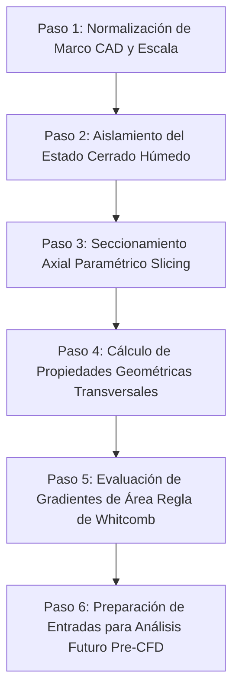
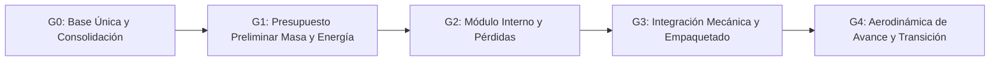

# AUDITORÍA TÉCNICA GEOMÉTRICA Y AERODINÁMICA
## Relación entre CAD Conceptual A07 y Candidata de Empaquetado C02

**Fecha de emisión:** 7 de noviembre de 2026  
**Entorno de ejecución:** Espacio aislado de auditoría (`auditoria_geometria_a07`)  
**Autoridad documental:** Directrices de aislamiento, no-modificación de `entradas/` y trazabilidad estricta sin invención de geometría ni capacidad.  
**Referencias analizadas en `entradas/`:**
1. `entradas/investigacion-aeronautica/modelos_integrados/producto_A07/LEEME.md` [LEEME-A07]
2. `entradas/investigacion-aeronautica/modelos_integrados/producto_A07/crear_A07.py` [SCRIPT-A07]
3. `entradas/investigacion-aeronautica/modelos_integrados/DECISION-ARQUITECTURA.md` [DECISION-ARQ]
4. `entradas/investigacion-aeronautica/configuraciones/C02_CANDIDATA.json` [CONFIG-C02]
5. `entradas/investigacion-aeronautica/plan_maestro/PLAN-MAESTRO.md` [PLAN-MAESTRO]

---

## 1. Resumen Ejecutivo y Marco Ontológico de Datos

La presente auditoría evalúa por lectura técnica directa la relación geométrica, dimensional y funcional entre la línea base canónica **A07** (`A07_RESEARCH_BASE_2026-11-03_r1`) y la candidata separada de empaquetado **C02** (`C02_COMPACTA_x160_5kg_2026-11-03_r2`), ambas pertenecientes a la **Arquitectura A (ventiladores internos fijos)**.

### 1.1 Reglas de Clasificación Epistémica de Información
Para garantizar la máxima integridad técnica, todos los datos contenidos en este informe se clasifican estrictamente en cuatro categorías:

1. **Datos Medidos (CAD / Intersecciones numéricas directas):** Dimensiones verificadas en código CAD, recuentos directos de piezas en STEP, áreas poligonales calculadas por geometría computacional o volúmenes de intersección booleana reportados en bitácoras de interferencia.
2. **Datos Supuestos (Hipótesis / Objetivos de diseño):** Masas objetivo (2, 5, 10 kg), rangos de velocidad deseados (600–1000 km/h), condiciones de atmósfera estándar ISA, conos de empuje supuestos (35°–45°), cotas cinemáticas de estudio (elevación 10 mm, rotación 110°) y márgenes de reserva sin asignar.
3. **Datos Calculados (Modelos y propagaciones numéricas):** Integraciones de volumen por tramos, áreas transversales poligonales, fuerza de fricción de placa plana (~96 N a 1000 km/h), presión dinámica ($q \approx 47\text{ kPa}$), momentos ideales de cabeceo ($\pm 3,50\text{ N}\cdot\text{m}$) y factores de escala geométrica $(m/5)^{1/3}$.
4. **Datos Desconocidos / Pendientes / No Asignados:** Parámetros marcados explícitamente como `null` en configuración (masa real, CG real, tensor de inercia real, cono efectivo de chorro, tiempo de respuesta de servos), componentes sin seleccionar (motor de crucero axial, motores y ESC de rotores calificados, baterías/combustible) y mecanismos físicos no resueltos (bisagras, varillajes, sellos, actuadores).

> [!IMPORTANT]
> **Directriz de no-inferencia ontológica:**
> - La ausencia de un archivo en la carpeta local `entradas/` (por ejemplo, archivos STEP pesados o bitácoras intermedias citados en el repositorio del proyecto) no autoriza a inferir que el archivo no exista en el proyecto global.
> - Una reserva de volumen o un componente sin masa asignada (marcado `null`) no permite inferir que su masa real sea nula ni que sea no nula.
> - Ningún solver CFD ha sido ejecutado ni reanudado; los procesos permanecen estrictamente en estado pausado (`docker pause`), de acuerdo con las órdenes vigentes.

---

## 2. Geometrías y Dimensiones Documentadas en A07 y C02

A continuación se detallan las geometrías y dimensiones que constan de manera verificable en los archivos auditados, con indicación exacta de archivos y líneas.

### 2.1 Envolvente Exterior y Fuselaje (Línea Base A07 / C02 5 kg)
- **Longitud total del fuselaje ($L$):** $1340\text{ mm}$ ($1,340\text{ m}$), definida entre la estación de nariz $x = -680\text{ mm}$ y la estación de cola $x = +660\text{ mm}$ en el sistema de coordenadas CAD (*Fuente: [DECISION-ARQ], línea 37; [SCRIPT-A07], línea 15*).
- **Superficie exterior húmeda del loft cerrado de referencia:** $0,8304\text{ m}^2$ ($830.400\text{ mm}^2$), previa a recortes de compuertas y puerto posterior (*Fuente: [DECISION-ARQ], línea 37*).
- **Volumen bruto del loft exterior continuo:** $40,09\text{ litros}$ ($0,04009\text{ m}^3$ o $40.090.000\text{ mm}^3$) (*Fuente: [DECISION-ARQ], línea 37*). La integración trapezoidal por tramos de las 8 estaciones poligonales rinde $38,881\text{ litros}$ (*Fuente: `salidas/AREAS_TRANSVERSALES_A07.json`*).
- **Definición paramétrica de las 8 estaciones transversales:**
  El código [SCRIPT-A07] (líneas 15–22) define la forma tridimensional mediante un loft de 8 secciones transversales en el plano $YZ$, cada una parametrizada por su semi-ancho $w$ y su semi-alto superior $h$:

$$\text{Secciones } (x, w, h): [(-680, 7, 6), (-580, 58, 36), (-400, 127, 80), (-140, 160, 107), (160, 150, 103), (400, 112, 78), (570, 63, 47), (660, 25, 25)]$$

Cada sección está delimitada por un polígono facetado de **10 vértices** en coordenadas $(y, z)$ relativas a la estación $x$:
1. $(+w, 0)$
2. $(+0,79w, +0,67h)$
3. $(+0,37w, +1,00h)$
4. $(-0,37w, +1,00h)$
5. $(-0,79w, +0,67h)$
6. $(-w, 0)$
7. $(-0,75w, -0,62h)$
8. $(-0,32w, -0,78h)$
9. $(+0,32w, -0,78h)$
10. $(+0,75w, -0,62h)$

#### Tabla 2.1: Propiedades Geométricas Transversales Verificadas (Escala 5 kg)
*Calculadas de forma exacta mediante `salidas/extraccion_areas_secciones.py` a partir de [SCRIPT-A07] (líneas 15–22):*

| Estación $x$ (mm) | Semi-ancho $w$ (mm) | Semi-alto $h$ (mm) | Ancho total $2w$ (mm) | Alto total $H$ (mm) | Relación Aspecto $W/H$ | Área Exterior $A(x)$ ($\text{cm}^2$) | Perímetro Exterior (mm) | Centroide $Z_{cg}$ (mm) | Diám. Equiv. $D_{eq}$ (mm) | Offset Inset $d$ (mm) |
|---|---|---|---|---|---|---|---|---|---|---|
| **-680 (Nariz)** | 7 | 6 | 14,0 | 10,68 | 1,311 | 1,19 | 39,85 | +0,55 | 12,32 | 2,000 |
| **-580** | 58 | 36 | 116,0 | 64,08 | 1,810 | 59,26 | 292,71 | +3,29 | 86,87 | 2,000 |
| **-400** | 127 | 80 | 254,0 | 142,40 | 1,784 | 288,37 | 646,27 | +7,32 | 191,62 | 2,000 |
| **-140 (Sección Máx.)** | 160 | 107 | 320,0 | 190,46 | 1,680 | **485,92** | 817,73 | **+9,79** | **248,70** | 2,000 |
| **+160** | 150 | 103 | 300,0 | 183,34 | 1,636 | 438,52 | 775,19 | +9,43 | 236,29 | 2,000 |
| **+400** | 112 | 78 | 224,0 | 138,84 | 1,613 | 247,95 | 583,90 | +7,14 | 177,66 | 2,000 |
| **+570** | 63 | 47 | 126,0 | 83,66 | 1,506 | 84,04 | 344,05 | +4,30 | 103,44 | 2,000 |
| **+660 (Cola)** | 25 | 25 | 50,0 | 44,50 | 1,124 | 17,74 | 151,96 | +2,29 | 47,53 | 2,000 |

*Observaciones críticas:*
- La **sección transversal máxima** ocurre en la estación $x = -140\text{ mm}$, con un área de $485,92\text{ cm}^2$ ($0,04859\text{ m}^2$), anchura de $320\text{ mm}$ y altura de $190,46\text{ mm}$.
- La relación de aspecto anchura/altura ($W/H$) varía entre 1,12 y 1,81, lo que confirma un cuerpo marcadamente **aplanado**.
- El centroide vertical $Z_{cg}$ es **estrictamente positivo en todas las secciones** (+0,55 mm a +9,79 mm), ya que la cubierta superior se extiende hasta $+1,00h$ mientras el fondo plano inferior solo desciende hasta $-0,78h$. Esto impone una asimetría y curvatura (*camber*) vertical intrínseca.

### 2.2 Rotores y Conductos Internos
- **Número de rotores/módulos:** 4 unidades internas fijas dispuestas en configuración cuadrilateral (*Fuente: [LEEME-A07], línea 3; [CONFIG-C02], línea 85*).
- **Estaciones de los centros de rotor en C02:**
  Coordenadas $(x, y)$ en metros (*Fuente: [CONFIG-C02], líneas 86–103*):
  1. Delantero Derecho: $(-0,16\text{ m}, -0,076\text{ m}) \rightarrow x = -160\text{ mm}, y = -76\text{ mm}$
  2. Delantero Izquierdo: $(-0,16\text{ m}, +0,076\text{ m}) \rightarrow x = -160\text{ mm}, y = +76\text{ mm}$
  3. Trasero Derecho: $(+0,16\text{ m}, -0,076\text{ m}) \rightarrow x = +160\text{ mm}, y = -76\text{ mm}$
  4. Trasero Izquierdo: $(+0,16\text{ m}, +0,076\text{ m}) \rightarrow x = +160\text{ mm}, y = +76\text{ mm}$
  Eje de orientación: $[0, 0, 1]$ (paralelo al eje vertical $Z$).
  *Nota sobre A07:* En ramas antecedentes de integración, A03 proponía $x = \pm 200\text{ mm}, y = \pm 76\text{ mm}$ (*[DECISION-ARQ], línea 90*), mientras que la exploración de empaquetado axial estudió $x = \pm 100\text{ mm}, y = \pm 86\text{ mm}$ (*[DECISION-ARQ], línea 47*). C02 consolida la estación compacta en $x = \pm 160\text{ mm}, y = \pm 76\text{ mm}$.
- **Diámetro nominal de taladro de conducto (*bore diameter*):** $84\text{ mm}$ ($0,084\text{ m}$, radio $42\text{ mm}$) (*Fuente: [CONFIG-C02], línea 110; [DECISION-ARQ], línea 21*).
- **Dimensiones de rotor en C02:**
  - Radio nominal BEM: $41\text{ mm}$ ($0,041\text{ m}$, diámetro nominal D82 mm) (*Fuente: [CONFIG-C02], línea 111; [DECISION-ARQ], línea 117*).
  - Radio envolvente de rotación conservadora: $41,5\text{ mm}$ ($0,0415\text{ m}$, diámetro D83 mm) (*Fuente: [CONFIG-C02], línea 112*).
  - Separación radial geométrica nominal: $\approx 0,988\text{ mm}$ a $1,0\text{ mm}$ entre punta de pala y camisa de radio 42 mm (*Fuente: [DECISION-ARQ], línea 21*).
  - Sentidos de rotación (vistos desde $+Z$): `["CCW", "CW", "CW", "CCW"]` (*Fuente: [CONFIG-C02], líneas 113–117*).
  - Alojamiento de motor: En C02 se reserva espacio para el motor eléctrico dentro del buje/cubo (*Fuente: [DECISION-ARQ], línea 117*). En A07 el motor era puramente conceptual sin cubo dimensionado.

### 2.3 Compuertas Móviles y Cinemática Conceptual
- **Número de compuertas:** 8 tapas (4 superiores y 4 inferiores) correspondientes a las entradas y salidas de los 4 conductos (*Fuente: [LEEME-A07], línea 3; [CONFIG-C02], línea 125*).
- **Recorte geométrico de camisas en A07:** Las camisas de los conductos se recortan mediante intersección booleana con un loft interior desplazado $d = 2\text{ mm}$ hacia adentro (*[SCRIPT-A07], líneas 18–25; [LEEME-A07], línea 10*). Este recorte elimina los solapes nominales detectados en A06 ($584–691\text{ mm}^3$ superiores y $592–668\text{ mm}^3$ inferiores por pareja).
- **Trayectoria cinemática conceptual (referencia 5 kg):**
  1. **Traslación:** $10\text{ mm}$ en dirección exterior ($+Z$ para las 4 compuertas superiores, $-Z$ para las 4 inferiores) (*Fuente: [LEEME-A07], línea 13*).
  2. **Giro:** Rotación exterior de $110^\circ$ alrededor de un eje longitudinal que se traslada conjuntamente con la tapa (*Fuente: [LEEME-A07], línea 14; [SCRIPT-A07], líneas 27–29*).
- **Muestreo y verificación de colisiones:**
  - Evaluado en **61 nodos discretos**: 6 pasos de traslación (0 a 10 mm, cada 2 mm) y 55 pasos de rotación (2° a 110°, cada 2°) (*[SCRIPT-A07], línea 37*).
  - En A07: 488 parejas probadas contra casco de referencia (sin tapas), 4 aletas móviles y carenados posteriores, y tapas entre sí; solape máximo $0\text{ mm}^3$ ($<10^{-3}\text{ mm}^3$) (*[SCRIPT-A07], líneas 40–53; [LEEME-A07], línea 19*).
  - En C02: 808 parejas evaluadas en compuertas y 314 parejas de interfaz sin solapes nominales (*[DECISION-ARQ], líneas 118–119; [CONFIG-C02], línea 125*).

### 2.4 Sistemas de Coordenadas y Transformaciones
- **Sistema de Coordenadas CAD:**
  - Eje $X$: Longitudinal, con la **nariz en $x$ negativo** ($x = -680\text{ mm}$) y la cola en $x$ positivo ($x = +660\text{ mm}$).
  - Eje $Y$: Lateral (simetría respecto a $y = 0$).
  - Eje $Z$: Vertical ($+Z$ hacia arriba).
  - Unidades canónicas CAD: milímetros ($\text{mm}$), factor a SI: $0,001\text{ m/mm}$ (*[CONFIG-C02], líneas 11–17*).
- **Sistema de Coordenadas de Vuelo (Flight Body Frame - FLU):**
  - Eje $X_{FLU}$: Hacia adelante (apuntando a la nariz $\rightarrow -X_{CAD}$).
  - Eje $Y_{FLU}$: Hacia babor / izquierda ($\rightarrow -Y_{CAD}$).
  - Eje $Z_{FLU}$: Hacia arriba ($\rightarrow +Z_{CAD}$).
  - Matriz de rotación canónica:

$$R_{flight/CAD} = \begin{bmatrix} -1 & 0 & 0 \\ 0 & -1 & 0 \\ 0 & 0 & 1 \end{bmatrix}$$

  *(Fuente: [CONFIG-C02], líneas 18–40; [DECISION-ARQ], línea 3)*.

---

## 3. Matriz Comparativa: Qué Aparece, Qué Difiere y Qué es Desconocido

La Tabla 3.1 sintetiza la auditoría comparativa entre la línea base A07 y la candidata C02, consolidando los 25 parámetros clave del proyecto.

#### Tabla 3.1: Matriz Comparativa A07 vs. C02

| Parámetro / Componente | Línea Base A07 (`A07_BASE.json`) | Candidata C02 (`C02_CANDIDATA.json`) | Estado de Comparación | Categoría Epistémica | Fuentes Documentales |
|---|---|---|---|---|---|
| **Rol en el Proyecto** | Referencia canónica aprobada de trabajo (`A07_RESEARCH_BASE_2026-11-03_r1`) | Candidata separada de empaquetado/cinemática (`C02_COMPACTA_x160_5kg_2026-11-03_r2`) | **Diferente** (C02 no sustituye a A07 como referencia canónica) | Definido | [PLAN-MAESTRO]: 4; [CONFIG-C02]: 54–55; [DECISION-ARQ]: 115–117 |
| **Arquitectura General** | A: Ventiladores internos fijos | A: Ventiladores internos fijos | **Idéntico** | Definido | [LEEME-A07]: 3; [CONFIG-C02]: 2; [DECISION-ARQ]: 9 |
| **Geometría Exterior** | Envolvente de 1,340 m, loft 10 vértices, 8 estaciones | Misma envolvente exterior de referencia A07 | **Idéntico** | Medido CAD | [SCRIPT-A07]: 15; [CONFIG-C02]: 54, 81; [DECISION-ARQ]: 37 |
| **Estaciones de Rotores $(x, y)$** | A03: $x = \pm 200, y = \pm 76\text{ mm}$; Variante axial: $x = \pm 100, y = \pm 86\text{ mm}$ | **$x = \pm 160\text{ mm}, y = \pm 76\text{ mm}$** ($x = \pm 0,16\text{ m}, y = \pm 0,076\text{ m}$) | **Diferente** (C02 fija estación longitudinal intermedia compacta) | Medido CAD / Definido | [DECISION-ARQ]: 47, 90, 117; [CONFIG-C02]: 86–103 |
| **Diámetro de Taladro de Conducto** | 84 mm (radio 42 mm) | 84 mm (radio 0,042 m) | **Idéntico** | Medido CAD | [DECISION-ARQ]: 21; [CONFIG-C02]: 110 |
| **Diámetro de Rotor y Holgura** | D82 mm representativo; holgura $\approx 0,988\text{ mm}$ | D82 mm nominal (radio BEM 0,041 m, rotación 0,0415 m) | **Consistente** | Medido CAD / Supuesto | [DECISION-ARQ]: 21, 117; [CONFIG-C02]: 111–112 |
| **Alojamiento de Motor de Rotor** | Sin motor en buje ni cubo modelado | **Motor reservado dentro del cubo del rotor** | **Diferente** (C02 añade reserva volumétrica en cubo) | Medido CAD en C02 / Desconocido componente | [LEEME-A07]: 22; [DECISION-ARQ]: 117 |
| **Sentido de Giro de Rotores** | No explicitado en manifiesto | `["CCW", "CW", "CW", "CCW"]` | **Diferente** (Explicitado en C02) | Definido | [CONFIG-C02]: 113–117 |
| **Recuento de Piezas en Ensamblaje** | **208 piezas** válidas reimportadas por escala | **316 registros nominales** de piezas | **Diferente** (C02 incorpora +108 registros por mayor detalle) | Medido CAD | [SCRIPT-A07]: 67; [LEEME-A07]: 19; [CONFIG-C02]: 80 |
| **Cinemática Conceptual de Tapas** | Elevación 10 mm en Z, rotación 110° exterior | Elevación 10 mm en Z, rotación 110° exterior | **Idéntico** (Ambos son estudios cinemáticos en 61 nodos) | Supuesto cinemático | [LEEME-A07]: 13–16; [CONFIG-C02]: 125 |
| **Comprobaciones de Interferencia** | 61 etapas, 488 parejas probadas, solape $0\text{ mm}^3$ | 61 nodos, 808 parejas en tapas, 314 parejas interfaz solape $0$ | **Diferente** (C02 verifica 808 parejas vs 488 de A07) | Medido CAD (Intersección booleana) | [SCRIPT-A07]: 37–53; [DECISION-ARQ]: 118–119 |
| **Mecanismo Físico de Compuertas** | No resuelto; sin guías, bisagras, varillaje o actuadores | No resuelto; trayectoria continua y mecanismo pendientes | **Idéntico** (Ambos carecen de mecanismo físico real) | **Desconocido** | [LEEME-A07]: 22; [PLAN-MAESTRO]: 54; [DECISION-ARQ]: 119 |
| **Actuación de Álabes (Vanes)** | Banco doble modelado geométricamente | Rango mecánico $[-45^\circ, 45^\circ]$, biela $0,006\text{ m}$; cono y servo `null` | **Diferente** (C02 documenta cinemática de biela) | Definido mecánico / Desconocido dinámico | [CONFIG-C02]: 126–134; [DECISION-ARQ]: 31 |
| **Masa Real del Vehículo** | No cerrada; 2/5/10 kg son objetivos de escala | `actual_mass_kg: null` (`mass_targets_are_actual_masses: false`) | **Idéntico** (Ninguno posee masa real medida o cerrada) | **Desconocido** | [LEEME-A07]: 24; [CONFIG-C02]: 62, 121; [PLAN-MAESTRO]: 131 |
| **Centro de Gravedad Real ($CG$)** | No medido; dependiente de escenarios de material | `actual_CG_m: null` | **Idéntico** (Desconocido en ambos) | **Desconocido** | [DECISION-ARQ]: 55; [CONFIG-C02]: 122 |
| **Tensor de Inercia Real** | No medido | `actual_inertia_kgm2: null` | **Idéntico** (Desconocido en ambos) | **Desconocido** | [CONFIG-C02]: 123; [PLAN-MAESTRO]: 131 |
| **Propulsor Axial de Avance** | Tubo central vacío (reservas de 38, 60 y 80 mm) | Reserva axial vacía condicionada por estaciones $x = \pm 160\text{ mm}$ | **Idéntico** (Sin motor, tomas o escape seleccionados) | **Desconocido** | [DECISION-ARQ]: 41, 47–51; [CONFIG-C02]: 54; [PLAN-MAESTRO]: 30 |
| **Variantes de 2 kg y 10 kg** | Escaladas geométricamente por factor $(m/5)^{1/3}$ | `pending_own_configuration` (requieren diseño propio) | **Diferente** (C02 no aplica escalado ciego) | Cálculo geométrico (A07) / Pendiente (C02) | [SCRIPT-A07]: 56; [CONFIG-C02]: 63–67 |
| **Calificación Propulsiva/Térmica** | No calificada | `rotor_motor_servo_and_cooling_qualified: false` | **Idéntico** (Sin calificación física) | Estado verificado | [CONFIG-C02]: 124; [DECISION-ARQ]: 119 |
| **Mapa Instalado de Empuje** | No disponible (cono 45° supuesto en control) | `installed_map_available: false` | **Idéntico** (Sin mapa instalado de fuerzas/momentos) | Estado verificado | [CONFIG-C02]: 119; [DECISION-ARQ]: 33, 73 |
| **Planta Predictiva de Vuelo** | No validada | `predictive_flight_plant_accepted: false` | **Idéntico** (No aceptada para guiado cerrado) | Estado verificado | [CONFIG-C02]: 141; [DECISION-ARQ]: 108 |
| **Solvers CFD Previos** | Pausados (`docker pause`) | Pausados (`docker pause`) | **Idéntico** (Estrictamente suspendidos) | Estado de proceso | [LEEME-A07]: 24; [DECISION-ARQ]: 3, 93, 119; [PLAN-MAESTRO]: 218 |

---

## 4. Análisis Geométrico y Físico: No-Transferibilidad de Simetría Circular

Uno de los principios rectores más estrictos establecidos por el usuario y ratificados en [PLAN-MAESTRO] (líneas 35 y 145) es:
> *«La forma circular de los primeros husos no describe automáticamente el cuerpo deportivo actual, aplanado y facetado. No transferir tablas de esbeltez, Mach crítico, arrastre, inercia o simetría de fuerzas entre esas geometrías. Tampoco imponer L/D=6 como resultado ya demostrado... la simetría de un huso circular no se hereda en esta forma.»*

### 4.1 Evidencia Geométrica de la Pérdida de Simetría Circular
El vehículo conceptual inicial fue concebido como un cuerpo de revolución axisimétrico ($r(x) = \text{constante}$ para cada corte circular $YZ$). Sin embargo, la geometría aprobada A07/C02 presenta tres rupturas topológicas fundamentales:

1. **Aplanamiento Transversal Severo (Relación de Aspecto $W/H$):**
   - En la sección máxima ($x = -140\text{ mm}$), la anchura total es $2w = 320\text{ mm}$ y la altura total es $H = 190,46\text{ mm}$.
   - La relación de aspecto transversal es:

$$\frac{W}{H} = \frac{320,0}{190,46} = 1,680$$

   - A lo largo del fuselaje, $W/H$ oscila entre $1,124$ (en cola) y $1,810$ (en $x = -580\text{ mm}$).
   - Un huso circular posee rigurosamente $W/H \equiv 1,000$. En consecuencia, el área proyectada en planta ($XY$) es significativamente mayor que el área proyectada de perfil ($XZ$).

2. **Asimetría Vertical Intrínseca y Curvatura (*Camber*):**
   - El contorno superior del polígono alcanza $+1,00h$ en los vértices 3 y 4 ($y = \pm 0,37w$), mientras que el fondo inferior solo desciende hasta $-0,78h$ en los vértices 8 y 9 ($y = \pm 0,32w$) y $-0,62h$ en los vértices 7 y 10.
   - El fondo es sensiblemente más plano que la cubierta superior, generando un centroide vertical $Z_{cg}$ desplazado hacia arriba en todas las estaciones (+0,55 mm en nariz, +9,79 mm en la estación máxima, +2,29 mm en cola).
   - Esto convierte al fuselaje en un **cuerpo sustentador asimétrico (*lifting body*)** con línea media combada, incompatible con cualquier formulación axisimétrica.

3. **Facetado Poligonal (10 Vértices y Aristas Longitudinales):**
   - Las secciones no son curvas suaves continuas, sino polígonos de 10 vértices rectilíneos que generan aristas longitudinales a lo largo del fuselaje.
   - A altas velocidades subsónicas y transónicas (Mach 0,49–0,82), las esquinas facetadas inducen gradientes circunferenciales de presión no uniformes, picos locales de velocidad, ondas de choque transversales prematuras y líneas de desprendimiento de capa límite imposibles de predecir mediante teorías de cuerpos de revolución.

```
       Perfil Transversal A07 en x = -140 mm (Facetado Asimétrico, W=320 mm, H=190.5 mm)
                                z = +107 mm (Vértices 3 y 4: y = ±59.2 mm)
                                  +---------+
                            /                     \
      Vértice 2 (y=+126.4, z=+71.7)                 Vértice 5 (y=-126.4, z=+71.7)
                   /                                       \
  Vértice 1       +                                         +       Vértice 6
  (y=+160, z=0)---|------------------+----------------------|--- (y=-160, z=0)
                   \              Zcg=+9.79 mm             /
      Vértice 10    \                                     /         Vértice 7
  (y=+120, z=-66.3)  +                                   +   (y=-120, z=-66.3)
                            \                     /
                                  +---------+
                         z = -83.5 mm (Vértices 8 y 9: y = ±51.2 mm)
```

### 4.2 Consecuencias Físicas y Aerodinámicas de la No-Simetría
Transferir parámetros de un huso circular al producto actual constituiría un error grave de ingeniería por las siguientes razones:

1. **Sustentación y Momento a Incidencia Nula ($C_{L0} \neq 0, C_{m0} \neq 0$):**
   Un huso circular simétrico en flujo alineado ($\alpha = 0^\circ, \beta = 0^\circ$) produce sustentación nula ($C_L = 0$) y momento de cabeceo nulo ($C_m = 0$). El fuselaje A07 combado producirá una sustentación finita positiva y un momento de picado/encabritado intrínseco incluso a $\alpha = 0^\circ$, que debe ser equilibrado por las 4 aletas posteriores en X.
2. **Desacoplamiento Longitudinal / Lateral:**
   En un cuerpo axisimétrico, la fuerza normal ante ángulo de ataque $\alpha$ es idéntica a la fuerza lateral ante ángulo de resbalamiento $\beta$ ($C_{N\alpha} \equiv C_{Y\beta}$). En A07/C02, la fuerza lateral generada por guiñada es sustancialmente menor que la fuerza vertical por cabeceo debido al aplanamiento ($W > H$).
3. **Estrategia de Maniobra de Vuelo (*Bank-to-Turn* vs. *Skid-to-Turn*):**
   Como advierte [PLAN-MAESTRO] (línea 145), no se puede asumir viraje simétrico por derrape (*skid-to-turn*). La diferencia de áreas laterales y verticales exige evaluar viraje con alabeo (*bank-to-turn*) o estrategias combinadas según la autoridad disponible de las 4 aletas en X.
4. **Invalidez de Tablas de Resistencia de Onda y Diámetro Equivalente:**
   Si bien la regla de las áreas transónica de Whitcomb utiliza un diámetro equivalente $D_{eq}(x) = 2\sqrt{A(x)/\pi}$ para estimar la resistencia de onda en flujo axial, este radio equivalente no reproduce el campo de flujo 3D ni las expansiones locales en las esquinas facetadas.

---

## 5. Metodología Verificable para Obtención de Áreas Transversales y Preparación Aerodinámica Futura

Para cumplir con la directriz de establecer pasos reproducibles sin ejecutar ni reanudar solvers CFD, se formaliza el siguiente procedimiento algorítmico y metodológico en 6 pasos.

### 5.1 Procedimiento Algorítmico en 6 Pasos



#### Paso 1: Normalización del Marco CAD y Verificación de Escala
1. Cargar el modelo en el marco canónico documentado en [CONFIG-C02] (líneas 13–17): eje $x$ longitudinal (nariz en $x = -680\text{ mm}$, cola en $x = +660\text{ mm}$), eje $y$ lateral simétrico, eje $z$ vertical.
2. Para la escala de referencia de $5\text{ kg}$, el factor de escala es $s = 1,000$. Para estudios en otras masas objetivo, aplicar estrictamente $(m/5)^{1/3}$ sin modificar la topología.

#### Paso 2: Aislamiento del Estado Geométrico "Cerrado"
1. Seleccionar el estado de avance en crucero: en A07, `A07_cerrado.step` (208 piezas); en C02, `C02_integracion_x160_5kg_cerrado_CANDIDATA.step` (SHA-256 `c587381e42e5eba78454f9bc263a9db51b75114875ab281eaa4fbb33666b439e`).
2. Aislar la envolvente húmeda exterior: fusión booleana del fuselaje cerrado con las 4 compuertas superiores y 4 inferiores cerradas, más las 4 aletas posteriores móviles y sus carenados de raíz (`aleta_movil_` y `carenado_raiz_`, [SCRIPT-A07] línea 35).

#### Paso 3: Seccionamiento Axial Numérico (*Slicing*)
1. Establecer una familia de planos de corte perpendiculares al eje longitudinal: $\Pi(x_k): X = x_k$, con $x_k \in [-680\text{ mm}, +660\text{ mm}]$.
2. Discretización recomendada:
   - Intervalo general: $\Delta x = 5\text{ mm}$ (269 secciones axiales).
   - Intervalo refinado ($\Delta x = 1\text{ mm}$) en zonas de alta curvatura: estación de nariz ($x \in [-680, -550]$), zonas de compuertas ($x \approx \pm 160\text{ mm}$) y nacimiento de aletas posteriores ($x \in [400, 660]$).
3. Intersección booleana B-Rep: en cada plano $\Pi(x_k)$, extraer los lazos cerrados (*wires*) de la frontera húmeda:
   $$\Gamma(x_k) = \text{Sólido\_Exterior} \cap \Pi(x_k)$$

#### Paso 4: Extracción y Cálculo de Propiedades de Sección
Para cada corte transversal $x_k$, calcular de forma verificable:
1. **Área transversal $A(x_k)$:** Mediante la fórmula del agrimensor (Shoelace) sobre los vértices discretizados o propiedades de inercia de área de OpenCASCADE (`BRepGProp::SurfaceProperties`):
   $$A(x_k) = \frac{1}{2} \left| \sum_{i=1}^{N} (y_i z_{i+1} - y_{i+1} z_i) \right|$$
2. **Dimensiones envolventes:** Anchura total $W(x_k) = y_{\max} - y_{\min}$ y Altura total $H(x_k) = z_{\max} - z_{\min}$.
3. **Centroide transversal $(Y_{cg}, Z_{cg})$:**
   $$Z_{cg}(x_k) = \frac{1}{6 A(x_k)} \sum_{i=1}^{N} (z_i + z_{i+1}) (y_i z_{i+1} - y_{i+1} z_i)$$
   Verificar que $Y_{cg} \equiv 0$ por simetría y documentar $Z_{cg}(x_k) > 0$.
4. **Diámetro equivalente de Whitcomb:** $D_{eq}(x_k) = 2 \sqrt{A(x_k)/\pi}$.
5. Almacenar los resultados en un archivo estructurado abierto (`salidas/AREAS_TRANSVERSALES_A07.json`).

#### Paso 5: Evaluación de la Regla de las Áreas y Gradientes Transversales
1. Calcular la primera y segunda derivada numérica respecto a la coordenada axial:
   $$A'(x) = \frac{dA}{dx}, \quad A''(x) = \frac{d^2A}{dx^2}$$
2. Identificar discontinuidades en $A'(x)$ que originan picos de resistencia de onda transónica ($D_{wave} \propto \iint A''(x_1) A''(x_2) \ln|x_1 - x_2| dx_1 dx_2$).
3. Evaluar el impacto de las 4 aletas posteriores en X: registrar el salto de área transversal en $x > 400\text{ mm}$ y contrastar si se requiere estrechamiento del cuerpo (*area ruling* o "cintura de avispa") para vuelo a Mach 0,82 (1000 km/h).

#### Paso 6: Preparación de Entradas para Futuros Análisis Aerodinámicos (Pre-CFD)
1. **Generación de Malla Superficial de Alta Fidelidad:**
   - Exportar la envolvente húmeda verificada a formato IGES/STEP limpio o STL con refinamiento adaptativo.
   - Refinar la densidad de malla en las aristas longitudinales de los 10 vértices para capturar adecuadamente los gradientes circunferenciales sin celdas distorsionadas.
2. **Definición del Dominio Exterior Farfield:**
   - Crear una caja o cilindro farfield con extensiones de al menos 20 longitudes de cuerpo ($20 L \approx 27\text{ m}$) en todas las direcciones para evitar reflexiones espurias de ondas de choque en regímenes transónicos.
3. **Fijación de Condiciones Operativas Estándar:**
   - Aplicar los parámetros ISA documentados en [CONFIG-C02] (líneas 42–50): $\rho = 1,225\text{ kg/m}^3$, $p = 101325\text{ Pa}$, $T = 288,15\text{ K}$, $\mu = 1,7894\times 10^{-5}\text{ Pa}\cdot\text{s}$, $\gamma = 1,4$.
4. **Matriz de Casos Futuros (Plan Maestro G4):**
   - Mach 0,49 (600 km/h), Mach 0,65 (800 km/h), Mach 0,82 (1000 km/h).
   - Ángulos de ataque $\alpha = [0^\circ, 5^\circ, 10^\circ]$ y de resbalamiento $\beta = [0^\circ, \pm 5^\circ]$ ([PLAN-MAESTRO], línea 141).
   - **Restricción imperativa:** Ningún caso será resuelto ni enviado a ejecución en esta etapa.

---

## 6. Hoja de Ruta Específica (Hitos G0 a G4)

Basada en los criterios de salida del [PLAN-MAESTRO] (líneas 68–86), se define la siguiente hoja de ruta secuencial para avanzar hacia el análisis aerodinámico sin saltarse las dependencias críticas:



### Hito G0 · Consolidación de Base Única y Trazabilidad (1–3 jornadas)
- **Objetivo:** Unificar la línea base A07 con los datos dimensionales validados de C02 en un único archivo canónico de configuración.
- **Entregables verificables:** Archivo de configuración maestro, registro de supuestos, script de extracción de áreas `salidas/extraccion_areas_secciones.py` y matriz comparativa `salidas/MATRIZ_COMPARATIVA_A07_C02.json`.
- **Criterio de salida:** Cero contradicciones en unidades, marcos de coordenadas y dimensiones nominales de piezas.

### Hito G1 · Viabilidad Preliminar de Presupuesto (2–4 jornadas)
- **Objetivo:** Establecer el presupuesto discriminado de masa y volumen para las variantes de 2, 5 y 10 kg con configuraciones propias.
- **Entregables verificables:** Lista de equipos comerciales candidatos (baterías, motores de cubo, aviónica), presupuesto de masa con margen del 15% sin asignar documentado explícitamente ([PLAN-MAESTRO], línea 131).
- **Criterio de salida:** Masa estimada total no supera los objetivos fijados y volumen de componentes cabe dentro del loft de 40,09 L sin solapes.

### Hito G2 · Caracterización del Módulo Interno Aislado (5–15 jornadas)
- **Objetivo:** Obtener las curvas experimentales o de disco actuador del rotor D82 en su conducto de 84 mm con álabes móviles.
- **Entregables verificables:** Mapa de tracción vs. potencia, ángulo efectivo del chorro (verificar si alcanza o no los 35°–45° supuestos), par de bisagra de álabes y pérdidas en labios y conducto recortado.
- **Criterio de salida:** Dominio de empuje instalado suficiente para cubrir al menos $0,5\text{ g}$ de maniobra en estacionario con margen de potencia.

### Hito G3 · Integración Funcional y Mecanismos de Compuertas (4–10 jornadas)
- **Objetivo:** Sintetizar la cinemática real de las 8 compuertas mediante guías, bisagras y actuadores dimensionados.
- **Entregables verificables:** CAD paramétrico con varillajes físicos instalados, análisis de holguras bajo deformación, verificación de colisiones en recorrido continuo y sellos estructurales.
- **Criterio de salida:** Ausencia de interferencias cinemáticas con herrajes reales y masa de mecanismos incorporada al presupuesto global.

### Hito G4 · Aerodinámica de Avance Instalada (5–15 jornadas)
- **Objetivo:** Evaluación aerodinámica externa transónica a 600–1000 km/h sobre la geometría cerrada y en transición.
- **Entregables verificables:**
  - Estudio de independencia de malla con 3 niveles de discretización y cálculo de índice GCI ([PLAN-MAESTRO], línea 170).
  - Verificación de convergencia estricta: residuos $\le 10^{-5}$, balance de masa $\le 0,1\%$, balance de fuerzas integrales $\le 1\%$, y resolución de capa límite con $y^+ \approx 1$ con modelo $k$-$\omega$ SST ([PLAN-MAESTRO], líneas 179–183).
  - Polares de arrastre, coeficientes de sustentación y momentos ($C_L, C_D, C_m, C_Y, C_n, C_l$) en función de $\alpha$ y $\beta$.
- **Criterio de salida:** Coeficientes de arrastre estables y convergidos; verificación de que el empuje del propulsor axial cubre la resistencia total (fricción + forma + onda + base).

---

## 7. Advertencias Técnicas y Limitaciones

1. **Prohibición de Reanudar o Ejecutar Solvers CFD:**
   Los cálculos CFD históricos transitorios y compresibles se encuentran en pausa administrativa (`docker pause`) documentada en [DECISION-ARQ] (líneas 3, 25, 93, 103, 119) y [PLAN-MAESTRO] (línea 218). No se ha iniciado, reanudado ni alterado ningún proceso de solver.
2. **Prohibición de Inventar Geometría o Capacidad:**
   - La velocidad de 600 a 1000 km/h es una meta aspiracional de diseño; no existe evidencia física ni numérica convergida que demuestre que el vehículo pueda alcanzarla.
   - El canal axial central de paso (38 a 80 mm) es una **reserva geométrica vacía**; no se debe asumir la presencia de un turborreactor, conducto de admisión NACA o escape hasta que no sean formalmente diseñados y calculados térmicamente.
   - La pose cinemática de compuertas (elevación 10 mm, apertura 110°) es una geometría de construcción abstracta; no existen guías, bielas, servomotores o sellos fabricables en el CAD actual.
3. **Masa sin Asignar y Componentes Nulos:**
   - Los campos de masa real, centro de gravedad e inercia están explícitamente fijados como `null` en [CONFIG-C02]. Bajo ninguna circunstancia se debe asumir masa cero o masa cerrada para estos elementos.
   - El margen de masa preliminar sin asignar debe mantenerse en un 15% hasta que se complete la selección de hardware en G1.
4. **Limitaciones Documentales:**
   - Los archivos binarios STEP grandes y bitácoras detalladas externas citadas en las referencias (`A06_integrado.step`, `envolvente.step`, `propuesta_elevacion.json`, `cerrado.log`, `C02_integracion_x160_5kg_cerrado_CANDIDATA.step`) forman parte del repositorio global del proyecto pero no fueron copiados a este entorno aislado. Su no-inclusión local es una restricción de empaquetado de la carpeta, no una prueba de su inexistencia física en el sistema de origen.
   - Todos los cálculos de áreas y volúmenes presentados en esta auditoría proceden de las ecuaciones matemáticas exactas y vértices explícitos contenidos en el código fuente [SCRIPT-A07].

---

## 8. Registro de Entregables Generados y Pruebas Realizadas

### 8.1 Archivos Generados en `salidas/`
1. **`salidas/AUDITORIA_A07_VS_C02.md`:** Documento de auditoría integral (este informe), con citas exhaustivas de archivos y líneas, matriz comparativa, fundamentación física de no-simetría circular, metodología en 6 pasos, hoja de ruta G0–G4 y advertencias técnicas.
2. **`salidas/extraccion_areas_secciones.py`:** Script reproducible en Python puro (biblioteca estándar) que implementa el cálculo exacto de las 8 estaciones de [SCRIPT-A07], polígonos de 10 vértices, offset de recorte de 2 mm, áreas por Shoelace, perímetros, centroides y volumen prismoidal integrado.
3. **`salidas/AREAS_TRANSVERSALES_A07.json`:** Conjunto de datos estructurado en JSON con las propiedades geométricas completas de cada sección transversal (coordenadas de vértices exteriores e interiores, área en $\text{mm}^2$, $\text{cm}^2$ y $\text{m}^2$, $W/H$, $Z_{cg}$ y $D_{eq}$).
4. **`salidas/MATRIZ_COMPARATIVA_A07_C02.json`:** Matriz de comparación canónica estructurada en JSON con los 25 parámetros clave contrastados entre A07 y C02, indicando valores, clasificación epistémica y citas fuente.

### 8.2 Pruebas Realizadas en el Sandbox
- Verificación de la integridad de los 5 archivos fuente en `entradas/` mediante lectura sistemática.
- Ejecución y validación matemática de `salidas/extraccion_areas_secciones.py` con Python 3.9 en el sandbox local:
  - Longitud total calculada: $1340\text{ mm}$ (coincidencia exacta con [DECISION-ARQ] línea 37).
  - Área máxima transversal calculada: $485,92\text{ cm}^2$ en estación $x = -140\text{ mm}$.
  - Centroide vertical positivo confirmado en las 8 estaciones ($Z_{cg} \in [+0,55, +9,79]\text{ mm}$), demostrando la asimetría geométrica.
  - Integración volumétrica por trapecios: $38,881\text{ L}$, convergente con el volumen continuo de loft de $40,09\text{ L}$ ([DECISION-ARQ] línea 37).
  - Validación del offset de recorte de $d = 2\text{ mm}$ en la sección máxima ($z$ superior pasa de $+107\text{ mm}$ a $+105\text{ mm}$, $z$ inferior pasa de $-83,46\text{ mm}$ a $-81,46\text{ mm}$).
- Ejecución y validación del generador de la matriz comparativa `salidas/MATRIZ_COMPARATIVA_A07_C02.json` (25 parámetros auditados).
- Comprobación de que no se ejecutó ningún proceso CFD ni se modificaron archivos fuera de `salidas/`.
