# Análisis FMEA Conceptual del Sistema de Compuertas A07

**Configuración:** Arquitectura A — Cuatro ventiladores internos entubados en fuselaje  
**Referencia geométrica base:** Modelo integrado A07 (C02_CANDIDATA / producto_A07)  
**Fecha de elaboración:** Noviembre de 2026  
**Entorno de ejecución:** Directorio aislado de trabajo (`salidas/`)  

---

## 1. Resumen Ejecutivo y Objeto del Documento

Este documento presenta el **Análisis de Modos de Fallo y sus Efectos (FMEA conceptual)** para el sistema de ocho compuertas móviles de la configuración aeronáutica **A07**. El vehículo de Arquitectura A aloja cuatro ventiladores internos fijos dentro del fuselaje, disponiendo de ocho compuertas (cuatro superiores en la admisión y cuatro inferiores en el escape) que modulan la exposición de los conductos de 84 mm al flujo exterior.

El objeto de este análisis es:
1. Identificar sistemáticamente los riesgos operativos y funcionales de los siete modos de fallo requeridos:
   - **Fallo al cerrar**
   - **Apertura no comandada**
   - **Una tapa atascada** (examinando asimetrías de admisión y escape)
   - **Sensor discordante**
   - **Pérdida de energía**
   - **Fallo de sellos perimetrales**
   - **Fallo de bloqueo / enclavamiento mecánico**
2. Evaluar el impacto diferenciado en dos estados de vuelo propuestos: **Bajo avance** (sustentación interna y hover) y **Alto avance** (avance rápido y crucero axial, estudio de 600 a 1000 km/h).
3. Establecer mecanismos de **detección propuesta**, estrategias de **mitigación** y la **evidencia experimental/numérica necesaria** para su futura validación, separando explícitamente las **hipótesis de implementación** de la realidad geométrica actual del CAD A07.

> [!IMPORTANT]
> **Declaración epistemológica y de límites de ingeniería:**
> - **Sin cuantificación de probabilidades no medidas:** No se cuantifican probabilidades de fallo numéricas (tasas por hora, MTBF o RPN arbitrarios), debido a la inexistencia de datos empíricos de fiabilidad sobre componentes físicos fabricados.
> - **Rechazo de empuje proporcional a área:** Se prohíbe y rechaza expresamente modelar la pérdida de empuje como una función lineal o proporcional al área geométrica abierta de la compuerta. En conductos propulsivos, el empuje está dominado por la dinámica no lineal de capa límite, distorsión de admisión, desprendimiento de flujo y contrapresión.
> - **Sin garantía de vuelo seguro:** Ninguna estrategia de mitigación, redundancia o lógica de control aquí descrita constituye una garantía de vuelo seguro o de supervivencia estructural del vehículo. La dinámica de vuelo, el acoplamiento aeroelástico y la autoridad de control en configuración degradada permanecen no validados.
> - **No implementación actual en A07:** Los estados de vuelo, actuadores, cerrojos, sellos y lazos de control se proponen únicamente con fines de investigación conceptual; no están implementados ni funcionan en el CAD de referencia A07.

---

## 2. Antecedentes Técnicos y Base Geométrica A07

### 2.1 Estado del Modelo A07
El modelo integrado A07 representa un avance sobre la auditoría A06:
- **Corrección de solapes:** En A06 se detectaron solapes volumétricos nominales en CAD entre tapas y camisas de aproximadamente 584–691 mm³ en las parejas superiores y 592–668 mm³ en las inferiores [CÁLCULO CAD LEEME.md].
- **Recorte geométrico de camisas:** En A07, las camisas de los conductos se recortan mediante un loft interior desplazado 2 mm [CÁLCULO CAD LEEME.md]. Este recorte es una operación geométrica de modelado; no constituye una tolerancia de fabricación garantizada ni un alojamiento dimensional de sellos.
- **Cinemática de referencia (5 kg):**
  1. Traslación exterior pura de 10 mm en el eje Z (+Z para tapas superiores, −Z para inferiores).
  2. Giro de 110° hacia el exterior alrededor de un eje longitudinal que se desplaza solidario a la tapa [SUPUESTO propuesta_elevacion.json].
  - Escalado cinemático: $(m/5)^{1/3}$, resultando en desplazamientos calculados de 7,37 mm para 2 kg, 10,00 mm para 5 kg y 12,60 mm para 10 kg [CÁLCULO / SUPUESTO LEEME.md].
- **Cribado discreto:** El documento `VERIFICACION_RECORRIDO.json` registra 61 nodos cinemáticos evaluados y 488 pares booleanos comprobados contra la envolvente, reportando 0 mm³ de solape nominal. Este resultado es un barrido discreto en CAD en la referencia de 5 kg; no representa un barrido continuo ni una validación bajo cargas aerodinámicas o deformación elástica.

### 2.2 Lo que falta en A07 (Carencias reconocidas)
Tal como declara textualmente `LEEME.md`:
> *"No hay todavía guías, bisagras, soportes, cierres, sellos, cableado o actuadores de compuerta dimensionados. La trayectoria impone dos coordenadas cinemáticas; falta sintetizar y alojar el mecanismo que las produzca... No se afirma que todos los actuadores quepan, que las tapas no obstruyan el flujo, o que el dispositivo pueda volar."*

Respecto a las masas: las reservas de masa sin asignar no tienen una masa real nula ni no nula inferida; se encuentran indeterminadas hasta que se cierre la lista de materiales (BOM) y su arquitectura física.

---

## 3. Definición de Estados Conceptuales de Vuelo

Para estructurar el análisis FMEA, se definen dos regímenes operativos extremos. Se subraya que ambos son **estados conceptuales de estudio**, no modos de vuelo demostrados ni validados:

```mermaid
flowchart LR
    subgraph Estado_Bajo_Avance["Bajo Avance (VTOL / Hover)"]
        direction TB
        B1["Ventiladores internos: ACTIVOS"]
        B2["Propulsión axial: INACTIVA / RALENTÍ"]
        B3["8 Compuertas: ABIERTAS (+10 mm, 110°)"]
        B4["Sustentación: EMPUJE INTERNO DE ROTORES"]
    end

    subgraph Transicion["Fase Crítica de Transición"]
        direction TB
        T1["Apertura / Cierre de compuertas bajo flujo oblicuo"]
        T2["Transferencia de autoridad aerodinámica"]
    end

    subgraph Estado_Alto_Avance["Alto Avance (Crucero / Dash)"]
        direction TB
        A1["Ventiladores internos: INACTIVOS"]
        A2["Propulsión axial: ACTIVA (600–1000 km/h)"]
        A3["8 Compuertas: CERRADAS Y ENRASADAS"]
        A4["Sustentación: CUERPO Y ALETAS POSTERIORES"]
    end

    Estado_Bajo_Avance --> Transicion
    Transicion --> Estado_Alto_Avance
```



### 3.1 Estado a Bajo Avance (Sustentación por Ventiladores Internos)
- **Definición:** Régimen de vuelo a baja velocidad de traslación ($V < 30\text{ m/s}$), despegue vertical, vuelo estacionario (hover) y maniobra omnidireccional.
- **Configuración de compuertas:** Las ocho compuertas deben estar en posición abierta nominal (elevación de 10 mm en Z y rotación de 110° hacia el exterior) para permitir la entrada libre de aire por las cuatro toberas superiores y la descarga orientable mediante álabes en las toberas inferiores.
- **Riesgo crítico:** Obstrucción de admisión o escape que desestabilice el equilibrio de momentos de sustentación o cause sobrepresión/estrangulamiento del rotor.

### 3.2 Estado a Alto Avance (Avance Rápido y Crucero Axial)
- **Definición:** Régimen de avance horizontal a alta velocidad (rango de investigación conceptual: 600 a 1000 km/h, Mach 0,49 a 0,82 a nivel del mar).
- **Configuración de compuertas:** Las ocho compuertas deben encontrarse completamente cerradas, enrasadas con la superficie exterior del fuselaje y mecánicamente bloqueadas. Los cuatro ventiladores internos están detenidos o en autorotación controlada; el avance se sostiene por propulsión axial.
- **Cargas aerodinámicas:** A 1000 km/h, la presión dinámica alcanza aproximadamente:
  $$q = \frac{1}{2} \rho V^2 = \frac{1}{2} (1{,}225\text{ kg/m}^3) \left(\frac{1000}{3{,}6}\text{ m/s}\right)^2 \approx 47{,}2\text{ kPa} \quad \text{[CÁLCULO PLAN-MAESTRO.md]}$$
- **Riesgo crítico:** Succión exterior de compuertas, fallo de enclavamiento estructural, flutter, desprendimiento de componentes o presurización destructiva de la cavidad interna.

---

## 4. Metodología FMEA y Fundamentos Físicos

### 4.1 Por qué no se cuantifican probabilidades
En análisis de ingeniería preliminares suele incurrirse en el error de asignar números arbitrarios a la probabilidad de ocurrencia (p. ej., $10^{-6}/\text{h}$ o índices RPN calculados multiplicando números inventados). En el proyecto A07:
- No existen ensayos de fatiga de materiales de compuertas.
- No se han seleccionado ni ensayado servomotores, rodamientos, cerrojos ni sensores comerciales.
- No existe experiencia de campo con la geometría enrasada sometida a flujo transónico.
Por tanto, la probabilidad se declara estrictamente como **No cuantificada (ausencia de datos empíricos de fiabilidad en componentes físicos)**, evaluando la severidad en una escala ordinal cualitativa: `Catastrófica`, `Crítica`, `Mayor`, `Menor`.

### 4.2 Por qué el empuje NO es proporcional al área de la compuerta
Es físicamente incorrecto suponer que si una compuerta abre al 50% de su área geométrica, el ventilador entregará el 50% de su empuje ($T \neq k \cdot A$). Las razones aero-termodinámicas son:
1. **Pérdida de presión total en admisión:** Una compuerta parcialmente abierta o atascada induce una restricción brusca en la sección de entrada, acelerando el flujo localmente y generando vórtices de desprendimiento en los labios del conducto. Esto provoca una caída abrupta de la presión total antes del rotor.
2. **Distorsión del flujo y entrada en pérdida (stall):** Los perfiles aerodinámicos de las palas del ventilador interno experimentan variaciones masivas del ángulo de ataque local a lo largo de cada revolución. Esto precipita la entrada en pérdida rotativa (*rotating stall*), reduciendo el empuje neto de forma no lineal y generando vibraciones severas.
3. **Contrapresión en tobera inferior:** Si la compuerta inferior está bloqueada o entreabierta, el rotor bombea contra un volumen casi cerrado, elevando la presión estática en el difusor, provocando recirculación hacia la admisión y sobrecalentando el motor por consumo excesivo de par.

### 4.3 Separación entre Hipótesis de Implementación y Evidencia Necesaria
Para evitar la confusión entre el diseño conceptual y la ingeniería verificada:
- **Hipótesis de Implementación:** Especifica qué componentes mecánicos, sensores, buses y lógicas de software tendrían que existir para que una mitigación o detección funcione en teoría (aclarando siempre que NO están en el CAD A07).
- **Evidencia Necesaria:** Define los ensayos experimentales específicos (bancos de prueba dinamométricos, cámaras climáticas, túnel aerodinámico transónico) y simulaciones multifísicas (CFD 3D no estacionario, interacción fluido-estructura FSI) requeridos para demostrar su viabilidad física.

---

## 5. Resumen de los 7 Modos de Fallo Analizados

A continuación se resume la matriz de los 15 casos evaluados en la tabla FMEA canónica (`salidas/fmea_compuertas_a07.csv`):

| ID Caso | Modo de Fallo | Subsistema Afectado | Estado de Vuelo | Severidad Cualitativa | Efecto Crítico Principal | Detección Propuesta |
|---|---|---|---|---|---|---|
| **FMEA-A07-001** | Fallo al cerrar | Cinemática y accionamiento | Bajo avance | Crítica | Aumento severo de resistencia parásita y asimetría de momentos al intentar acelerar. | Microinterruptor de enrase abierto + encoder > 0° + sobrecorriente de servomotor. |
| **FMEA-A07-002** | Fallo al cerrar | Cinemática y accionamiento | Alto avance | Catastrófica | Flujo transónico en cavidad (q ≈ 47 kPa), momento incontrolable y choque local prematuro. | Sensor de enrase abierto a alta velocidad + salto inercial en IMU. |
| **FMEA-A07-003** | Apertura no comandada | Control de actuación | Bajo avance | Mayor | Flujo parásito reverso en conducto inactivo y perturbación de control multivariable. | Comparador continuo en FCC entre comando (CERRADO) y encoder (ABIERTO). |
| **FMEA-A07-004** | Apertura no comandada | Bloqueo estructural | Alto avance | Catastrófica | Succión violenta hacia el exterior, rotura de herrajes e impacto contra aletas posteriores. | Discontinuidad instantánea en lazo de cerrojo + acelerómetro angular de la IMU. |
| **FMEA-A07-005** | Una tapa atascada (Superior) | Mecanismo elevación +Z | Bajo avance | Catastrófica | Estrangulamiento de admisión, entrada en pérdida rotórica y pérdida no lineal de empuje. | Sensor lineal LVDT < 9 mm + depresión en plenum de admisión. |
| **FMEA-A07-006** | Una tapa atascada (Inferior) | Mecanismo elevación -Z | Bajo avance | Catastrófica | Descarga contra tobera bloqueada, sobrepresión masiva (> 5 kPa) y sobrecarga de ESC. | Microinterruptor inferior cerrado + sobrepresión en difusor + sobrecorriente. |
| **FMEA-A07-007** | Una tapa atascada (Rotación) | Mecanismo giro 110° | Alto avance | Catastrófica | Asimetría severa de arrastre lateral/cabeceo y riesgo de flutter de la tapa saliente. | Sensor angular ≠ 0° tras tiempo límite + par perturbador de guiñada en IMU. |
| **FMEA-A07-008** | Sensor discordante | Sensado y telemetría | Bajo avance | Mayor | Incertidumbre de posición real; riesgo de arrancar rotor contra compuerta obstruida. | Votación cruzada (cross-channel) entre encoder continuo y fin de carrera. |
| **FMEA-A07-009** | Sensor discordante | Sensado y telemetría | Alto avance | Crítica | Falsa alarma de desalineación o continuación peligrosa a alta velocidad sin bloqueo. | Fusión sensorial con presostatos en cavidad interna y acelerómetros de aletas. |
| **FMEA-A07-010** | Pérdida de energía | Distribución de potencia | Bajo avance | Catastrófica | Caída de tapas por succión o gravedad, estrangulamiento de flujo y pérdida de control. | Monitor de tensión en PDU (0 V) + desconexión masiva en bus de compuertas. |
| **FMEA-A07-011** | Pérdida de energía | Distribución de potencia | Alto avance | Crítica | Pérdida de capacidad de reapertura para modo VTOL (aterrizaje convencional obligado). | Telemetría de la PDU reporta fallo de bus; retención mecánica pasiva requerida. |
| **FMEA-A07-012** | Fallo de sellos | Sellado perimetral | Bajo avance | Mayor | Sobreesfuerzo por adherencia (stiction) y riesgo de ingestión de fragmentos (FOD). | Pico de corriente al arranque de elevación lineal + inspección visual. |
| **FMEA-A07-013** | Fallo de sellos | Sellado perimetral | Alto avance | Crítica | Soplado de sello por gradiente transónico, arrastre de ranura y presurización interna. | Sensor de presión diferencial exterior-cavidad + detección aeroacústica. |
| **FMEA-A07-014** | Fallo de bloqueo | Cerrojo estructural | Bajo avance | Crítica | Cerrojo trabado impide elevación de 10 mm; conducto permanece bloqueado. | Switch de desenclavamiento abierto tras timeout (200 ms) + sobrecorriente. |
| **FMEA-A07-015** | Fallo de bloqueo | Cerrojo estructural | Alto avance | Catastrófica | Compuerta cerrada en posición geométrica pero sin enclavamiento estructural. | Sensor de bloqueo positivo abierto al completar rotación; alerta en FCC. |

---

## 6. Trazabilidad de Datos, Supuestos y Fuentes

En cumplimiento estricto de las directrices metodológicas, cada dato cuantitativo se clasifica formalmente por su procedencia:

| Concepto / Variable | Valor Cuantitativo y Unidades | Clasificación Epistemológica | Documento Fuente Canónico | Notas y Restricciones |
|---|---|---|---|---|
| Solape nominal A06 | 584–691 mm³ (sup), 592–668 mm³ (inf) | **[CÁLCULO CAD]** | `LEEME.md` (producto_A07) | Intersecciones booleanas en CAD cerrado; no mediciones físicas. |
| Recorte de camisas | 2 mm de loft interior | **[CÁLCULO CAD]** | `LEEME.md` (producto_A07) | Modificación geométrica; no es tolerancia de mecanizado ni sello. |
| Nodos cinemáticos | 61 posiciones discretas | **[CÁLCULO CAD]** | `VERIFICACION_RECORRIDO.json` | Muestreo discreto de carrera; no garantiza barrido continuo con cargas. |
| Pares booleanos | 488 pares evaluados (0 mm³ solape) | **[CÁLCULO CAD]** | `VERIFICACION_RECORRIDO.json` | Comprobación geométrica frente a envolvente nominal rígida. |
| Desplazamiento Z | 10 mm (+Z sup, −Z inf) | **[SUPUESTO CONCEPTUAL]** | `propuesta_elevacion.json` | Altura arbitraria de estudio cinemático; no optimizada. |
| Ángulo de rotación | 110° hacia el exterior | **[SUPUESTO CONCEPTUAL]** | `propuesta_elevacion.json` | Pose geométrica de estudio; no ángulo probado en vuelo. |
| Diámetro de conducto | 0,084 m (84 mm) | **[CÁLCULO CAD]** | `C02_CANDIDATA.json` | Diámetro interior de las camisas de los 4 ventiladores. |
| Radio BEM nominal | 0,041 m (41 mm) | **[CÁLCULO CAD]** | `C02_CANDIDATA.json` | Radio aerodinámico de cálculo de pala de ventilador. |
| Centros de ventiladores | $x = \pm 0{,}16\text{ m}, y = \pm 0{,}076\text{ m}$ | **[CÁLCULO CAD]** | `C02_CANDIDATA.json` | Sistema de coordenadas CAD (nariz en $-x$, origen datum). |
| Presión dinámica 1000 km/h | $\approx 47{,}2\text{ kPa}$ | **[CÁLCULO FÍSICO]** | `PLAN-MAESTRO.md` | Calculado con $\rho = 1{,}225\text{ kg/m}^3, V = 277{,}78\text{ m/s}$. |
| Masa de referencia | 5 kg (con variantes 2 y 10 kg) | **[SUPUESTO DE DISEÑO]** | `C02_CANDIDATA.json` | Masa objetivo; masa real clasificada como `null` en configuración. |
| Masa de reservas | Indeterminada | **[NO MEDIDO]** | `PLAN-MAESTRO.md` | No puede inferirse nula ni no nula hasta el cierre del BOM. |
| Tasas de fallo y MTBF | No cuantificadas | **[NO MEDIDO]** | Este estudio | Ausencia total de ensayos experimentales de fiabilidad. |

---

## 7. Verificación de Entregables e Instrucciones de Uso

Todos los entregables generados residen en el directorio `salidas/`:
1. `fmea_compuertas_a07.csv`: Matriz tabular con los 15 casos, 15 columnas y formato RFC 4180.
2. `validar_fmea.py`: Script independiente de validación sintáctica, estructural y semántica.
3. `test_fmea.py`: Batería de 10 pruebas unitarias con `unittest` que evalúa consistencia, ausencia de celdas vacías, prohibición de probabilidades numéricas y casos negativos.
4. `README.md`: Este documento descriptivo y metodológico.

### 7.1 Ejecución del Validador
Para verificar la conformidad del archivo CSV:
```bash
python3 salidas/validar_fmea.py salidas/fmea_compuertas_a07.csv
```

### 7.2 Ejecución de las Pruebas Unitarias
Para ejecutar la suite completa de pruebas unitarias:
```bash
python3 -m unittest salidas/test_fmea.py -v
```

---

## 8. Limitaciones Técnicas del Análisis

1. **Ausencia de síntesis mecánica de herrajes:** El modelo A07 proporciona únicamente cinemática de cuerpo rígido. Los puntos de apoyo, rodamientos, guías y actuadores no tienen espacio verificado de empaquetamiento dentro de la bahía de los conductos de 84 mm.
2. **Modelo aeroelástico no acoplado:** No se dispone de simulaciones acopladas fluido-estructura (FSI) que evalúen la flexión de las compuertas bajo la presión dinámica de 47 kPa o el desprendimiento de vórtices sobre las aletas traseras.
3. **Control no validado en asimetría:** El simulador de dinámica de vuelo no cuenta con un mapa instalado de pérdidas por distorsión de flujo con compuertas intermedias. Las mitigaciones propuestas son estrategias teóricas dependientes de una futura identificación de planta.
4. **Dependencia de ensayos físicos (Hitos F1–F4):** Ninguna conclusión de este análisis puede considerarse cerrada hasta la ejecución de ensayos de banco estático de contrapresión, túnel de viento transónico y pruebas de corte eléctrico en hardware real.
