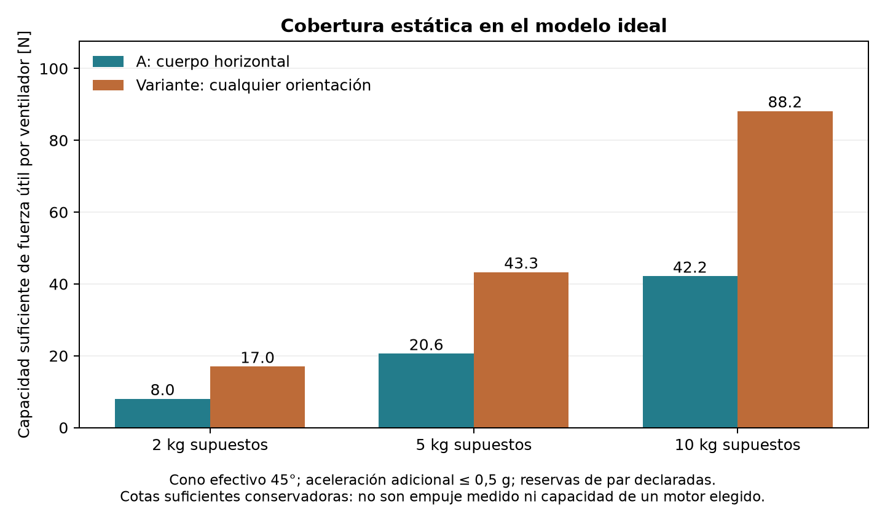
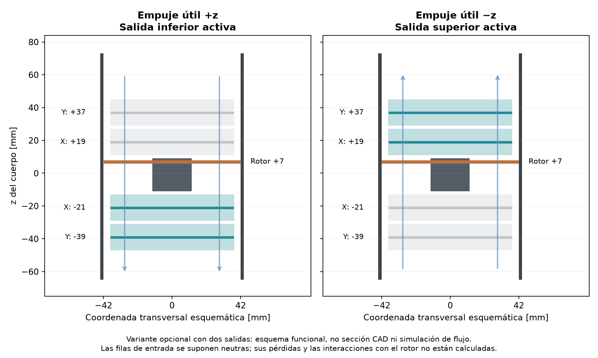

# Arquitectura A: control de fuerzas, reversibilidad y respuesta ideal

Fecha: 1 de noviembre de 2026. Cálculos en Python/SciPy y CAD en CadQuery. **El objetivo completo de geometría óptima, velocidad, agilidad y autonomía continúa abierto.**

## Resultado y recomendación de esta etapa

Se mantiene **A, ventiladores internos**, como arquitectura seleccionada. La primera prioridad es verificar el modo de desplazamiento en todas las direcciones con el cuerpo horizontal. El vuelo sostenido a cualquier orientación, incluido invertido, se estudia como capacidad adicional: no se convierte en un requisito obligatorio para satisfacer el movimiento omnidireccional de la versión base.

En el modelo ideal declarado, la versión base cubre una esfera continua de aceleraciones adicionales de radio 0,5 g alrededor del estacionario, con reservas simultáneas de momento. La variante reversible cubre un dominio suficiente para esas aceleraciones con cualquier orientación. También se calcularon escenarios de 1, 2 y 5 g con cuerpo horizontal y empuje reversible para no reducir el objetivo de máxima agilidad al escenario inicial de 0,5 g. Ambas versiones necesitan datos de flujo, potencia, actuadores y masa antes de atribuirles prestaciones reales. Las cotas siguientes son suficientes y conservadoras, **no mínimos exactos ni empuje de catálogo**.

| Masa supuesta | Capacidad útil suficiente por ventilador, A horizontal | Capacidad útil suficiente, variante cualquier orientación | Reserva por componente de momento |
|---:|---:|---:|---:|
| 2 kg | 8.03 N | ±17.00 N | ±0.109 N·m |
| 5 kg | 20.58 N | ±43.30 N | ±0.500 N·m |
| 10 kg | 42.16 N | ±88.17 N | ±1.587 N·m |

Hipótesis comunes: cuatro puntos x=−280/+285 mm, y=±65 mm en la referencia de 5 kg; CG supuesto en el origen; cono **efectivo de fuerza** de semiángulo 45°; fuerza vertical local mínima de magnitud 1 N para 5 kg. Para 2/10 kg se usa semejanza geométrica s=(m/5)^(1/3), fuerza mínima proporcional a m y reserva de momento proporcional a m^(5/3). Esta última relación mantendría la aceleración angular si la distribución de masa fuese realmente semejante; la inercia y el CG reales aún no están cerrados.

La envolvente algebraica de 5 kg mide aproximadamente 1345 × 322 × 194 mm y los rotores representativos tienen diámetro de barrido 82,024 mm. Para 2 y 10 kg, las envolventes semejantes serían 991 × 237 × 143 y 1695 × 406 × 245 mm; no son dos nuevos productos con masa demostrada ni selecciones de rotor.

## Qué está comprobado y qué está supuesto

**Comprobado en archivos CAD:** sólidos válidos reimportados, posiciones geométricas y comprobaciones locales de interferencia especificadas. **Comprobado numéricamente:** equilibrio del modelo lineal de fuerza/momento, límites de los conos ideales y una construcción suficiente de cobertura continua. **Supuesto:** que el conjunto rotor–conducto–álabes puede realizar esas fuerzas, sus puntos efectivos de aplicación y sus límites. Se omiten par de reacción de los rotores, efectos giroscópicos, aerodinámica exterior, interacción entre conductos y dinámica de actuadores. No hay validación de vuelo ni de empuje instalado.

Los precedentes científicos distinguen control de posición y orientación: el Omnicopter de ETH demuestra un vehículo de ocho rotores reversibles; Voliro demuestra seis rotores inclinables. Sustentan la posibilidad de arquitecturas plenamente actuadas, pero no validan nuestros cuatro ventiladores internos. [Brescianini y D’Andrea, ICRA 2016](https://ethz.ch/content/dam/ethz/special-interest/mavt/dynamic-systems-n-control/idsc-dam/People/bdario/brescianini_dandrea_omnidirectional_aerial_vehicle.pdf), [Kamel et al., Voliro](https://arxiv.org/abs/1801.04581).

## Método: cobertura continua, sin mezclar empujes incompatibles

Cada ventilador dispone de un cono convexo de fuerzas con magnitud limitada. Se usa una aproximación **interior** formada por rayos unitarios en cuatro anillos polares y 32 azimuts por anillo, más el eje. Las combinaciones de rayos representan una única fuerza realizable en ese cono ideal; no representan alternancia temporal entre dos sentidos.

En A horizontal los cuatro signos son positivos. En la variante reversible se fija el patrón diagonal (+, −, −, +): cada ventilador conserva su signo durante el estudio. Los conos positivo y negativo de un mismo ventilador nunca se convexifican entre sí. Dos ventiladores trabajan permanentemente en cada sentido en ese modo opcional; cambiar desde el modo de cuatro empujes positivos requiere una transición adicional.

La esfera de fuerzas deseadas se encierra en un poliedro **exterior** de 192 vértices construido con 98 planos tangentes. Su radio máximo es 1,04942 veces el de la esfera: el dominio comprobado excede en algunas direcciones el requerido. Se combina con los ocho vértices de la caja de momentos, obteniendo 1536 solicitudes por condición. En la base, la esfera se centra en (0,0,mg) y tiene radio 0,5 mg. En la variante cualquier orientación se emplea una esfera centrada en cero y radio 1,5 mg, que es un conjunto suficiente más exigente que la unión exacta de gravedad más aceleración.

Si todos los vértices del producto poliedro–caja tienen solución con un mismo límite por ventilador y signos fijos, cualquier combinación convexa conserva equilibrio y límites. Por ello se cubre todo el dominio, no solo 1536 direcciones aisladas. La tolerancia numérica no sustituye una demostración formal con aritmética de intervalos.

La revisión independiente reconstruyó las caras del poliedro, comprobó su esfera inscrita y verificó 15360 solicitudes guardadas de 10 condiciones usando ecuaciones de momento explícitas y coordenadas de las filas del CAD. El error máximo de equilibrio guardado fue 2.18e-08 en las componentes N o N·m. `VERIFICACION_INDEPENDIENTE.json` contiene huellas y alcance. Esto comprueba la implementación matemática, no la física del chorro.

La revisión detectó que una primera exportación omitía sumar mg al guardar los targets del modo horizontal, aunque el LP sí lo incluía al resolver. Se corrigió, se añadió una comprobación de equilibrio para las combinaciones y se regeneraron los archivos. La versión incorrecta queda separada en `auditoria_error_centro_original/`; no se utiliza como resultado.

## Aceleraciones mayores y límite del empuje de un solo sentido

Poder desplazarse hacia abajo no exige por sí mismo empuje negativo: basta reducir la fuerza ascendente por debajo del peso. Pero con fuerzas propulsivas solo ascendentes, sin otras fuerzas aerodinámicas, no puede obtenerse una aceleración hacia abajo mayor que g manteniendo el cuerpo horizontal. La reserva de momentos estrecha ese límite antes de la caída libre.

En el modelo base, para una fuerza neta vertical y reserva de alabeo ±0,5 N·m, la semiseparación lateral b=0,065 m obliga a F_z ≥ |M_x|/b. Con la precarga elegida de 1 N por ventilador, F_z ≥ 0,5/0,065 + 4 = 11,69 N. Para 5 kg, eso limita necesariamente la aceleración descendente compatible con esa reserva a aproximadamente 0,762 g, aun con motores arbitrariamente potentes. Es un límite necesario del modelo y la precarga declarados; otras restricciones pueden reducirlo.

La reversibilidad también puede servir al objetivo de aceleraciones simétricas muy altas con el cuerpo horizontal, aunque no se exija vuelo invertido. Los siguientes cálculos de la variante conservan δ efectivo=45°, reserva por componente de momento de 0,5 N·m, cuatro signos diagonales y 5 kg supuestos. **No son aceleraciones demostradas.**

| Radio de la esfera de aceleraciones adicionales, cuerpo horizontal | Capacidad útil suficiente por ventilador en ambos sentidos |
|---:|---:|
| 1 g | ±54.62 N |
| 2 g | ±81.16 N |
| 5 g | ±160.79 N |

## Dónde se aplica la fuerza importa

En un rotor basculante una fuerza puntual puede ser una simplificación útil. En un ventilador fijo con álabes de salida, las fuerzas laterales se transmiten también a través de los álabes y la carcasa. Usar sin verificar el centro del motor como aplicación de toda la fuerza puede alterar mucho los momentos.

Se separaron las palancas laterales z_x y z_y en las ecuaciones: M_x=Σ(y_i F_zi − z_yi F_yi), M_y=Σ(z_xi F_xi − x_i F_zi), M_z=Σ(x_i F_yi − y_i F_xi). En la base se aproxima z_x=−40 mm y z_y=−12 mm, centros geométricos de las filas Y y X del CAD. Sus centros de presión reales y los pares libres quedan sin conocer. En la variante, cada signo usa los centros de su banco de salida.

A igualdad del dominio refinado de cualquier orientación, el modelo puntual anterior a z=+58 mm da una cota suficiente de 61.72 N por ventilador; la variante con palancas de sus bancos da 43.30 N. Esa diferencia es sensibilidad del modelo, no una reducción medida de empuje o potencia. Con capacidad inversa del 60 % de la positiva, la variante requiere una capacidad nominal positiva suficiente de 71.84 N, con su límite inverso correspondiente. Por eso la simetría de prestaciones entre ambos sentidos debe comprobarse, no suponerse.

Una sensibilidad de ±8 mm en palancas laterales produciría errores de momento del orden de varias décimas de N·m en las asignaciones calculadas; no es una cota de incertidumbre física identificada. No se debe gastar la reserva de control sin caracterizar el mapa completo de fuerza y momento.

## CAD de la capacidad adicional de doble flujo

Se creó una **rama opcional de estudio**, `../CAD_doble_flujo/`, con 48 álabes y 48 ejes repartidos en cuatro conductos. Conserva rotores/motores representativos; todavía no modela un buje reversible funcional. Sus dos STEP, neutro y modo diagonal, se reimportaron con 149 piezas válidas cada uno.

| Elemento | z en la referencia de 5 kg |
|---|---:|
| Fila inferior Y | −39 mm |
| Fila inferior X | −21 mm |
| Centro del motor representativo | −1 mm |
| Plano de las palas representativas | +7 mm |
| Fila superior X | +19 mm |
| Fila superior Y | +37 mm |

Se comprobaron 48 prismas conservadores que contienen todo el barrido mecánico ±45° de las filas, además de ejes, rotor y motor respecto a la envolvente y las interferencias locales especificadas. La separación mínima entre barridos de filas es 1.930 mm y entre fila y motor, 1.965 mm. Se alargaron ejes hasta el alojamiento y se abrieron pasos geométricos en paredes/camisas. No se han dimensionado rodamientos, sellos, soportes o servos. El ángulo mecánico ±45° no acredita un cono efectivo de fuerza de 45°.

Al invertir el flujo, los álabes que antes estaban después del rotor pasan a estar antes. No se acredita la misma vectorización de salida conservando únicamente un banco inferior; se propone otro banco por el lado superior para estudiarlo. Los bancos inactivos se suponen neutros, pero también bloquean y perturban la entrada: falta calcular sus pérdidas e interacción con el rotor. NASA documenta que la entrada en flujo inverso, la geometría de la antigua tobera y los transitorios afectan las prestaciones del ventilador reversible; sus ensayos no se transfieren a nuestra escala. [NASA, reverse-thrust technology](https://ntrs.nasa.gov/citations/19780016127).

Como escenario de materiales, usando densidades SUPUESTAS de 1600 kg/m³ para conductos/álabes y 7850 kg/m³ para ejes, solo esos tres grupos sumarían 0.710 kg. No incluye motores, palas, bujes, 16 accionamientos si se usa uno por fila, transmisiones, rodamientos, sellos, batería, carrocería o aviónica. No es una masa verificada de vehículo. Las asignaciones y volúmenes están en el JSON CAD.

## Movimientos rápidos: fuerzas factibles y velocidades exigidas

Se construyeron cuatro transiciones de aceleración con el cuerpo horizontal: −0,5 g a +0,5 g en x, la misma en y, de +0,5 g en x a +0,5 g en y, y de −0,5 g a +0,5 g adicional en z. Son cambios de aceleración; **no son inversión instantánea de velocidad**. Un vehículo a +10 m/s necesitaría al menos 4,08 s para llegar a −10 m/s con aceleración de magnitud 0,5 g, aun ignorando el tiempo de respuesta y otras fuerzas.

Cada transición interpola fuerzas entre extremos factibles mediante una media onda coseno, manteniendo los signos. Por convexidad, el recorrido ideal conserva los límites. Se calcularon duraciones de 50, 100, 200 y 500 ms, sin integrar un motor, servo, flujo no estacionario ni dinámica del vehículo. Para una inversión lateral −0,5 g a +0,5 g en 100 ms, el jerk máximo prescrito es 154,0 m/s³.

Se comparan tres asignaciones: minimizar numéricamente la referencia ideal de rotor libre Σ||F_i||^(3/2), minimizar el mayor cambio absoluto de una componente de fuerza por ventilador, y, conservando ese óptimo de componentes, aumentar el menor empuje axial para reducir sensibilidad angular. El primer criterio es un problema convexo en las doce componentes de fuerza, con comprobación numérica de factibilidad y condiciones KKT; el segundo tiene comprobación de dualidad del LP. Ninguno es un óptimo de potencia eléctrica instalada o tiempo de maniobra físico.

La tabla muestra la inversión en x de 100 ms. La velocidad angular se refiere a la dirección de la **fuerza efectiva**, no al servo ni al ángulo del álabe. La potencia es una referencia de rotores libres ideales con igual área, no potencia instalada del conducto.

| Modo y asignación | Máximo cambio vectorial por ventilador, N/s | Máxima tasa de dirección efectiva, °/s | Referencia ideal rotor libre en los extremos, W |
|---|---:|---:|---|
| A horizontal, referencia ideal de potencia | 195.2 | 910 | 1786 / 1787 |
| A horizontal, cambios repartidos | 229.5 | 1025 | 1829 / 1824 |
| A horizontal, mayor empuje axial mínimo | 195.0 | 910 | 1793 / 1793 |
| Variante cualquier orientación, referencia ideal de potencia | 345.3 | 1970 | 2676 / 2701 |
| Variante cualquier orientación, cambios repartidos | 193.2 | 1801 | 3505 / 3547 |
| Variante cualquier orientación, mayor empuje axial mínimo | 192.6 | 609 | 6436 / 6451 |

Las tasas son resultados de trayectorias y asignaciones específicas, no requisitos mínimos universales. El ejemplo de mayor empuje axial de la variante reduce su tasa angular a costa de mayores fuerzas contrapuestas y mayor referencia de potencia. No se deriva de esa referencia una autonomía, batería o motor. Un conducto puede contribuir al empuje y modificar el área efectiva, por lo que el rotor libre no es una cota inferior universal del sistema carenado. [NASA NDARC, teoría](https://ntrs.nasa.gov/api/citations/20170011656/downloads/20170011656.pdf).

Para la variante, la inercia de los tres álabes y tres ejes de una fila, usando las densidades anteriores, sería 1.532e-07 kg·m². Un perfil triangular de velocidad para recorrer 90° entre reposos en 100 ms implica pico de 1800 °/s, aceleración de 628,3 rad/s² y par inercial aproximado 9.626e-05 N·m. Excluye engranajes, servo, transmisión y cargas aerodinámicas. No permite seleccionar el par del servo: falta integrar la presión y fricción sobre los álabes.

El precedente MIT cambia de paso positivo a negativo en aproximadamente 70 ms con su motor girando a régimen máximo. Es una medición de ese prototipo, no una constante de tiempo de empuje ni una prestación transferible a nuestro rotor interno. [MIT Aerospace Controls Laboratory](https://acl.mit.edu/projects/variable-pitch-quadrotor).

## Validaciones que siguen abiertas

1. Construir el mapa de seis componentes de fuerza/momento frente a caudal, presión, régimen, paso y ángulos. Priorizar el modo A horizontal y su banco inferior; evaluar la variante bidireccional aparte. No transferir el cono ideal de 45° a los álabes por identidad de ángulos.
2. Verificar el cálculo CFD: el diagnóstico Euler/upwind anterior solo cubrió 1 ms de un conducto sin rotor. No valida fuerzas medias, la instalación actual ni el régimen transónico. Se requieren sensibilidad temporal, espacial, dominio, capas de pared y contraste con datos apropiados.
3. Cerrar masa, CG e inercias con geometría de pared, materiales y conjuntos funcionales. Diseñar actuadores, rodamientos, transmisiones y buje antes de asignar sus masas.
4. Acoplar límites eléctricos, térmicos y de potencia con la dinámica. Las trayectorias calculadas presuponen realización instantánea de la fuerza y solo producen demandas de respuesta.
5. Analizar carcasa y mecanismos a cargas aerodinámicas, centrífugas, fatiga y aeroelasticidad; la presión dinámica de 47 kPa no equivale por sí sola a presión uniforme de pared.
6. Resolver puertas, tomas, toberas, arrastre compresible y transición a 600–1000 km/h. La cobertura de estacionario no prueba velocidad máxima.
7. Construir la simulación 6DOF calibrada y sus incertidumbres antes de entrenar autonomía/ML. No aceptar rendimiento de entrenamiento sobre un modelo de empuje que todavía no existe.

No se afirma todavía que A sea el óptimo global frente a otras geometrías o repartos de propulsión. La selección del usuario define la arquitectura de trabajo; la comparación de prestaciones y sus compromisos sigue siendo un objetivo de investigación.

## Archivos reproducibles

- `reversibilidad_6dof_A.py`: dominios, rayos, LP y archivos NPZ/JSON.
- `verificar_dominio_doble_flujo_A.py`: comprobación independiente de matrices guardadas, cobertura y puente a coordenadas CAD.
- `transitorios_ideales_A.py`: asignaciones, comparación de respuestas y perfiles calculados; `--case base_horizontal_5kg` selecciona la versión base.
- `doble_flujo_A.py`: rama CAD opcional, volúmenes, barridos e inercia supuesta.
- `RESUMEN.json`, `VERIFICACION_INDEPENDIENTE.json`, `BASE_HORIZONTAL_TRANSITORIOS_IDEALES.json` y `TRANSITORIOS_IDEALES.json`: resultados de esta etapa.

Fuentes primarias enlazadas: [ETH Omnicopter, ICRA 2016](https://ethz.ch/content/dam/ethz/special-interest/mavt/dynamic-systems-n-control/idsc-dam/People/bdario/brescianini_dandrea_omnidirectional_aerial_vehicle.pdf), [Voliro](https://arxiv.org/abs/1801.04581), [NASA sobre empuje inverso de ventiladores](https://ntrs.nasa.gov/citations/19780016127), [NASA NDARC](https://ntrs.nasa.gov/api/citations/20170011656/downloads/20170011656.pdf), [MIT sobre paso variable](https://acl.mit.edu/projects/variable-pitch-quadrotor). Los resultados propios no son datos experimentales de esas fuentes.
