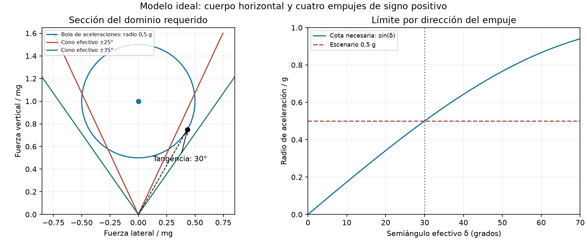

# Sensibilidad a la desviación efectiva del empuje

## Resultado

El escenario intermedio de aceleración en cualquier dirección de hasta 0,5 g, con cuerpo horizontal, no requiere necesariamente un cono ideal de 45°. Se encontraron cotas suficientes con 35° y 40° para 2, 5 y 10 kg supuestos, con las mismas capacidades máximas que la referencia previa de 45° hasta tolerancia numérica. Se verificaron independientemente 9.216 vértices conjuntos de fuerza/momento. No se valida ningún módulo instalado.

El máximo objetivo del proyecto no se reduce a 0,5 g: este estudio es un escalón de caracterización de control. No demuestra vuelo rápido, rechazo dinámico de perturbaciones ni capacidad de maniobra abrupta con actuadores reales.

## Límite necesario derivado

Si cada fuerza útil tiene signo axial positivo y pertenece a un cono de semiángulo δ, su suma también pertenece al cono convexo: norma de fuerza lateral ≤ fuerza vertical·tan(δ). No depende de cuánto empuje pueda producir el motor.

Para una aceleración horizontal pura con altura constante, se requiere δ ≥ atan(a/g): a=0,5 g exige al menos 26,565°. Sin embargo, cubrir la bola completa de aceleraciones tridimensionales exige encerrar una esfera de fuerza de radio 0,5·mg centrada en (0,0,mg). Su tangencia desde el origen está a asin(0,5)=30°. Por tanto, 30° es condición necesaria, sin garantizar los momentos, precargas o capacidades.

El punto de tangencia es F/(mg)=(0,433013; 0; 0,75), equivalente a aceleración/g=(0,433013; 0; −0,25), de norma 0,5. El verificador comprueba esa distancia y ángulo. No debe confundirse radio de bola de aceleraciones con máximo horizontal aislado.

Más generalmente, el radio de la bola no puede superar sin(δ)·g bajo estos supuestos. Con δ=15°, 20° o 25°, las cotas necesarias son 0,259 g, 0,342 g y 0,423 g. Aumentar potencia no elimina esa limitación de dirección. Cambiar actitud, permitir signos de fuerza distintos o modificar la geometría de vectorización cambia el problema; estas cotas no se aplican directamente a la variante reversible.

## Cotas suficientes con fuerzas y momentos acoplados

Cada capacidad es fuerza útil máxima suficiente por ventilador en el modelo; no es empuje de rotor libre, empuje medido ni una selección de motor. Se mantienen los cuatro centros de la arquitectura A y su escalado geométrico s=(m/5)^(1/3), CG en el origen, palancas laterales idealizadas de filas, precarga vertical de (m/5) N por ventilador y reserva simultánea de momento por componente de ±0,5·(m/5)^(5/3) N·m.

| Masa supuesta | Cono 35° | Cono 40° | Referencia previa 45° |
|---|---:|---:|---:|
| 2 kg | 8.029 N | 8.029 N | 8.029 N |
| 5 kg | 20.578 N | 20.578 N | 20.578 N |
| 10 kg | 42.155 N | 42.155 N | 42.155 N |

Se usan conos interiores discretizados y un poliedro exterior que contiene la bola de fuerzas; su producto con los ocho vértices de la caja de momentos da 1.536 comprobaciones por caso. La convexidad extiende la cobertura a todo el dominio continuo bajo el modelo, no solo a las direcciones muestreadas. La verificación independiente reconstruye Newton–Euler por componentes, límites de fuerza/cono/precarga y cobertura de la bola mediante las facetas de la envolvente convexa exterior.

No se calcula aquí el mínimo ángulo suficiente: el límite necesario de 30° y los certificados de 35° dejan una franja pendiente que incluye conservadurismo del poliedro, reservas de momento y otras restricciones. La igualdad de capacidades entre 35°/40°/45° se refiere al peor caso de este dominio concreto y no demuestra equivalencia en agilidad máxima.

## Consecuencia de diseño

El mapa instalado debe medir dirección y magnitud de la fuerza neta, incluidos conducto y rotor, además de pares libres. Un ángulo mecánico de álabe no determina el ángulo efectivo del empuje. El resultado instantáneo anterior sobre reacción de paredes no se usa como factor de eficiencia ni como calibración de δ.

Los tiempos de giro previos, calculados con cono ideal de 45°, no se transfieren automáticamente al cono de 35°: requieren volver a asignar fuerzas con límites temporales para cada trayectoria y con el mapa físico. Falta también comprobar la dependencia de potencia, tasas y cargas estructurales. Ninguna fila demuestra por sí sola que la geometría sea la mejor posible.

Archivos reproducibles: `../../sensibilidad_angulo_A.py`, `../../verificar_sensibilidad_angulo_A.py`, `../../informar_sensibilidad_angulo_A.py`, `RESUMEN.json`, seis NPZ/JSON de asignaciones y `VERIFICACION_INDEPENDIENTE.json`.
