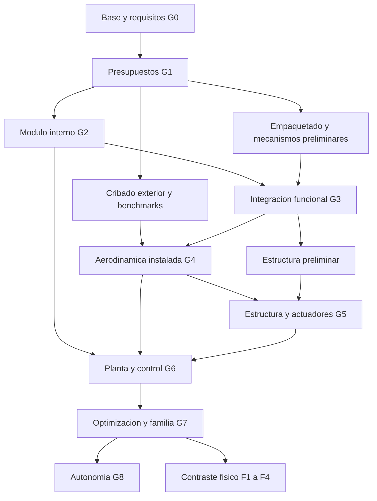

# Plan maestro de cierre del proyecto

**Versión 1.0 · 2 de noviembre de 2026 · America/Bogota**  
**Base:** arquitectura A, ventiladores internos; A07 como referencia geométrica de trabajo.  
**Objeto:** llegar lo antes posible a una configuración digital defendible, después a un prototipo contrastado y, finalmente, a un producto deportivo verificable.

Este documento fija el proceso de decisión y sus entregables. No fija de antemano una geometría óptima, una masa cerrada ni prestaciones no demostradas. El plan se mantiene estable; los valores de diseño cambian mediante evidencia y control de revisiones.

## 1. Decisión ejecutiva

El camino crítico es:

**Requisitos medibles → presupuesto preliminar de masa/energía → módulo interno capaz de producir fuerzas y momentos útiles → integración propulsiva/mecánica → aerodinámica y estructura coherentes → simulación predictiva con control cerrado → contraste físico → producto.**

La presentación visual acompaña esa cadena utilizando los mismos estados y geometría. Un nuevo render no cierra un hito de física. La optimización compara candidatos factibles y su incertidumbre; no se declara «mejor posible» por una puntuación estética o por un mínimo de un modelo incompleto.

Recomendación de ejecución: mantener 5 kg como referencia de integración porque concentra el CAD y las simulaciones recientes; comprobar pronto presupuestos propios de 2 y 10 kg. No convertir 5 kg en requisito obligatorio ni descartar silenciosamente 2 kg. Alcanzar 600 km/h será un hito intermedio; 1000 km/h permanece como objetivo de extensión que debe justificarse con los mismos criterios.

## 2. Qué está decidido y qué sigue abierto

| Elemento | Tratamiento vigente |
|---|---|
| Arquitectura | Ventiladores internos. Los rotores no salen del cuerpo. B retráctil y C exterior son antecedentes, no la ruta de desarrollo. |
| Familia de masas | Objetivos 2, 5 y 10 kg; cada versión debe cerrar su propia configuración. |
| Uso y apariencia | Producto deportivo, compacto, profesional y agresivo; conservar identidad visual cuando sea compatible con la física. |
| Trabajo inmediato | Desarrollo por computador; preparar especificaciones de ensayo sin comprar, fabricar ni publicar automáticamente. |
| Movimiento | Traslación XYZ y reorientación rápida con límites cuantificados. Separar movimiento con actitud fija de vuelo a cualquier actitud. |
| Velocidad | Investigar 600–1000 km/h; no acreditada actualmente. |
| Aletas | Cuatro superficies posteriores móviles en X son una candidata del A05–A07, no dimensiones aerodinámicas aprobadas. |
| Propulsión de avance | Ruta axial y microturborreactor/EDF son opciones; no existe motor instalado seleccionado. El tubo central está vacío. |
| Rotores/vectorización | Cuatro módulos y sus álabes son una base de integración; empuje, reversibilidad, cono útil y potencia siguen abiertos. |
| Tapas | A07 elimina solapes nominales y propone elevación/abatimiento. Falta sintetizar y dimensionar el mecanismo. |
| Autonomía/ML | Objetivo posterior; el control físico de referencia y la planta identificada tienen prioridad. |

La forma circular de los primeros husos no describe automáticamente el cuerpo deportivo actual, aplanado y facetado. No transferir tablas de esbeltez, Mach crítico, arrastre, inercia o simetría de fuerzas entre esas geometrías. Tampoco imponer L/D=6 como resultado ya demostrado.

### Definiciones que hay que cerrar en G0/G1

- Separar masa al despegue, combustible consumible, batería, accesorios y carga útil.
- Especificar aceleración lateral/vertical, jerk, velocidad angular, tiempo de giro reposo–reposo, error de posición y actitud, sobreimpulso y tiempo de recuperación.
- Tratar 0,5 g y 1 g como escalones de investigación, no como sustitución del objetivo de máxima agilidad. Los 3/6/10 g de los videos son demandas elegidas, no capacidades.
- Estudiar estacionario, ascenso, descenso, traslación, inversión de maniobra, transición y crucero. Evaluar explícitamente qué aceleración descendente exige empuje negativo con actitud fija.
- Como duración no elegida, usar una matriz inicial de 30/120/300 s de estacionario y 30/120/300 s de avance, incluyendo transición y reservas. Son escenarios de comparación, no misión final ni promesa de autonomía.
- Definir altitud/densidad, temperatura, viento/ráfaga, lluvia, polvo, hielo, vibración, impacto y tolerancia a fallos como dominios separados. No existe un requisito verificable de «cualquier condición» sin límites.
- Registrar restricciones de ruido, calor, accesibilidad, mantenimiento, espacio de ensayo y presupuesto antes de seleccionar tecnología definitiva.

## 3. Estado real y jerarquía documental

El inventario reproducible indexa **547 archivos de texto: 76 Markdown, 322 JSON y 149 Python**, fuera de las exclusiones indicadas en `inventariar.py`. Se realizó revisión dirigida de documentos de decisión, estado y verificación; catalogar un archivo no revalida científicamente todas sus afirmaciones. Fuentes PDF, imágenes y archivos CAD se referencian desde sus manifiestos; no se afirma haber releído todos los artículos.

| Base existente | Reutilización correcta | Cierre pendiente |
|---|---|---|
| A07, 208 piezas por escala | Envolvente y alojamiento de referencia; tres posiciones de tapas | Tolerancias globales, accionamientos, materiales, montaje y masas |
| Compuertas A07 | 61 posiciones, 488 comprobaciones, sin solapes con los obstáculos evaluados; ocho solapes tapa–camisa anteriores corregidos | Recorrido continuo, herrajes, sellos, cargas, obstrucción de flujo y estados de fallo |
| Conos de fuerza y asignaciones ideales | Herramientas de demanda, geometría de control y escenarios | Mapa instalado fuerza/momento/potencia y dinámica |
| Simulación de baja velocidad | Código 6DOF y comprobaciones analíticas/paso temporal | Planta física; 21 N, 35°, 80 ms e inercias son supuestos |
| Video rápido 600/1000 | Trayectoria prescrita y reconstrucción de demandas | Simulación predictiva, equilibrio aerodinámico y autoridad de mando |
| CFD histórico | Casos, lectores, monitores, balances y fallos documentados | Convergencia y contraste antes de aceptar cargas; correspondencia con A07 |
| Estructura preliminar | Tendencias de viga y panel con verificación propia | Cascarón con aberturas, uniones, modos libres, fatiga y aeroelasticidad |
| Blender y FreeCAD | `.blend` de 208 piezas, render probado; STEP importado a FCStd desde instalador | FreeCAD en Aplicaciones y arranque de ParaView por confirmar/corregir |

La simulación reciente de 5 kg alcanza 34,92° con un límite supuesto de 35°: aproximadamente 0,08° de margen en esa trayectoria. No se acepta esa evidencia como robustez de control real. El CFD compresible histórico de 200 iteraciones no pasó su cribado; una pared deslizante tampoco calcula arrastre viscoso total.

**Orden de autoridad:** instrucción explícita del usuario → requisitos y decisiones vigentes → configuración identificada → evidencia reproducible de esa configuración → antecedentes. La fecha más reciente, por sí sola, no convierte un cálculo en validación.

Documentos rectores: `modelos_integrados/DECISION-ARQUITECTURA.md`, `ESTADO-VERIFICACION-GLOBAL.md`, `modelos_integrados/producto_A07/LEEME.md`, `simulacion_vuelo_A/INFORME.md`, `vuelo_rapido_visual/INFORME.md`, `integracion_apps/LEEME.md`. `DATOS-PARA-CERRAR-VALIDACION.md` sigue aportando categorías R/E/G/M/A/S útiles, pero su afirmación histórica de ausencia de CAD/herramientas está superada. `REVISION-POTENCIA-Y-ESPACIO.md` corresponde a ocho rotores exteriores de otra geometría: no aporta el consumo del A07.

## 4. Hitos con criterios de salida

**Los plazos siguientes son estimaciones de planificación en jornadas técnicas efectivas, no resultados medidos, fechas de entrega ni tiempo continuo de una sesión automática.** Las actividades se solapan según sus entradas; las esperas de cálculo y la disponibilidad de personas/ensayos se presupuestan aparte.

| Hito | Trabajo y producto verificable | Condición para avanzar | Esfuerzo orientativo |
|---|---|---|---|
| G0 · Base única | Inventario, requisitos, configuraciones, registro de supuestos, entorno y pruebas mínimas | Toda cifra decisiva identifica geometría, unidades, método, alcance y procedencia | 1–3 jornadas |
| G1 · Viabilidad preliminar | Presupuestos propios de 2/5/10 kg, energía, volumen, demandas de fuerza y selección de variables | No hay una contradicción conocida ignorada; alternativas y márgenes explícitos | 2–4 |
| G2 · Módulo interno | Curvas de rotor/ducto/álabes, respuesta, reversibilidad y pérdidas; mapa de seis cargas con potencia | Dominio útil y límites cuantificados; sensibilidad numérica y contraste pertinente | 5–15 |
| G3 · Integración funcional | CAD paramétrico de mecanismos, propulsión, batería/depósito, electrónica, refrigeración y estructura preliminar | Todo componente tiene alojamiento, masa, interfaz, recorrido y acceso; cierre iterado | 4–10 |
| G4 · Avance aerodinámico | Casos compresibles a 600/1000, incidencias/derivas, aletas, tomas y estados de tapas pertinentes | Cargas aceptadas con incertidumbre documentada; equilibrio y presupuesto de empuje coherentes | 5–15 |
| G5 · Estructura y actuadores | FEM, cargas locales, rigidez, modos, uniones, accionamientos y aeroelasticidad | Márgenes positivos frente a envolvente declarada; ningún modo crítico pendiente presentado como aprobado | 4–10 |
| G6 · Vuelo predictivo | Planta reducida identificada, 6DOF, control cerrado, transición y perturbaciones | Sigue maniobras dentro de límites físicos, con saturaciones y reserva suficientes | 4–10 |
| G7 · Selección y familia | Optimización robusta, candidatos finales, versiones 2/10 recalculadas y regresión | Configuración seleccionada defendible dentro de dominio y competidores estudiados | 4–10 |
| G8 · Autonomía y entrega digital | Estimación de estado, navegación, gestión de modos; ML solo si aporta ventaja; paquete de ingeniería | Rendimiento frente a controlador base, incertidumbre y fallos; trazabilidad completa | 5–15 adicionales |
| F1–F4 · Contraste físico | Banco de módulo, estructura/térmico, vuelo restringido y envolvente ampliada | Evidencia experimental correlacionada; discrepancias regresan a G2–G7 | Estimar con laboratorio y presupuesto |

Una primera configuración digital coherente G0–G7 podría requerir **25–60 jornadas técnicas efectivas**, suponiendo un candidato razonablemente factible y recursos disponibles. Es una banda inicial con baja confianza; no se obtiene sumando las filas porque existen solapes e iteraciones. Un módulo propio difícil, rediseños, CFD costoso o falta de datos pueden superarla. **No es una estimación de producto físicamente terminado.** G0 debe recalibrarla con un benchmark real de malla, coste por caso y problemas de instalación resueltos.

### Ruta crítica y trabajo simultáneo

El modelo de control y la estructura pueden desarrollarse antes, pero sus resultados finales necesitan mapas y cargas aceptados. G7 genera iteraciones hacia G2–G6 si cambia la configuración. Trabajar en paralelo significa procesar frentes independientes con recursos disponibles, no suponer personal o capacidad de cálculo ilimitados.

## 5. Desarrollo técnico por frente

### 5.1 Módulo interno y omnidireccionalidad

1. Comparar área de rotor, número/disposición de módulos y ruta de aire dentro de la arquitectura A; cuatro módulos actuales no son una restricción inmutable.
2. Estimar hélice/rotor con métodos de anteproyecto y polares de sección pertinentes; controlar Reynolds, Mach relativo de punta, paso, RPM, solidez, holgura, buje y bloqueo. No utilizar polares fuera de rango sin marcar extrapolación.
3. Contrastar un caso publicado de rotor/ventilador con geometría y condiciones recuperables antes de aplicar modelos más caros al módulo propio.
4. Modelar por niveles: fuente de presión/disco actuador para cribado; método con rotor representado para puntos críticos cuando haga falta. La fidelidad depende de la pregunta, no del atractivo de la imagen.
5. Integrar presión y cizalla sobre rotor, álabes, conductos y superficies relevantes con un mismo origen de momentos. Evitar interpretar la carga sobre un álabe como reacción lateral neta instalada; cerrar balance de cantidad de movimiento.
6. Barrer mando, paso/RPM, reversión si procede, incidencia de entrada, geometría de labios/difusor, salida libre y tapas. Identificar fuerza útil, seis momentos/fuerzas, potencia, par de bisagra y transitorios.
7. Sustituir el cono supuesto por una región alcanzable identificada, con incertidumbre, límites de tasa, retrasos y estados de transición. No convertir el ángulo mecánico de álabe en ángulo del empuje sin medir/calcular el conjunto.
8. Evaluar gradualmente 0,5/1/2 g y orientaciones de interés; mantener objetivos mayores como demandas hasta que la planta los soporte. Para descenso más rápido que caída libre a actitud fija, comprobar explícitamente la fuerza descendente requerida.

**Decisión temprana:** si el módulo no aporta fuerzas/momentos útiles con masa y potencia aceptables, modificar canales, área o disposición dentro de A antes de detallar la carrocería o entrenar un controlador.

### 5.2 Masa, volumen, energía y propulsión

Construir una lista única de piezas con masa nominal/rango, material, posición, método de estimación y revisión. Incluir todos los rotores, motores, ESC, álabes, transmisiones, rodamientos, sellos, cables, estructura, tapas/cierres, aletas, equipos, propulsor axial, toma/escape, protecciones térmicas, batería, combustible, depósito, bomba y reservas. El volumen vacío del CAD no es espacio utilizable garantizado.

Calcular CG y tensor con distribuciones y estados reales de carga, incluida pérdida de combustible; distinguir rotor giratorio de componentes fijos. Mantener un margen preliminar de masa sin asignar —propuesta inicial 15%, ajustable y documentada—, no rellenar masas desconocidas con cero. Un objetivo de masa solo cierra cuando el presupuesto completo y su margen caben.

Dimensionar empuje neto instalado, potencia útil, potencia eléctrica/térmica, corriente, tensión mínima, descarga, refrigeración y energía de cada modo. Incluir transición y reservas. Usar mapas de propulsión en avance, con versión exacta y balance neto/bruto que evite doble contabilización. Comparar EDF/microturborreactor y otras rutas solo si encajan; diseñar una turbina completa desde cero sería un subproyecto aparte, no una tarea menor del calendario rápido.

Reevaluar la reserva axial de 38/60/80 mm con motor, paredes, aislamientos y acceso reales. El diámetro de tubo no demuestra una toma ni compatibilidad térmica. Elegir integración y disposición conjuntamente con autoridad de momentos e inercia.

### 5.3 Geometría exterior, aletas, tomas y transición

La base A07 se convierte en parametrización de nariz, secciones, recuperación posterior, área total del conjunto, puertos, aletas y límites internos. Conservar estilo mediante superficies y paneles que no invaliden alojamiento y cargas. Separar ancho, altura y diámetro equivalente; no llamar cuerpo de revolución a la envolvente actual.

Cribado inicial de avance: Mach aproximados 0,49/0,65/0,82; incidencia 0/5/10° y deriva 0/±5°, con simetrías solo cuando la geometría y contornos las permiten. Resolver primero un subconjunto que cambie decisiones; añadir 15° y puntos de deflexión después de ver separación y necesidades de control. No ejecutar automáticamente el producto cartesiano de todos los factores.

Comparar cuerpo solo, cuerpo con aletas y configuración instalada con tomas/escape y tapas pertinentes. Medir arrastre, fuerzas normales, momentos, equilibrio, estabilidad, interacción y coste de maniobra. Separar primera aparición sónica local de divergencia de arrastre. No imponer ausencia de choque como condición de éxito si la configuración cumple su presupuesto con choque controlado.

Evaluar skid-to-turn/bank-to-turn y combinación según autoridad, pérdidas y cargas; la simetría de un huso circular no se hereda en esta forma. No fijar centro de presión sobre CG ni estabilidad negativa de antemano: debe existir un equilibrio controlable y robusto en la envolvente completa.

La transición debe conservar autoridad entre ventiladores internos y superficies aerodinámicas, gestionar flujo oblicuo, apertura/cierre bajo carga, momento de propulsión, entradas y calentamiento. Definir qué ocurre si una tapa no llega a posición o los ventiladores no descargan. La elevación de 10 mm y giro de 110° son variables iniciales, no especificaciones congeladas.

### 5.4 Mecánica, estructura, temperatura y aeroelasticidad

Sintetizar un mecanismo que produzca el recorrido necesario: guías/bisagras/varillaje, actuador, apoyos, cierres estructurales, sellos, sensores y cableado. Verificar montaje, acceso, recorrido continuo o envolventes conservadoras, tolerancias, holgura bajo deformación, vibración, fatiga, suciedad y fallo asimétrico. Rehacer las comprobaciones al añadir herrajes; 61 poses de tapas sin mecanismo no son su validación.

Usar cargas distribuidas del flujo y reacciones de equipos. La presión dinámica de aproximadamente 47 kPa a 1000 km/h no es presión exterior uniforme sobre toda la carcasa. Dimensionar piel/laminados, cuadernas, insertos, anclajes de rotor, ejes, cojinetes, uniones y superficies de control. Evitar imponer el espesor visual de la carcasa como solución resistente.

El conducto protector no demuestra contención de fragmentos: evaluar retención de pala/buje, cargas centrífugas, fatiga y protección en su dominio real.

FEM por niveles: verificaciones analíticas, piezas/placas locales, estructura completa con aberturas y modos libres; después pandeo/imperfecciones, fatiga, rotación de rotores, cargas giroscópicas, mecanismos y temperatura. Flutter/divergencia requieren modelos aeroelásticos y rigidez/holguras; no se aprueban comparando una frecuencia de viga empotrada con una RPM.

### 5.5 Simulación, control y autonomía

Conservar y ampliar el integrador 6DOF verificado. Acoplar aerodinámica, propulsión, masa/CG variable, potencia, retardos, límites, mezcla de mandos, sensores y estados de mecanismos. No reescribir el simulador solo por incorporar JSBSim; usarlo si reduce trabajo o aporta contraste independiente. La geometría del video debe proceder de la misma revisión.

Definir IMU/localización y sensores de mecanismos, cómputo, alimentación, comunicaciones, telemetría, frecuencia de muestreo y latencia. Evaluar vibración, saturación, compatibilidad electromagnética, pérdida de enlace/localización y registros para correlación.

Implementar primero un controlador interpretable con estimación de estado. Pruebas: estacionario, ocho direcciones horizontales y verticales, cambios de signo, reorientación, perturbaciones, transición, crucero, virajes y recuperación. Añadir viento, incertidumbre de mapas, batería mínima, CG extremo, ruido/retardo y fallos declarados. Las trayectorias de prueba se separan de las usadas para ajustar el controlador.

Para ML: justificar función concreta —identificación, compensación o planificación—, compararla con el control base, separar entrenamiento/validación/prueba y aleatorizar solo parámetros dentro de rangos fundamentados. Fijar restricciones duras y una estrategia de recuperación independiente. Un agente que aprende una planta inventada no acredita autonomía del prototipo.

## 6. Investigación y aceptación de resultados

Adoptar la separación entre verificación del cálculo y contraste físico descrita por [NASA/NPARC](https://www.grc.nasa.gov/www/wind/valid/tutorial/tutorial.html). Para discretización, estudiar al menos tres niveles en los puntos de aceptación y comprobar el régimen de convergencia antes de aplicar [GCI/Richardson](https://www.grc.nasa.gov/www/wind/valid/tutorial/spatconv.html). No exigir tres mallas para cada punto exploratorio: concentrarlas en decisiones y casos representativos.

**Objetivos internos iniciales de aceptación, propuestos para el proyecto, no normas de certificación:**

| Frente | Regla inicial | Tratamiento si falla |
|---|---|---|
| Trazabilidad | Geometría/huella, unidades, contornos, software, datos y alcance completos | Resultado exploratorio, no base de decisión |
| CFD básico | Campos finitos y p/T físicos; malla y contornos compatibles; balances documentados | Rechazo/diagnóstico conservado |
| Convergencia | Residuos relevantes del orden de 1e−5 o justificación; estabilidad de fuerzas/momentos y balance además del residuo | No aceptar por código de salida o iteraciones |
| Balances | Objetivo preliminar ≤0,1% en masa y ≤1% en fuerzas integrales, con referencias físicas y acumulación explícitas | Revisar dominio, contornos, integración y malla |
| Sensibilidad espacial | Objetivo de cambio/incertidumbre ≤5% en cargas decisivas; exigir menor si cambia el ganador o el margen | Refinar o conservar incertidumbre en decisión |
| Temporal/estadística | Refinar paso; descartar arranque; verificar medias y dispersión por bloques físicos suficientes | No usar pseudotiempo ni ventanas cortas como estadísticas de vuelo |
| Pared/turbulencia | Tratamiento consistente; si SST integrado a pared, objetivo y+ próximo a 1 y cobertura comprobada | No aceptar fricción de una pared deslizante o sin resolución pertinente |
| Dinámica | Casos analíticos/independientes y refinamiento de paso; error numérico menor que la tolerancia de maniobra elegida | Reducir paso y revisar integración/control |
| Estructura | Equilibrio, malla, materiales/apoyos/cargas identificados; márgenes con incertidumbre positivos | Redimensionar y devolver masa/rigidez al modelo |
| Control | Autoridad simultánea de fuerzas y momentos, tasas, potencia y reserva frente a incertidumbre | No aceptar rango algebraico o saturación nominal sin reserva |

Las cifras se revisan en G0/G1 según el tamaño de la decisión. Cerca de fuerza/momento cero se usan tolerancias absolutas y referencias declaradas, no cocientes relativos inestables. Los márgenes de control deben superar la incertidumbre combinada identificada; no basta con elegir arbitrariamente un 10%.

Contraste: reproducir geometrías experimentales publicadas con condiciones comparables; documentar diferencias de Mach, Reynolds, rugosidad, transición y montaje. Después, contrastar el módulo propio y la instalación físicamente. Referencias metodológicas adicionales: [NASA, casos 6DOF](https://ntrs.nasa.gov/citations/20150001263) y [NASA SP-8007 Rev. 2](https://ntrs.nasa.gov/citations/20205011530), esta última limitada a su dominio de cascarones y no como garantía automática del cuerpo con aberturas.

Cada afirmación de fuente debe identificar enlace/DOI, página/figura, geometría y condiciones. Cada cálculo propio debe identificar fórmula/código, entradas y pruebas. Conservar datos negativos y explicar límites de extrapolación.

## 7. Optimización sin multiplicar trabajo innecesario

Definir variables de diseño y límites a partir de alojamiento y fabricación. Rechazar primero candidatos que no caben o no cierran masa/potencia. Utilizar modelos baratos para sensibilidad y diseño de experimentos; ajustar modelos reducidos con puntos CFD contrastados y reservar puntos fuera de ajuste.

Orden de objetivos: cumplir requisitos obligatorios y márgenes → maximizar agilidad y velocidad sostenibles → minimizar masa, consumo y complejidad según misión. Conservar una frontera de Pareto entre velocidad, aceleración, autonomía, control, masa y mantenimiento. Comparar A07 con variantes cercanas viables dentro de A; alternativas de huso/anillo/cuerpo sustentador quedan como referencias limitadas si una hipótesis concreta justifica el coste. Cambiar de arquitectura requiere una decisión explícita, no un render nuevo.

Solo los finalistas pasan refinamiento caro y verificación completa. Confirmar con datos nuevos las mejoras de un sustituto/optimizador. Si la diferencia entre candidatos es menor que la incertidumbre, informar empate técnico y preferir simplicidad/margen como criterio declarado. Buscar «óptimo dentro del dominio estudiado», no insuperabilidad universal.

## 8. Herramientas y reproducibilidad

| Herramienta | Papel | Restricción actual |
|---|---|---|
| Python/SciPy y verificadores | Presupuestos, dominio de control, integración, optimización y regresión | Ampliar planta; mantener pruebas analíticas |
| CadQuery | Geometría paramétrica reproducible y STEP | No confundir BRep válido con montaje/estructura aceptados |
| FreeCAD | Revisión mecánica, documentos y planos | Importación probada desde instalador; verificar/completar copia de Aplicaciones; FEM requiere solver/modelos adecuados |
| Gmsh/OpenFOAM | Mallas y flujo instalado | Recuperar diagnósticos con procedencia; geometría histórica no es A07 funcional |
| ParaView | Postproceso y lectura de campos | Arranque terminó con 137 en última prueba; diagnosticar apertura sin alterar seguridad |
| Blender/Cycles y FFmpeg | Inspección, cámaras y video de estados calculados | Funcionamiento probado fuera del aislamiento gráfico; render no calcula aerodinámica |
| JSBSim / ML / cálculo remoto | Opcionales según beneficio medido | No añadir software por acumulación; decidir tras benchmark y planta |

Un único archivo de configuración por revisión debe alimentar CAD, masa, simulación y visualización, con conversiones SI/mm explícitas. Guardar huellas y versiones, mapas tabulados y ejes de referencia. Separar estados de pieza, número de sólidos y objetos importados: los 293 objetos con Shape de FreeCAD no son 293 piezas nuevas frente a las 208 del STEP.

No sobrescribir A03–A07 ni resultados rechazados. Las revisiones funcionales nuevas usan identificadores y un registro de cambios. Git debe iniciar una historia revisada: actualmente no hay commits. Excluir entornos, cachés, fotogramas y volcados grandes; decidir respaldo de CAD/campos y conservar manifiestos. No realizar un commit masivo sin revisar contenido.

Los dos cálculos CFD pausados se conservan. Este plan **no los reanuda**, no crea una automatización ni un nuevo objetivo persistente. Cuando se autorice ejecutar la fase correspondiente, inspeccionar estado real y guardar evidencia antes de continuar, reiniciar o sustituir un caso.

## 9. Las primeras dos jornadas y la regla para acelerar

### Jornada 1: eliminar ambigüedad y medir coste

1. Registrar requisitos, decisiones y configuraciones con los CSV adjuntos; abrir una lista de contradicciones de documentos históricos.
2. Comprobar FreeCAD/ParaView y rutas reproducibles; conservar Blender y el pipeline ya funcional.
3. Extraer del A07 geometría funcional, huecos, piezas representativas y masa pendiente, sin inventar componentes.
4. Preparar una lista completa de masas/volúmenes y estimación de demandas por modo para 2/5/10 kg.
5. Elegir un benchmark de módulo y otro de avance con datos recuperables; estimar recursos sin lanzar una campaña grande.

### Jornada 2: decidir qué cálculo cambia el diseño

6. Medir coste de mallado/solver, memoria y almacenamiento con un caso pequeño autorizado; recalibrar calendario y concurrencia.
7. Contrastar capacidad necesaria de vectorización con área disponible y presupuesto energético; identificar si el módulo o el avance es el cuello de botella.
8. Fijar el primer subconjunto de mapas y condiciones, sus criterios de parada y entregables.
9. Entregar revisión de requisitos, presupuesto, riesgos y calendario actualizado. Si aparece una contradicción, proponer cambios dentro de A y demostrar su efecto antes de propagarla a todo el CAD.

**Regla de eficiencia:** cada tarea debe desbloquear una decisión o reducir una incertidumbre que pueda cambiarla. Los cálculos de diagnóstico tienen un límite inicial de coste. Tras dos intentos sin progreso verificable, revisar la formulación/benchmark/contornos con un diagnóstico concreto antes de gastar más; eso no equivale a declarar imposible el vehículo. Priorizar los parámetros con mayor sensibilidad y mayor incertidumbre.

## 10. Riesgos decisivos y respuestas

Los detalles están en `RIESGOS.csv`; su severidad es juicio de planificación y no probabilidad de fallo medida.

- Vectorización útil insuficiente tras incluir paredes/pérdidas: rediseñar canales y reparto antes de fijar actuadores.
- Empuje/potencia/masa no cierran juntos: iterar área, tamaño y misión; mantener visible cualquier cambio de requisito.
- El espacio axial no admite instalación real: estudiar tomas/emplazamiento, calor y CG conjuntamente.
- Compresibilidad, separación o tomas elevan el arrastre: optimizar geometría y mapa instalado, sin prometer 1000 km/h.
- Tapas y aletas añaden masa, holgura o flutter: acoplar estructura/actuación y revisar la envolvente.
- Control nominal sin reserva: usar rangos de planta y perturbaciones antes de ML.
- Recursos locales insuficientes: reducir primero el experimento numérico; decidir cálculo remoto por coste medido.
- Resultados de modelos incompatibles o información antigua: registrar configuración y alcance, no combinar máximos favorables de escenarios distintos.

## 11. Entregas finales y definición de terminado

### Entrega digital defendible

Requisitos y decisiones trazados; CAD funcional con cinemática y planos preliminares; BOM y presupuestos por variante; mapas instalados con incertidumbre; análisis de cargas/estructura; modelo 6DOF con control cerrado, sensores y fallos declarados; resultados de regresión; scripts reproducibles; informe de limitaciones; videos procedentes de esos estados; y plan de ensayos físicos. Un cálculo sin datos físicos propios conserva esa limitación aun si pasa todos los verificadores.

### Prototipo contrastado

Componentes/masas medidos; ensayo de fuerzas/par/potencia y respuesta; funcionamiento de mecanismos bajo carga; comprobaciones estructurales/térmicas; progresión de vuelo restringido y de envolvente; correlación con el simulador y corrección de discrepancias. Para pruebas rápidas hacen falta instalaciones, instrumentación y revisión especializada adecuadas; no se deducen de una animación.

### Producto

Además del prototipo: configuración fabricable, tolerancias, montaje y mantenimiento; repetibilidad de fabricación, vida útil y entorno declarado; estrategia de fallos, documentación y cumplimiento aplicable revisado con especialistas. No es equivalente a terminar el CAD ni puede certificarse solo por computador.

Reportar avance por **hitos aceptados y evidencia**, no por porcentajes subjetivos de apariencia. Un entregable está listo para revisión solo si incluye entradas, resultados, comprobación, incertidumbre y decisión que permite tomar. La aceptación física se registra aparte de la aceptación digital.

## 12. Paquete de ejecución y mantenimiento

- `INVENTARIO-DOCUMENTAL.csv` y `INVENTARIO-RESUMEN.json`: índice y huellas; no clasificación automática de validez.
- `REQUISITOS.csv`: métricas, decisiones y pendientes explícitos.
- `TRABAJO.csv`: tareas, dependencias, salidas y aceptación.
- `RIESGOS.csv`: riesgos, señales tempranas y respuesta.
- `inventariar.py` y `crear_matrices.py`: regeneración de los registros.
- `VERIFICACION-PLAN.json`: comprobación de IDs, enlaces locales y dependencias; no validación de ingeniería.

Revisar el plan al cerrar cada hito o cuando cambie masa, forma, material, propulsión, mapa o requisito. No reiniciar todo: identificar y repetir únicamente los cálculos afectados. Toda decisión queda enlazada a su evidencia y a la revisión que sustituye.
